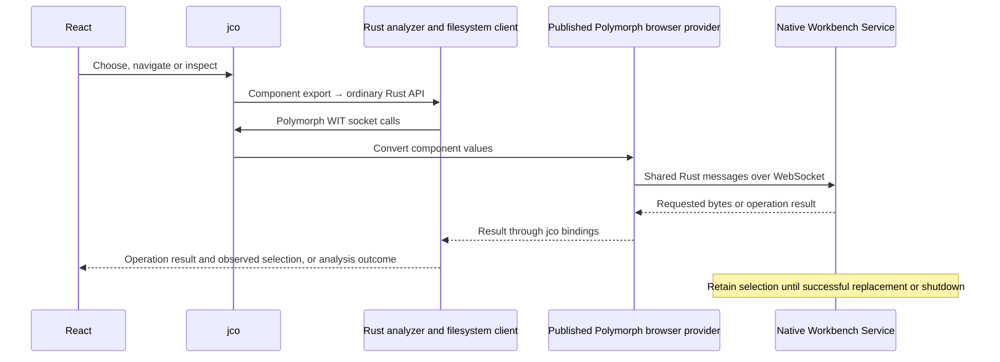

# Code Workbench

**Suggested GitHub repository name: `apple-code-workbench`.**

A standalone Next.js App Router application for exploring Apple code, backed by a reusable Rust library. React and Base UI own presentation. Rust owns binary interpretation. A separate WIT component adapter and jco connect React to the analyzer running in browser Wasm. Native Rust supplies requested file ranges.

An optional Ark UI + Panda CSS implementation is available alongside the Base UI view. Use the navigation to open `/` (Base UI), `/?view=ark` (Ark + Panda), or `/?view=compare` (both side by side). The page shell owns one component runtime and presentation model across these view changes. Both views display the same operation feedback, current report and architecture tab. Native selection survives refresh and inspection; a full page refresh creates a new component and queries the service at its Rust-configured address. Reports remain in application memory, without history or disk persistence.

See [UI comparison](docs/architecture/base-ui-and-ark-panda-comparison.md) for the styling and maintenance tradeoffs. Base UI remains installed and is the default view.

## Primary requirement: portable ad-hoc signing

The intended signing capability must work without Apple hardware, macOS, Xcode,
Apple's signing tools or a remote Mac. It must generate ad-hoc signatures offline,
without a signing certificate, private key or Apple account. Reuse existing
libraries before implementing signing machinery.

Screen each library's README, dependency features, build configuration and actual
signing path before adding it to the experimental shortlist. Record unsupported
hosts, required tools and browser integration blockers first.

Evaluate native Linux and Windows execution and, separately, the browser through
our Rust/Wasm component and jco. "Any device" is the portability goal; support must
be demonstrated per host, runtime and artifact type. The
[dedicated signing experiments](docs/signing/ad-hoc-experiments.md)
define coverage for individual binaries, nested application code, resource seals
and enclosing packages. Apple tools may provide optional independent checks;
they must not be required to produce an output. Signature integrity and permission
to install, load or run that output remain separate questions.

**This is a requirement for future work, not an implemented signing feature.**

## Current scope

The workbench opens individual thin and universal Mach-O files and reports CPU type/subtype, file role, header flags, byte order, image ranges, declared platform versions and `LC_CODE_SIGNATURE` command/payload ranges. Rust uses `object` 0.40.0 for format detection, header and command parsing, Mach-O types and canonical constant names, retaining numeric values even when no name is known. React displays those names and numeric fallbacks. Multiple platform declarations remain separate; legacy commands retain their source evidence without inventing a modern platform identifier. Missing platform evidence is not guessed from the CPU.

Format acceptance follows the pinned upstream parsers: thin images support both byte orders; universal containers support big-endian fat32 and fat64. Project code supplies bounded reads, typed failures and owned report conversion. The [parser contract](docs/architecture/rust-analysis-core.md#parsing-dependencies) defines command validation, read granularity and diagnostics. A successful header report is not a claim of complete Mach-O validity. File and command ranges use absolute input offsets with exclusive ends, including ranges inside universal members.

It does **not** verify signatures, evaluate certificate trust, traverse application bundles, resolve dependencies, modify binaries or re-sign applications. Synthetic test fixtures contain headers only; they are not runnable programs. Input is selected through the native service, which returns bounded ranges to the browser Wasm analyzer. The application has no analytics or account integration.

Native callers use `inspect(bytes)` for resident input or `inspect_source(source)` for range-based access. The [parser contract](docs/architecture/rust-analysis-core.md#reads-and-memory) describes read granularity, cache retention and allocation diagnostics. The browser requests inspection by passing the observed resource identifier.

## Native filesystem analysis

The application calls the generated WIT `Session` methods through jco.
`createNativeRuntime()` returns an owner for lazy component/session initialization
and host bindings. The shared presentation model obtains the session through
`getNativeSession`.
The component combines `binary-inspection` analysis with the ordinary
`workbench-operations` API. The client
requests bounded ranges from the native service through Polymorph WebSocket.
The published browser provider owns browser networking; a small host binding
converts its component values to jco's conventions.



The native service opens the OS file/folder dialog and acquires filesystem access;
see the [native selection sequence](docs/architecture/wasm-analysis-with-native-filesystem.md#native-selection-and-inspection-sequence).
Rust owns native selection, protocol validation and operation composition.
The UI shows “Analysis in progress…” until the invocation returns its outcome.
The application owns component/socket bindings independently of
its presentations; see [application ownership](docs/architecture/system-overview.md#application-ownership)
and the [runtime lifecycle](docs/architecture/system-overview.md#runtime-lifecycle).
Native access requires starting the
local Rust service. Requested ranges still enter Wasm memory. The
[filesystem overview](docs/filesystem/README.md) compares native acquisition with
browser filesystem APIs and distinguishes implemented support from future fidelity requirements.

```sh
cargo run --locked -p filesystem-service
```

The service accepts no arguments and starts with an empty selection. Start the web
app separately with `pnpm dev`, then use its file or folder control to open the
native dialog.

See the [service README](crates/services/filesystem/README.md) for the shared Rust address configuration,
persistent selection and qualification, and the [communication contract](docs/architecture/rust-runtime-independence/filesystem-communication-flow.md)
for ordinary Rust, in-process and component boundaries.

## Design and reuse references

Start with the [documentation guide](docs/README.md) for the reading order and
the distinction between implemented architecture, research, design and experiments.

- [Reusable foundations and library alternatives](docs/libraries/selection-and-reuse.md): detailed comparison by capability, including Mach-O readers, signatures and certificates, bundle/resources, dependency resolution, and native rebuilding/signing. Its dated findings distinguish library capabilities from proposed adoption; the [Rust core design](docs/architecture/rust-analysis-core.md) records the adopted `object` parsers and their contract.
- [Application relocation, rebuilding and re-signing](docs/rebuilding/application-relocation-and-signing.md): the problem to solve, resource/dependency relationships, reusable plans, staging and signing order.
- [Native LIEF Mach-O rewriting experiment](docs/libraries/lief-native-macho-rewriting-experiment.md): the proposed controlled fixtures, rewrite procedure, independent signing/runtime checks and adoption criteria.
- [Portable ad-hoc signing experiments](docs/signing/ad-hoc-experiments.md): candidate qualification without Apple tooling, artifact coverage, native/browser execution and independent integrity checks.
- [`macho` analysis and bounded rewriting experiments](docs/libraries/bryanmatteson-macho-evaluation.md): source-screened inspection coverage, feature-specific native/browser probes, limited rewriting and signing integration; no dependency adopted.
- [LIEF selective builds and Rust/Wasm integration](docs/libraries/lief-selective-builds-and-wasm.md): format selection, Rust bridge constraints, existing Wasm evidence, and the proposed WASI/jco evaluation with footprint measurements.
- [Rust core design](docs/architecture/rust-analysis-core.md): implemented API, parsing contracts, module responsibilities and validation.
- [Architecture](docs/architecture/system-overview.md): native Rust reuse, the component/jco boundary and application ownership.

## Development

Requirements: Node 24 (reference version 24.15.0), pnpm 11.1.1, Rust stable with `wasm32-unknown-unknown`, and `wasm-tools` (setup validated with 1.251.0), curl and `wkg` 0.16.0. The engine build downloads pinned upstream WIT without modifying it; see [WIT dependencies](wkg/README.md). Rust stable is intentionally a floating channel, matching the component reference; the initial build used Rust/Cargo 1.96.0. Included lockfiles pin JavaScript and Cargo dependencies.

```sh
pnpm install --frozen-lockfile
pnpm dev
```

Open http://127.0.0.1:3210. The root development command builds the Rust component, runs jco, publishes its generated assets, then starts Next.js. Start the native service before selecting a file. The Rust component connects to its configured address; the UI displays connection failures from Rust. Changes to Rust, WIT or component bindings require `pnpm engine:build`; reload the page afterward. Changes to `config/native_service.rs` require rebuilding both the engine and native service. React changes use Next.js HMR.

```sh
pnpm build          # Engine + production Next.js build
pnpm typecheck
pnpm test           # Rust tests and focused component/runtime checks
pnpm format:check
```

After `pnpm build`, `pnpm --filter @apple-code/web start` serves production. A clean checkout must build the engine before typechecking because the browser uses jco-generated declarations.

See [service qualification](crates/services/filesystem/README.md#scope-of-the-evidence)
for the scope of Rust and JavaScript checks and the remaining full-workflow qualification.

The web package generates Panda's styling API during installation and before dev, build and typecheck. Generated `apps/web/styled-system` files are ignored. The PostCSS plugin produces recipe CSS during Next.js builds. After editing Panda configuration or recipes, run `pnpm --filter @apple-code/web styles:codegen` and restart the development server if styles remain cached.

## Package boundaries

| Location                          | Responsibility                                                                   |
| --------------------------------- | -------------------------------------------------------------------------------- |
| `apps/web`                        | App Router routes, application ownership and Base UI/Ark presentation            |
| `crates/binary/inspection`        | Ordinary Rust library; no WIT, Wasm, browser or filesystem dependencies          |
| `crates/workbench/operations`     | Ordinary Rust filesystem client, selection and analysis workflow                 |
| `crates/filesystem/data`          | Shared directory-entry types for filesystem providers and consumers              |
| `crates/filesystem/protocol`      | Shared bounded filesystem message encoding                                       |
| `crates/filesystem/native`        | Native filesystem operations and retained handles                                |
| `crates/distribution/packaging`   | Build-time executable packaging and native installer creation                    |
| `crates/distribution/integration` | Reusable OS integration; currently single-instance file locking                  |
| `crates/distribution/composition` | Installed `native-workbench` entry point, service startup and instance ownership |
| `crates/services/filesystem`      | Native Workbench Service: selection, dialogs and filesystem requests             |
| `crates/workbench/component`      | WIT contract and conversion to/from core Rust types                              |
| `packages/apple-code-browser`     | Component/session initialization and environment bindings                        |
| `packages/archer`                 | Reused browser arrow drawing, geometry and surface-local rendering state         |

Native Rust consumers can depend directly on `binary-inspection` and call `binary_inspection::inspect(&bytes)`. They receive an owned `BinaryReport` with typed container, image, platform and signature-command records; the input is borrowed only for the call. `AnalysisError` implements `Display` and `std::error::Error`, exposes a typed kind and retains upstream decoding errors as its source. No jco or Wasm runtime is required. The crate documentation contains native usage guidance.

For common ELF, PE, COFF and thin Mach-O file identity, Rust callers use
`inspect_object(bytes)` or `inspect_object_source(source)`. These return upstream
format, architecture, file-kind, byte-order and address-width classifications in
an owned `ObjectReport`, using the same source/cache adapter. The application
component and UI expose the dedicated Mach-O report. See the
[Rust API scope](docs/architecture/rust-analysis-core.md#object-file-identity)
for parser coverage and read behavior.

The component contract is `apple-code:analysis@0.5.0`. Mach-O CPU, file-type, platform and command values cross as a numeric value and optional canonical name; generated jco types define the browser contract. The ordinary Rust API uses the pinned `object` types directly, so dependency upgrades require API compatibility review. Structured analysis errors carry a Rust-formatted message and typed failure details. All file offsets and sizes remain `u64` in Rust and `BigInt` in JavaScript.

No GitHub remote, deployment, external service or signing identity is configured.
