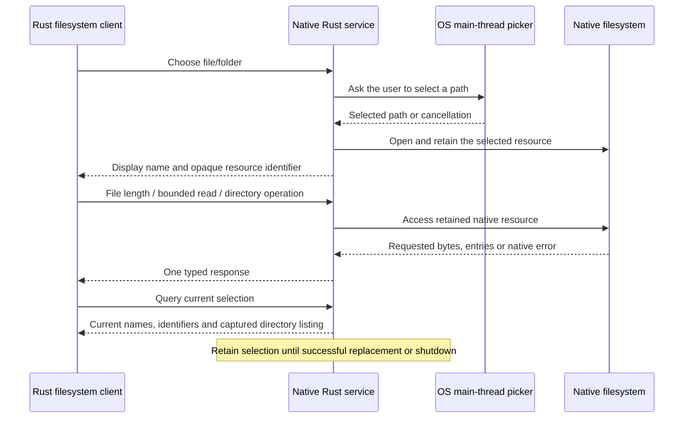

# Native Workbench Service

The service retains explicitly selected native files and directories. Rust
clients send bounded filesystem messages over a persistent loopback WebSocket;
the service reads only the requested ranges. Neither the service nor its
filesystem implementation requires JavaScript or a Wasm runtime. Any local client
with the endpoint may query, change and read the shared selection. Connection
credentials and Origin checks are not part of this access policy.



## Operations and ownership

The client and service share ordinary Rust types from
[`filesystem-protocol`](../../filesystem/protocol/src/lib.rs).
Each complete binary WebSocket message contains one MessagePack request or
response, encoded through Serde by `rmp-serde`. Struct fields and enum
variants use their names; `serde_bytes` stores file contents as binary data.
Requests execute sequentially on a connection, so one matching
response completes each operation. No text terminator or socket EOF is required.
The socket can remain open between operations and between user interactions.

- **Files:** obtain captured length and read an offset and bounded length.
- **Directories:** open a listed file or child directory by entry ID; the current
  selection response contains the captured bounded listing.
- **Selection:** choose a file or folder through the native dialog and query the
  current names, file/directory identifiers and listing.

The protocol never accepts a native pathname. The native picker supplies the path.
Resource identifiers are random 256-bit values encoded as
64 lowercase hexadecimal characters. They name the current file or directory;
file and directory identifiers cannot substitute for each other. Names sent to
the client are display names.

A selection owns one current file and one current directory. Opening another
file replaces the current file while retaining its directory. Choosing a file
replaces both previous selections. Choosing a folder or successfully opening a
child directory replaces both previous selections. A failed child acquisition
preserves the existing selections. Native directory code owns entry resolution,
link handling and the captured listing.

The reusable `filesystem_native::NativeSelection` owns acquired native resources,
display names and the directory listing. Acquisition and listing succeed before
replacement. Native-dialog cancellation preserves the existing selection.
Inspection success or failure, refresh, navigation and socket
closure do not change native ownership. Replacement, owner destruction and service
shutdown dispose resources. There is no frontend or remote deselection operation.
Replaced identifiers receive an `Unknown resource identifier` failure; identifiers
are never silently rebound to a replacement. An admitted read completes against
its original handle under the native-access lock.

The ordinary native [composition example](../../filesystem/native/examples/inspect_selection.rs)
uses `NativeSelection`, a borrowed `NativeFileSource` and `inspect_source()` with
no service, transport, JavaScript, WIT or Wasm runtime. The native library does not
own dialogs; this service invokes rfd for native presentation.

See [async helpers and runtime ownership](../../../docs/architecture/rust-runtime-independence/filesystem-communication-flow.md#async-helpers-and-runtime-ownership)
for how `futures` supplies socket helpers and test polling within the service's
Tokio runtime.

## Launch

Build, test and run the service directly with the repository's Rust toolchain:

```sh
cargo build --locked -p filesystem-service
cargo test --locked -p filesystem-service -p filesystem-protocol

cargo run --locked -p filesystem-service
```

The executable accepts no arguments and starts with an empty selection. Run the
web app separately with `pnpm dev`; its file or folder control requests the native
dialog.

The service and application component compile the shared `ADDRESS` from
[`config/native_service.rs`](../../../config/native_service.rs): `127.0.0.1:3211`.
The service binds that address; an occupied port is a startup error. There is no
service discovery, alternative port or runtime address override. After changing
the configuration, rebuild both the engine and native service:

```sh
cargo build --locked -p filesystem-service
pnpm engine:build
```

Startup prints a JSON readiness record containing the WebSocket `endpoint`.
The service runs until explicitly stopped.

Open `/`, `/ark` or `/compare` in the separately running web app. All presentations
use the same service. Their Rust components use the configured service address; React
presents their results and connection failures. Refresh and route switching create
new component instances that query the retained native owner. Restarting the service
starts an empty owner at the same address. The user must start the local service before
using native selection.

Ordinary native clients accept explicit endpoint arguments independently of this
application configuration.

## Bounds and lifecycle

Native reads are bounded to 64 KiB per request with checked range arithmetic and
bounded allocation. Empty reads perform no native I/O. See the
[parser contract](../../../docs/architecture/rust-analysis-core.md#reads-and-memory)
for analyzer memory behavior.

Messages are capped at 1 KiB for requests and 96 KiB for responses, including
named-field overhead. The shared codec checks message size before decoding owned
fields, rejects trailing bytes and
configures the decoder's nesting limit to 32. It validates resources, offsets,
lengths and response variants. Directory responses contain at most 512 distinct
entry IDs and 64 KiB of combined name bytes. Read payloads and error messages have their
own limits. Decoding returns owned values; the frame limit is not a strict bound
on decoder allocations.

The service admits at most eight connection tasks. Handshakes have a five-second
deadline. Connections may wait before their first request and between user actions
without expiring selection. Reply delivery and protocol flushes retain their
five-second transport deadlines. Client connection bounds and provider/library
timers remain unchanged. Selection/filesystem exchanges, native operations and
picker waits have no application deadline. The operation and its subsequent
current-state observation can both remain pending while awaiting a result.

### Waiting for native access before scheduling blocking work

[`Handler::dispatch()`](src/server/handler.rs) applies this ordering to state/metadata
queries, reads and child opens:

1. Await `selection.lock_owned()` asynchronously. The mutex protects the service's
   selection owner and retained handles; it is not an operating-system file lock.
   A request waiting here occupies no blocking worker.
2. Move the acquired guard into `spawn_blocking`. The job calls `operate()` while
   retaining exclusive access to the native owner.
3. Release the guard when that job finishes, allowing another request or shutdown
   to access the owner.

This ordering matters when native I/O stalls: additional requests wait
asynchronously rather than occupying blocking workers just to wait for the mutex.
If the service drops a dispatch future during that wait, no blocking job has been
submitted. After submission, dropping the caller does not cancel the job; the job
retains its guard until completion. Neither step uses an application deadline.

The Rust test `abandoned_native_admission_does_not_occupy_blocking_workers` in
[`handler.rs`](src/server/handler.rs) holds native access, explicitly drops a waiting
request and verifies that another blocking job can still run with a one-worker
pool. File/folder dialog requests use `choose()`; see the
[selection acquisition and lock handoff](SELECTION_ACQUISITION.md) for the sequence
diagrams, guard ownership and cleanup ordering.

### Dialogs and shutdown

The synchronous `run()` entry point owns the service's Tokio runtime. Call it
from the OS main thread without an entered runtime or a GUI framework owning
native event processing. Both the developer executable and installed launcher
use this entry point.

On macOS, `rfd::macos::run_with_native_events` processes AppKit events on main
while the service and its Tokio runtime run on rfd's worker. The serial dispatcher
uses ordinary synchronous `FileDialog` calls; rfd forwards native presentation
to main. Native events continue between requests and after a picker returns,
including deferred dismissal with normal animation. The workspace pins the
fork's `feat/macos-standalone-event-loop` revision; the application needs no direct
AppKit dependency or GUI framework. Other platforms run the service and serial
dispatcher on the calling thread.

A permit prevents overlapping panels, including when a caller stops waiting.
Queued abandoned requests do not open a dialog. Shutdown or service-side
abandonment invalidates pending requests, and late dialog results are discarded.
The service does not concurrently monitor the socket for disconnect while
dispatching a request. View disposal or disconnect
alone does not prove that the service abandoned or rolled back acquisition.
Synchronous native work may continue after the caller stops waiting. The provider
cannot dismiss an already-visible OS panel programmatically. Native opens and
reads run on blocking threads so they do not block the async networking runtime.

An already-running OS read cannot be forcibly interrupted. Shutdown stops
connection tasks, waits for native access, then marks the selection stopped and
drops the owner. Shutdown has no application deadline or forced termination timer.
The dispatcher waits for the user to dismiss any visible dialog and exits after
its request channel closes. Tokio teardown then completes before the application
closure returns to rfd and requests native-loop shutdown. Returning does not
certify that every dismissal animation has completed; the helper spans the
service lifetime, not an individual picker call. Signal registration precedes
readiness publication, and startup/publication failures also clean up. On POSIX,
Ctrl-C sends SIGINT through the service's registered
graceful-shutdown path. Forced termination in tests is disposal fallback,
not proof of graceful cleanup; Windows signal behavior requires separate qualification.

## Scope of the evidence

Native tests cover short reads, EOF, native errors, resource identifier separation,
transactional acquisition and listing, dialog cancellation, persistent selection,
and shutdown ordering. Socket tests cover multiple clients with
absent or arbitrary Origin headers and rejection of malformed or oversized
messages. Codec tests cover bounded binary payloads, malformed messages, directory
limits and request/response matching. The JavaScript suites
retain focused component, runtime and host-binding checks without starting this
service. They do not establish a complete native-service-to-browser round trip.
Qualifying that path requires running the service and application through the real
provider and native dialogs; native Rust tests alone do not establish browser support.

A retained handle identifies the opened object and survives pathname replacement;
it does not freeze file contents. Length is captured at open time. Concurrent
mutation can still change bytes or cause EOF. Bounded reads do not establish
snapshot consistency, complete symlink/xattr/ACL fidelity, application
reconstruction, signing or executable-loading eligibility. Cross-platform
service deployment and browser support require their own qualification.
