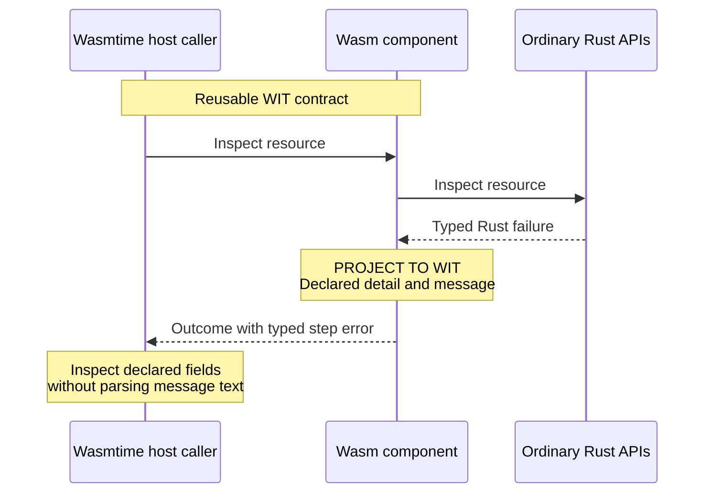
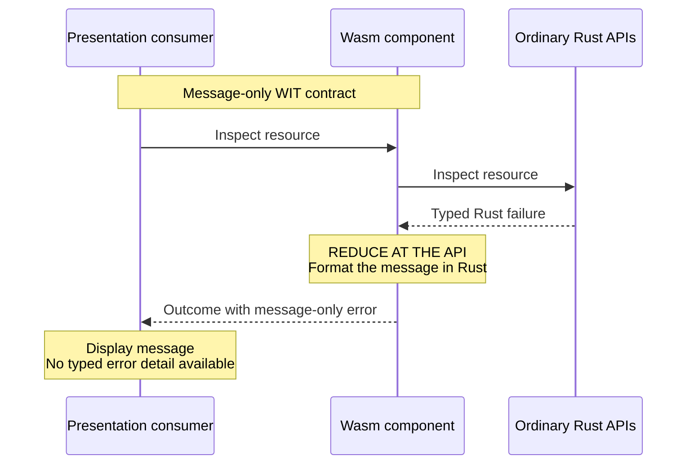
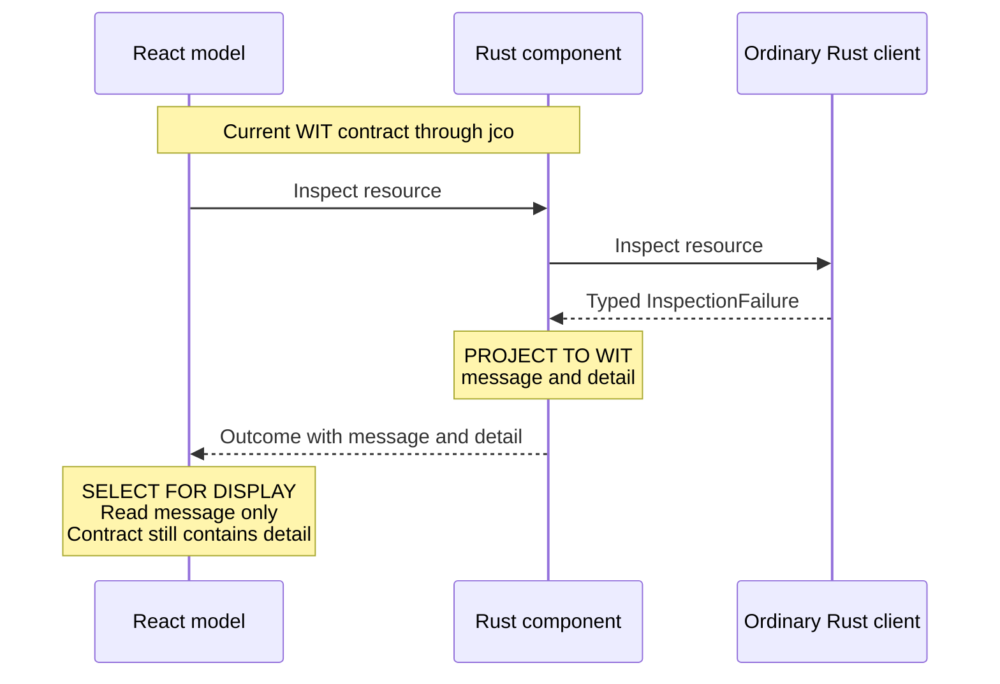
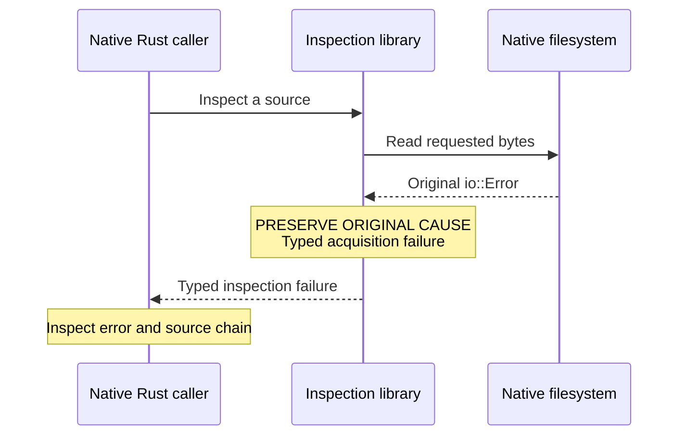
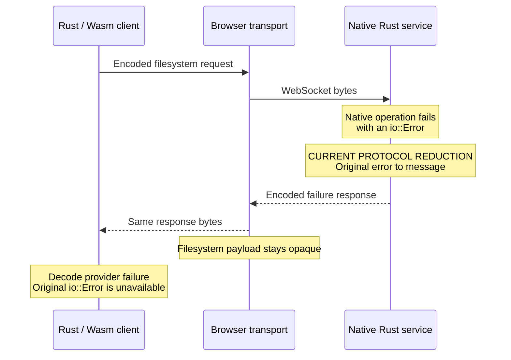
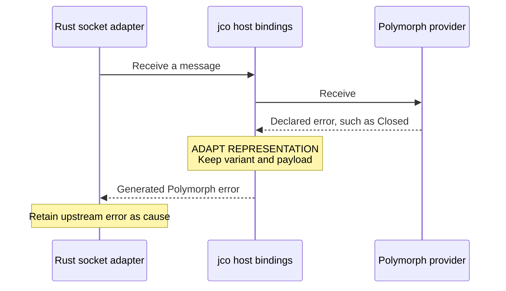
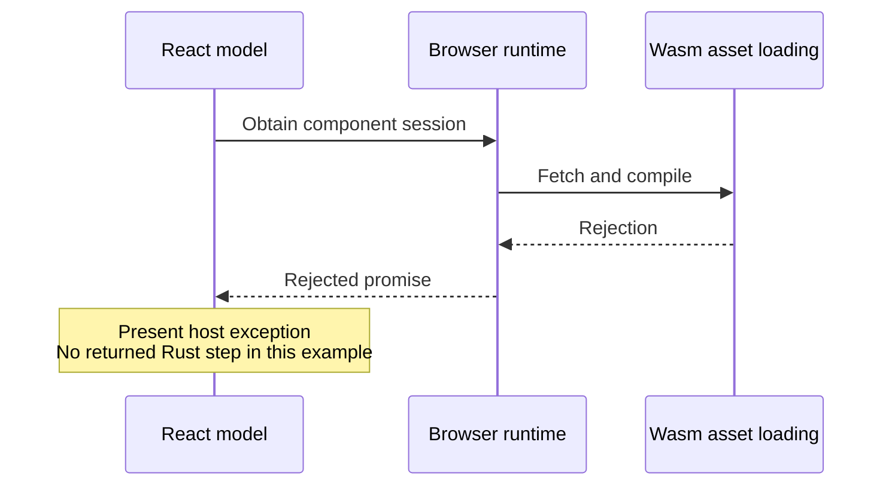

# Error contracts across Rust, WIT and transport boundaries

Status: current source and official WIT/WASI/Wasmtime documentation reviewed on
2026-10-16. The application currently exports structured errors with Rust-produced
messages. This document compares valid contract designs; it does **not** select a
message-only migration or add a Wasmtime execution mode.

## What we want

WIT should support both ends of the design range: a reusable API with structured
error semantics, and a presentation-specific API that returns only a diagnostic
message. Choose the contract for its intended consumers and purpose, not from
the implementation language of the current UI.

For this project:

- Ordinary Rust APIs preserve original errors and available causes without
  depending on WIT or a runtime.
- A reusable component API can expose deliberate, typed failure semantics through
  WIT, including useful payloads and a Rust-produced message.
- React may display only that message without narrowing the component contract
  or reconstructing its wording.
- A message-only WIT contract is also valid when the exported API is deliberately
  presentation-specific. It is an alternative design, not a prerequisite for
  keeping React simple.
- Implementation-specific objects remain with their owner unless an explicit
  interface defines how another consumer can access their information.

No new interface, wrapper, controller or error framework is required merely to
support this distinction. The current contract remains in place while its
individual fields are evaluated on their public meaning and intended use.

This document owns the contract comparison and sequence diagrams. The
[error-handling guide](error-handling.md) owns library choices and the Eros
assessment. The [Rust reuse contract](rust-runtime-independence/README.md) owns
execution boundaries; the [filesystem communication flow](rust-runtime-independence/filesystem-communication-flow.md)
owns networking and selection lifecycle.

## What WIT and Wasmtime support

WIT's `result<T, E>` permits a declared error type, including variants with record
payloads. These are language-independent contract types. WIT also permits a
string or a message record as the error type. Neither structured detail nor
message-only reporting is required for every interface.
[WIT reference](https://component-model.bytecodealliance.org/design/wit.html#results)

WASI provides existing examples of deliberate structured errors:

- Filesystem operations return an `error-code` enum with distinctions such as
  denied access, a missing entry and an interrupted operation.
  [WASI filesystem](https://github.com/WebAssembly/wasi-filesystem/blob/main/wit/types.wit)
- HTTP errors include DNS and TLS payload records and size-related information.
  Its optional internal diagnostic text is not a stable substitute for those
  typed cases.
  [WASI HTTP](https://github.com/WebAssembly/wasi-http/blob/main/wit/types.wit)

Wasmtime generates bindings for WIT contracts and distinguishes declared results
from execution failures. Its binding documentation describes the general shape
`wasmtime::Result<Result<WitOk, WitErr>>` for a fallible, trappable host function:
normal WIT failure and runtime failure are separate channels. This example is not
our `Session` signature: our methods return outcome records with a result inside
each step.
[Wasmtime bindings](https://docs.wasmtime.dev/api/wasmtime/component/macro.bindgen.html)

Using Wasmtime does not require exporting every Rust error detail. Using jco or
TypeScript does not require discarding structured error semantics. Both can
consume the contract chosen for the component.

## Reading the diagrams

Each sequence isolates one boundary. Solid arrows are calls and dashed arrows
are returned results. Notes mark what happens to information:

| Action                  | Meaning                                                                                                      |
| ----------------------- | ------------------------------------------------------------------------------------------------------------ |
| Preserve original cause | Keep the available concrete error in ordinary Rust, including its source chain.                              |
| Project to WIT          | Construct the declared portable fields and variants; do not claim that the Rust error object itself crosses. |
| Adapt representation    | Change binding representation while preserving its declared variant and payload.                             |
| Reduce at the API       | Export a smaller contract, such as a message without structured detail.                                      |
| Select for display      | Read part of a returned value without changing what the API exposes.                                         |

These are not security-leak labels. A documented domain error is public contract
information, even when it has several fields. An accidental dependency on a
private backend representation is a separate design concern. Preserving an error
also does not imply persisting it or extending its lifetime after its result is
dropped.

## Design A: structured WIT for a reusable component API

This illustrates a Wasmtime host consuming a component's typed outcome. Another
component or a JavaScript caller can use the same contract semantics. It is an
architectural example, not a claim that this repository has a qualified Wasmtime
host; such a host would also need to supply the world's required imports,
including Polymorph networking.



Our current inspection error already has this general shape:

```wit
record inspection-failure {
  message: string,
  detail: inspection-error,
}
```

The component formats the message in Rust and projects the available failure
information into `inspection-error`. A consumer may use structured data for
its own permitted decisions, diagnostics or presentation. Exposing that data does
not move the service's native ownership or the Rust client's recovery semantics
into that consumer.

For example, the existing `unexpected-eof` detail carries `offset` and `remaining`.
A caller can identify the incomplete read without guessing from display wording.
That can be meaningful public evidence rather than an implementation leak.
Whether each other existing variant belongs in the public contract remains a
field-by-field design question.

The original Rust error object, pointer identity and arbitrary `Error::source()`
chain do not automatically become WIT values. Structured WIT preserves the
information the schema actually declares. It cannot restore information already
lost at an earlier boundary.

## Design B: message-only WIT for a presentation-specific API

This is an equally valid WIT design when the API's stated purpose is returning a
human-readable result and no structured error classification is promised. Its
consumer could also be a Wasmtime host or another component; the choice is not
specific to JavaScript.



An illustrative error record would be:

```wit
record failure {
  message: string,
}
```

The result still distinguishes success from failure, and our ordered step
structure could remain. The trade-off is explicit: a caller no longer has a
machine-readable error category or payload. It must not parse the message to
recover information the API does not promise.

This example does not change the existing `failure` or `inspection-failure`
records. Narrowing a published contract requires a separate compatibility decision
and coordinated updates to bindings and consumers. Merely observing that React
currently renders messages does not establish that decision.

## Current browser flow: structured contract, selective display

These two activities can coexist without another API: the component returns
structured data, while React displays only its message. Information is not removed
at the WIT boundary in this arrangement.



The [component facade](../../crates/workbench/component/src/native.rs) formats
Rust errors before converting their details. The browser model retains the
returned outcome. [OutcomeErrors](../../apps/web/features/workspace/OutcomeErrors.tsx)
checks each step's result tag and presents `result.val.message`.

| Current record       | Exported fields     | Current UI use      | What that establishes                                                        |
| -------------------- | ------------------- | ------------------- | ---------------------------------------------------------------------------- |
| `failure`            | `kind`, `message`   | Displays `message`. | No current UI branch uses `kind`; it remains part of the declared API.       |
| `inspection-failure` | `message`, `detail` | Displays `message`. | No current UI branch uses `detail`; this alone does not justify deleting it. |

The detailed representation is already selective. Source failures carry declared
operation/read information, but their underlying I/O or provider causes become
messages. It does not preserve the complete Rust source chain.

Tests of those exported fields should be evaluated against the agreed public
contract. They are not automatically obsolete because React ignores the fields,
just as a test alone does not justify inventing a new public field.

## Comparing the two designs

| Question                                      | Structured WIT contract                                  | Message-only WIT contract                                |
| --------------------------------------------- | -------------------------------------------------------- | -------------------------------------------------------- |
| What can callers inspect?                     | Declared cases and payloads, plus a message if provided. | Success/failure and diagnostic text.                     |
| Can callers make typed distinctions?          | Yes, within the public contract.                         | No; message text is not a classification API.            |
| Can React display only the message?           | Yes.                                                     | Yes.                                                     |
| Can Wasmtime or another component consume it? | Yes.                                                     | Yes.                                                     |
| What must the implementation maintain?        | Meaningful public cases, payloads and their conversion.  | Message construction and the smaller error shape.        |
| What is the main trade-off?                   | More contract surface and compatibility obligations.     | Less machine-readable information and reuse flexibility. |

A structure is not overengineering solely because the UI uses a subset of it.
Nor should a reusable API copy every private Rust error type without examining its
meaning. The design target is a deliberate public contract with only justified
semantics. The WIT type system supports both designs; the application chooses its
contract, rather than making error shape depend on the runtime at execution time.

## Ordinary Rust: original causes without serialization

An ordinary native application can call `NativeFileSource` and `inspect_source()`
directly. This path needs no service, WebSocket, WIT, jco or Wasm runtime.



The native filesystem preserves available I/O error kinds and OS codes on the
original error. Upstream parser failures retain their `object::Error`.
[Input errors](../../crates/binary/inspection/src/input/error.rs) and
[analysis errors](../../crates/binary/inspection/src/error.rs) define the ordinary
Rust API, independently of its WIT projection.

The [source cache](../../crates/binary/inspection/src/input/cache.rs) retains the
first acquisition error because `object::ReadCacheOps` can report failure only as
`()`. Inspection captures the parser result, consumes the cache to recover that
error, and gives it precedence. Otherwise it returns the report or upstream
parsing error. Either WIT design can preserve this Rust behavior.

## Filesystem messages: the current remote I/O reduction

The Wasm client and native service share a MessagePack filesystem protocol.
This exchange is not WIT, even though Polymorph's WIT networking operations carry
its bytes. Its current I/O error representation is message-only; this is a
protocol choice, not a restriction imposed by MessagePack or WebSocket.



The [service](../../crates/services/filesystem/src/server/handler.rs) projects
an I/O error into `Response::Failed(FileError::Io { message })`. The
[client](../../crates/workbench/operations/src/session.rs) constructs a provider
failure from that message. The original error object, typed native error kind and
OS code are unavailable at the client; a later structured WIT result cannot
recreate them. Unexpected service failures may instead end request handling.

The current protocol also has a `Cancelled` case, which the client turns into
provider diagnostic text. That case is separate from ordinary dialog dismissal,
which succeeds without replacing selection. This document changes neither case.

Rust owns request validation and reply interpretation. Exchange, decoding and
response-validation failures reset the transport; a valid provider failure response
keeps the connection. Those decisions follow the failed phase, not a React branch
on `FailureKind`. JavaScript delivers the bytes without implementing filesystem
messages or recovery.

## Polymorph imports: adapt the declared networking error

Polymorph's typed networking errors cross WIT intentionally. The Rust component
is their consumer and the published browser provider supplies their implementation.



The [TypeScript binding](../../packages/apple-code-browser/src/native/websocket.ts)
converts declared provider payloads from `kind`/`value` to jco's `tag`/`val`.
The [Rust socket adapter](../../crates/workbench/component/src/websocket.rs)
retains the generated Polymorph error as its cause. This preserves the upstream
WIT variant and payload, not the original JavaScript exception identity, stack
or arbitrary browser internals. Unexpected host exceptions are not necessarily
declared Polymorph errors.

The generated Rust imports come from upstream WIT; they are not the Polymorph
Wasmtime host implementation. jco participates in both application exports and
browser-provided networking imports. Neither alternative application error design
requires changing upstream Polymorph WIT, provider timers or socket ownership.

## Declared operation failure and execution failure

A returned step error belongs to the declared application contract. A browser
loading failure or a runtime trap need not produce an outcome at all. The choice
between structured and message-only WIT errors does not merge these channels.



The [loader](../../packages/apple-code-browser/src/loader/engine.ts) owns asset
and execution requirements. The
[presentation model](../../apps/web/features/workspace/useWorkbenchModel.ts)
keeps unexpected host rejections separate from returned Rust outcomes. An
arbitrary `WebAssembly.RuntimeError` alone is not evidence of component health or
a safe recovery action.

Wasmtime likewise distinguishes declared WIT results from traps, as described in
its [binding documentation](https://docs.wasmtime.dev/api/wasmtime/component/macro.bindgen.html).
The exact binding representation depends on the function signature: our nested
step results are returned data, not automatically thrown JavaScript exceptions or
Wasmtime runtime errors. No trap classifier or new recovery mechanism is implied.

## Current interface ownership

Several owned WIT files contribute to one application component world. A file or
a type-only interface is not another independently running component.

| Definition                                                                                         | Current responsibility                                                                        |
| -------------------------------------------------------------------------------------------------- | --------------------------------------------------------------------------------------------- |
| [`wit/native.wit`](../../crates/workbench/component/wit/native.wit)                                | Session operations, ordered step results, selection state and application failure records.    |
| [`wit/inspection.wit`](../../crates/workbench/component/wit/inspection.wit)                        | Structured inspection/source error variants and payloads.                                     |
| [`wit/world.wit`](../../crates/workbench/component/wit/world.wit)                                  | Reports, analysis error types and the world's imports/exports.                                |
| [`wit/deps/filesystem/world.wit`](../../crates/workbench/component/wit/deps/filesystem/world.wit)  | Owned type-only read-error definitions used by inspection detail; not upstream Polymorph WIT. |

The component owns the projection in
[`native.rs`](../../crates/workbench/component/src/native.rs),
[`inspection_error.rs`](../../crates/workbench/component/src/inspection_error.rs)
and [`conversion.rs`](../../crates/workbench/component/src/conversion.rs).
The [binding configuration](../../crates/workbench/component/src/lib.rs) already
reuses compatible ordinary Rust types, including `FailureKind` and report enums.
Reuse removes duplicate generated Rust types; projection remains appropriate when
representations differ. Neither technique decides the public contract's scope.

## Criteria for further changes

Review each field against these questions before proposing its removal:

1. Does it describe a meaningful public failure or merely mirror a private
   implementation detail?
2. Is this API intended for reusable component consumption, presentation only,
   or both? Current UI field reads are evidence about one consumer, not the whole
   answer.
3. Does the producer actually possess the information, or has an earlier boundary
   already reduced it?
4. Can we reuse an existing type or generated binding without inventing a parallel
   classification or moving WIT into ordinary Rust libraries?
5. What consumer behavior and compatibility would a contract change affect?

Both designs must preserve ordered step results, independent action/query
failures and successful dialog dismissal. Native ownership, transport reset
behavior and the analyzer's acquisition-error precedence remain with their Rust
owners. React continues to display Rust messages without reimplementing their
wording or selecting native recovery policy.

Any actual WIT change needs coordinated component/binding updates, compiled-WIT
inspection and appropriate existing Rust, component and frontend checks. Do not
hand-edit generated bindings or upstream WIT. A future Wasmtime consumer requires
its own host integration and validation; describing it here does not qualify it.

The current review establishes no automatic deletion list. It also adds no new
runtime, error dependency, alternate API or lifecycle mechanism. The next code
change should follow a concrete contract decision, while this document keeps both
valid WIT designs explicit.
