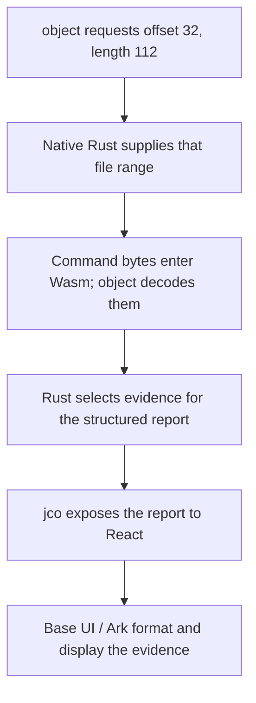

# Rust analysis core

**Status: Mach-O header analysis and ordinary Rust object-file identity APIs using `object` 0.40.0.**
`object` owns format detection, thin and universal header decoding, and load-command
iteration and decoding. Project code supplies bounded input, typed failures
and report conversion.
See the [system overview](system-overview.md) for communication and native session
lifecycle; this document owns the native API and analysis invariants.

The ordinary `binary-inspection` library owns binary interpretation. It accepts resident
bytes or a bounded `ByteSource`, delegates I/O to that source,
and returns owned, typed facts. A separate component crate converts
those facts into the versioned WIT contract. Neither WIT nor WebAssembly types
belong in the native library.

## Reading the implementation

| Module                        | Responsibility                                                        |
| ----------------------------- | --------------------------------------------------------------------- |
| `src/lib.rs`                  | Small public facade, usage and scope documentation                    |
| `src/model.rs`                | Report, CPU identity, platform declarations and evidence ranges       |
| `src/object_report.rs`        | Common file identity through the unified upstream parser              |
| `src/error.rs`                | Typed failure reasons and standard Rust error integration             |
| `src/macho/mod.rs`            | Public inspection facade                                              |
| `src/macho/report.rs`         | Upstream parser orchestration and owned report conversion             |
| `src/input/cache.rs`          | Format-independent cache ownership, partial reads and source failures |
| `src/macho/source.rs`         | Public inspection failures and their original causes                  |
| Component `src/conversion.rs` | Explicit native-to-WIT conversion                                     |

Upstream parsers consume `ReadRef` directly. Resident members use borrowed
subslices; source-backed members use `ReadCache::range()` over one shared cache.
Report conversion retains each member’s absolute origin and checks reported
coordinates and containment. The cache cursor preserves acquisition failures
that `ReadCacheOps` otherwise erases to `()`. The `input` module owns this storage
without choosing a parser; the Mach-O facade invokes inspection and returns any
retained acquisition failure before considering the parser result.

## Native use

### Object-file identity

`inspect_object(bytes)` and `inspect_object_source(source)` use
`object::File::parse()` to return an owned `ObjectReport`. Its format,
architecture, sub-architecture, file kind and endianness use upstream types;
`is_64` is the upstream address-width classification. A missing sub-architecture
can mean unspecified, unrestricted or unrecognized; it is not an error.

The enabled readers accept ELF, PE, COFF and thin Mach-O. PE enables upstream
COFF support as well. Universal Mach-O uses the dedicated `inspect` and
`inspect_source` APIs; the unified reader rejects containers such as universal
Mach-O and archives. The application WIT and UI expose the dedicated Mach-O report.

Both input paths call the same generic `ReadRef` function. Resident input is
borrowed directly; source input uses `input::SourceCache`, completing partial
reads and preserving original acquisition errors. No format-specific source
adapter or filesystem dependency is involved.

This API reports common identity, not complete validation. `File::parse()` can
read more than headers: ELF parsing loads section and symbol tables, while PE
parsing loads sections and may inspect COFF symbols. Read sizes follow the
upstream parser; there is no promise of a fixed transfer size or total. An actual
acquisition failure takes precedence even if an optional upstream read suppresses
its parsing error.

### Mach-O reports

```rust
use binary_inspection::{inspect, AnalysisError, BinaryReport};

fn analyze_for_host(bytes: &[u8]) -> Result<BinaryReport, AnalysisError> {
    inspect(bytes)
}
```

Native reports use `object::macho::CpuType`, `CpuSubtype`, `FileType`, `Platform`
and `LoadCommandType` directly. Callers compare these values with `object`'s named
constants; `object::Wrap::into_inner()` returns their numeric values, including
unrecognized identifiers. `ErrorKind` describes inspection failures.
`Version` and `Endianness` re-export the upstream types. Construct
versions with `Version::new()` and read their components with `major()`, `minor()`
and `update()`; versions also support ordering and human-readable `Display`.
Report types are owned and do not retain a borrow of the input.

Canonical names come from `object`'s `names` feature, for example `MH_DYLIB` and
`CPU_TYPE_ARM64`. CPU subtype lookup uses the CPU family and excludes capability
bits only when finding the name; the report retains the complete raw subtype.
A missing name means that the pinned library has no name for that value, not that
the header is invalid.

Platform declarations contain `Option<object::macho::Platform>`. `LC_BUILD_VERSION`
provides a platform identifier. Every legacy `LC_VERSION_MIN_*` command has `None`
because it carries no such identifier; its source command identifies the declared
family. In particular, legacy iOS evidence does not resolve device versus simulator.

These upstream types are part of the public Rust API. Consumers and dependency
upgrades must account for the pinned `object` version; the library does not promise
an interchangeable decoder behind independent classification enums.

## Contracts

- Every reported range is absolute within the supplied input and has an exclusive
  end. Signature data offsets are converted from their image-relative encoding.
- `FileRange` prevents arithmetic overflow. Its public constructor does not
  validate against a file; inspection additionally checks containment.
- Mach-O header format and universal entry width are separate types. Neither
  determines ABI pointer width or operating-system compatibility.
- Format acceptance follows the pinned upstream parsers described below. Unknown
  CPU, file-role and modern platform values are retained.
- Duplicate platform/signature commands are preserved as separate evidence.
  Inspection does not assert that those combinations are accepted by Apple's tools.
- Reports cover headers, platform declarations and signature-command ranges.
  Reserved fields, segment contents, signature blobs, trust and application bundles
  are outside this milestone. `AnalysisScope::HeadersOnly` records that boundary.
- Inspection returns the first error, without a partial report.

## Adapter and UI

The WIT contract is `apple-code:analysis@0.5.0`, which exposes zero-argument native
session construction, persistent selection and inspection outcomes.
Its `macho-value` record carries `value: u32` and `name: option<string>` for CPU,
file-type, platform and load-command values. The platform field is optional to
preserve the absence of an identifier in legacy commands. This serialized contract
contains no Rust dependency types. Minimum OS and SDK versions are strings produced
by `object::macho::Version`'s `Display` implementation. Evidence ranges and structured
errors retain their own records. The `decode(string)` error-kind variant carries
upstream decoding failures. The native crate version remains 0.1.0 while the
unpublished workspace is being developed; the contract version is independent.

The native component composes the ordinary Rust filesystem client and
`inspect_source` analyzer. Requested ranges enter Wasm through the Polymorph
provider; reports and inspection errors use explicit WIT conversion. The core
still supports resident bytes for native callers and fixtures. jco carries u64
offsets as JavaScript BigInt and preserves structured diagnostics alongside
Rust-formatted messages. Both UI variants use one presentation module and
one image-details component to display the supplied canonical names and numeric
fallbacks. They do not maintain Mach-O classification tables or interpret bytes.

## Parsing dependencies

The core pins [object 0.40.0](https://docs.rs/object/0.40.0/object/read/macho/index.html)
with `read_core`, `macho`, `names`, `elf` and `pe`, without default features. The
`pe` feature also enables `coff`. There is no second project implementation of
format detection or decoding. Mach-O analysis uses these low-level operations:

| Operation                                | Upstream API                                                                           |
| ---------------------------------------- | -------------------------------------------------------------------------------------- |
| Format detection                         | `FileKind::parse`                                                                      |
| Thin header and byte order               | `MachHeader32` / `MachHeader64`: `parse` and `endian`                                  |
| Command-region acquisition and iteration | Header `load_commands`, then iterator `next`                                           |
| Command payloads                         | `LoadCommandData::variant`; `BuildVersionCommand::tools` for the declared tool records |
| Universal header and architecture table  | `MachOFatFile32` / `MachOFatFile64`: `parse` and `arches`                              |
| Member offsets and lengths               | `FatArch::file_range`                                                                  |

These APIs let header analysis propagate each parse or iteration failure and avoid
reading section contents and symbol tables. `MachOFile::parse` is unsuitable for
this scope: it eagerly processes sections and symbols and suppresses some command
traversal failures. A successful general file parse would not provide the same
first-error behavior.

### Accepted formats and command evidence

`FileKind::parse` first requests 16 bytes. Some formats require further detection
reads; PE detection follows the DOS header to the NT headers. The dedicated
Mach-O APIs reject recognized ELF, PE and COFF inputs with `UnsupportedImage`;
failed detection retains its upstream error, and failed acquisition retains its
source cause. Thin 32-bit and 64-bit Mach-O images support both byte orders.
Fat32 and fat64 containers use the upstream
big-endian reader; there is no swapped/little-endian fat fallback. Short inputs
can fail during detection before a format-specific header parser is reached.

Every command is passed through `variant`, so upstream-supported command layouts
can produce decoding errors even when the report does not expose their fields.
Build-version tool records are read with the upstream tool accessor but are not
reported individually. Unknown command payloads remain opaque when upstream has
no decoder for them. No project checks require exact recognized-command lengths,
command alignment or complete consumption of `sizeofcmds` beyond what these APIs
enforce.

Universal-table acceptance also follows upstream. Project code does not add
nonzero-member, alignment, table-intrusion, member-overlap or table/header CPU
agreement rules. Generic range checks still require each selected member and each
reported signature payload to fit its containing input, and prevent arithmetic
overflow. Those checks preserve bounded input and report coordinates; they do not
establish complete Mach-O validity.

### Reads and memory

The parser reads the complete declared `sizeofcmds` region before iterating its
commands and the complete fat architecture table before traversing members.
`HeadersOnly` therefore does not imply one small read per reported command or
architecture. Signature payload ranges are validated without reading their blobs.

The analyzer traverses the members and commands supplied by the upstream parsers
and returns on the first error.
For `ByteSource` input, `inspect_source(source)` borrows the source directly.
`object::ReadCache` checks read bounds and owns the requested buffers. Its cursor
owns the borrowed source and the first acquisition failure, completes partial
reads, and preserves unexpected EOF, invalid read counts and original source
errors with their offsets. After traversal, `ReadCache::into_inner()` returns the
cursor; inspection returns its retained failure when present, otherwise the
parser result. Remote sources supply larger logical ranges through multiple
protocol-sized reads. Resident byte slices use the same parser and report
conversion without a source cache.

`object::ReadCache` retains requested ranges until inspection ends. Distinct
offset-and-size pairs can retain overlapping bytes separately. A logical parser
range can span several 64 KiB remote requests and occupy one larger cached buffer.
Inspection memory includes all retained ranges and the report being constructed.

#### Example: reading a command region and displaying its evidence

Consider an illustrative thin 64-bit Mach-O with three commands. Its 32-byte
header declares `ncmds = 3` and `sizeofcmds = 112`:

| File offsets (inclusive) | Contents                                 | Size     |
| ------------------------ | ---------------------------------------- | -------- |
| `0–31`                   | Mach-O header                            | 32 bytes |
| `32–103`                 | `LC_SEGMENT_64`, with no section records | 72 bytes |
| `104–127`                | `LC_BUILD_VERSION`, with no tool records | 24 bytes |
| `128–143`                | `LC_CODE_SIGNATURE`                      | 16 bytes |

After reading the header, `object` requests the command region at **offset 32,
length 112** and decodes the commands from that block. This range excludes the
header reads and any later segment contents or signature payload. The signature
command supplies the payload's location and size; inspection checks that range
without fetching or verifying the payload.

On a cache miss in the native-service workflow, the requested command bytes are
read by native Rust and delivered into Wasm memory through the existing filesystem
client and transport:



Reading the complete command region does not require displaying every command.
The current report selects platform declarations and signature locations;
`LC_SEGMENT_64` fields are not presented. React formats the supplied report through
`machoValueLabel()` and `rangeLabel()`: canonical names such as `LC_BUILD_VERSION`
and numeric offsets and ranges. Minimum OS and SDK version strings, such as
`14.0.0`, are displayed directly. React does not receive the command block for parsing.

### Diagnostics

`ErrorKind::Decode(object::Error)` retains the upstream error, and
`AnalysisError::source()` exposes it to native callers. Its text is carried across
WIT as `decode(string)`; project code does not classify upstream failures by
matching their messages. Member and reported-range failures remain typed, as do
input and provider failures for source-backed inspection. Failed parser reads
without an acquisition cause return the upstream decoding error. The dependency
erases allocation and size-conversion failures to `()`, so this diagnostic cannot
expose an underlying allocator error or distinguish those causes. Allocation
failures that abort or trap the runtime are not made recoverable by this adapter.

Input diagnostics describe the requested range, read offset or provider contract
failure as applicable. Inspection stops at the first failure and returns no
partial report.

Dependency upgrades must review these acceptance, read and diagnostic behaviors,
the public `object` types and the native/component conversion together. Measure
native and Wasm behavior and size against the same fixtures before expanding the
selected parser scope.

The [reusable foundations comparison](../libraries/selection-and-reuse.md) expands this decision
by capability, with source-reviewed alternatives, format coverage gaps, native/Wasm
boundaries and staged adoption checks. It recommends evaluating existing decoders
before adding substantial custom parsing; proposed additional decoders are not
current dependencies.

## Validation and maintenance

Synthetic test encoders are separate from parser code. Focused tests cover the
resident/source integration, absolute report ranges, preservation of input and
upstream errors, and report conversion. This coverage checks the
application's integration with the upstream parser.

Run:

```sh
cargo test --locked -p binary-inspection
cargo clippy --workspace --all-targets --locked -- -D warnings
RUSTDOCFLAGS="-D warnings" cargo doc --locked -p binary-inspection --no-deps
pnpm engine:build
pnpm test
pnpm typecheck
pnpm build
pnpm format:check
```

The core forbids unsafe code and warns on undocumented public items. Keep public
types documented with units and invariants, retain unknown values where inspection
can continue, and add a focused report-conversion test when new evidence warrants
one.
