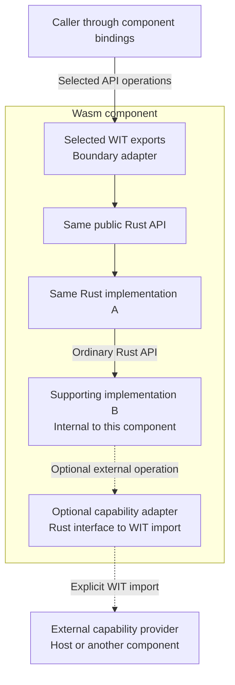

# Rust reuse across execution environments

**Status: mandatory architectural requirement. Implementation is partial.**

> **Ordinary Rust APIs define the component boundary.** Every consumer-facing
> domain operation exported by a Wasm component must be available through an
> ordinary Rust API. The component exposes selected operations through WIT
> adapters. Required functions and target-compatible dependencies remain internal;
> deliberately external capabilities are supplied through explicit imports.
> Adapters translate the boundary; reusable behavior stays in Rust and remains
> usable without Wasm.

**The complete implemented non-UI workflow must work with Rust alone.** The
analyzer, filesystem client and reusable operation/resource lifecycle must have
real Rust implementations, usable through Rust libraries and Rust platform
adapters without TypeScript, JavaScript, Node, jco or a Wasm runtime. This is a
mandatory baseline, not an optional future deployment.

Compile the same reusable Rust behavior into browser Wasm or native code. Outside
presentation and UI lifecycle, TypeScript/JavaScript is permitted only where the
execution environment requires binding or host API access. It must not contribute
analysis, filesystem-client protocol or workflow semantics that Rust depends on.
Removing the frontend or Wasm must require only the appropriate platform adapter,
not recreating behavior that was implemented in TypeScript.

This applies to current inspection and to future dependency analysis, rebuilding
and signing as those features are implemented. It does not claim those features
exist, require every backend to support every operation, or select a new runtime.
Share Rust source and contracts; compile and supply platform adapters as needed.

This document owns code responsibility and runtime independence. The
[Wasm/native-filesystem decision](../wasm-analysis-with-native-filesystem.md) owns the
selected browser execution path and byte boundaries. The
[filesystem requirements](../../filesystem/requirements.md) own fidelity and I/O
guarantees; the [portability requirements](../../portability/requirements.md) own tool,
host and complete-transformation qualification. Those contracts remain in force.

## Public APIs and component boundaries

Define the ordinary Rust API that a consumer needs before choosing component
packaging. Its implementation may use internal modules, other library crates and
interfaces for external capabilities. Modules organize code within a crate;
library crates can depend on other library crates. Neither determines what a
component must expose. Keep responsibilities clear without requiring a separate
crate for every responsibility or a speculative framework for future backends.

For each component, distinguish three things:

- **Exported operations:** selected operations from the ordinary Rust API, exposed
  through WIT adapters. Being public in Rust does not automatically export an
  operation; being reachable internally from an exported operation does not make
  a helper part of the consumer-facing API.
- **Internal implementation:** the functions, target-compatible dependencies and
  binding/runtime support needed to implement the selected operations. These may
  span modules and crates without additional component boundaries. Keep unrelated
  functionality out of the selected build where practical. WIT export selection
  alone does not remove unused code; dependency features, linking and optimization
  determine what remains in the artifact. Verify the artifact before claiming
  that only required code is included.
- **Imported capabilities:** operations deliberately supplied outside the
  component. A Rust adapter implements the required Rust capability interface
  using the selected WIT import. The provider may be another component or a host
  implementation; declaring an import alone supplies neither.

The diagrams use **A** for the implementation behind a public API and **B** for a
supporting dependency. Neither denotes a specific feature, module or crate. Arrows
show calls and required operations; results and errors return through the same
APIs. These are alternative compositions of the same Rust behavior, not separate
implementations or a claim that every target has already been qualified.

### Ordinary Rust composition


The caller chooses and composes Rust implementations directly. No component
runtime, WIT conversion or RPC is introduced for in-process calls. A remote
provider may be supplied through a Rust client and transport adapter when a
process boundary is deliberately selected.

### The same API through a component



The component consumer reaches A and B through the selected public operations.
Internal helper functions do not become independently callable merely because
they are compiled into the component. For example, exporting an analysis operation
does not also expose the internal header parser that it calls. Binding allocation,
initialization and other generated support are not additional domain operations.

Here A and B are linked into one component and call each other through ordinary
Rust APIs. **B can instead be supplied by another component when that separation
is useful.** In that arrangement, A's import adapter implements its required Rust
interface through a WIT import; B's export adapter calls B's existing Rust API.
Matching imports and exports must be explicitly connected during composition.
Each component may contain several crates; neither crate membership nor a Rust
`pub` declaration requires a corresponding component or export.
[Component composition](https://component-model.bytecodealliance.org/composing-and-distributing/composing.html).

WIT describes the selected external contract, not the Rust implementation's
entire type system. Adapters explicitly map values, errors, operations and resource
ownership. Rust traits, generics, lifetimes and internal references do not become
WIT APIs automatically. Generated WIT types stay out of ordinary library APIs.

The [error-handling guide](../error-handling.md) documents the current library
choices, boundary conversions and possible Eros integration. The rules below
define the runtime-independent contract regardless of that library choice.

Reusable Rust libraries own errors for the conditions they detect and preserve
upstream errors for operations supplied by dependencies. Transport adapters return
the existing client `Failure`, which retains the operation and the original
backend error directly through `std::error::Error::source()`. The original
Polymorph or Tokio type, variant and payload remain available without recreating
their error taxonomy. `Failure::operation()` supplies operation context. Adapter
checks, such as connection deadlines and the binary-response rule, supply a
diagnostic and retain an underlying cause when available. Backend timeouts retain
their original error; an adapter-owned connection deadline retains its timer error.
Selection/filesystem exchanges have no application deadline.

The filesystem protocol owns `ProtocolError` for resource validation, limits and
response mismatches. Its codec cases retain the original MessagePack error with
encoding or decoding context. `Failure::protocol_error()` exposes that diagnostic
without parsing message text. Errors own their data rather than borrowing sessions
or socket resources. `thiserror` supplies error implementations; it does not define
the protocol or require a runtime.

`Failure` stores backend and protocol causes once and formats their messages on
demand. Provider responses retain their wire message without inventing an
underlying error object. Provider-reported cancellation is a `Provider` failure
with a Rust diagnostic.
Ordinary Rust APIs return owned `Outcome<Step>` values. Each
`StepOutcome<Kind, Output, Error>` contains a `kind` and the original typed
`result`. These structures carry data; they do not schedule work or define recovery.
The session methods determine step order and which later steps run after a failure.
The public structures do not enforce correlations between a step's kind and output.

The session supplies the `StepKind` enum separately from the generic outcome
structures. Rust callers can match its cases exhaustively. The component's
explicit `wit-bindgen` `with` mapping reuses this ordinary Rust type for returned
steps, without a handwritten enum conversion or a WIT dependency in the client.
Its `u8` representation and discriminants must match the WIT enum's case order.
This mapping covers output only; accepting the enum as input would also require
the generator's lifting contract. Generated TypeScript exposes the same cases
as a string-literal union.

Selection requests return the action step followed by a `QuerySelection` step,
even when the action fails. `query_selection()` returns only the query step.
Each selection step returns `Result<Option<SelectionState>, Failure>`. Successful
actions carry `None`; successful queries carry `Some(state)`, including an empty
selection. Closing or cancelling the native dialog completes the action without
replacing selection; the query reports the retained state or its own failure.
A failed query cannot replace the original acquisition failure;
unknown state is distinct from a confirmed empty selection.
Inspection returns one `Inspect` step containing the report or the original
`InspectionFailure`.

WIT defines concrete selection and inspection records with the same `steps`,
`kind` and `result` structure; it does not support user-defined generics. The
component projects errors into the declared WIT representation and preserves
their Rust-formatted messages. That projection does not retain the complete Rust
source chain. The [error-boundary guide](../error-boundaries.md) compares reusable
structured WIT contracts with message-only presentation contracts; React reading
only the message does not itself narrow the component API.
The component's `query-selection` operation
projects the ordinary Rust `query_selection()` method.

Byte sources carry owned provider errors through `SourceError::Provider`.
Component adapters can move their generated WIT error into that carrier without
introducing WIT types into the core API. Native sources retain genuine I/O errors
in `SourceError::Io`; sources can retain genuine cancellation failures in
`SourceError::Cancelled` independently of application analysis controls.
An inspection failure has one diagnostic path:

```text
InspectionFailure → InspectionError → InputError (read offset)
    → SourceError::Provider → original provider error
```

For remote reads the retained provider error is the client `Failure`. Transport
and protocol failures retain their original cause; valid service failure replies
supply only a message, not the service's native error object. The component
converts the client failure to the public WIT error schema at the output boundary.
The source integration does not construct a synthetic I/O error from a message
or store a second provider cause.
The analyzer's adapter to `object::ReadCacheOps` still retains its input diagnostic
separately because that upstream interface returns only `()` on failure.
`inspect_source(source)` borrows a `ByteSource` directly. The cache
cursor fills requested ranges, including partial reads, while native and remote
sources keep their own access mechanisms. Protocol chunk sizes belong to the remote source;
they do not limit the size of a parser request. Requested ranges remain in
`object::ReadCache` until inspection ends, with memory behavior defined by the
[parser contract](../rust-analysis-core.md#reads-and-memory).

Convert errors at the actual consumer boundary. Executables may use `anyhow` for
reporting while preserving the underlying error; WIT and JSON adapters produce
their declared error records. MessagePack I/O provider failures carry only
the message, so a remote client cannot recreate the provider's
native error object. Unknown provider errors reaching the component's output
boundary use its existing message-only I/O representation without manufacturing a
Rust I/O error. Direct native callers retain the original `std::io::Error`,
including its kind and any OS error code.
These representations do not replace typed Rust errors or
change failure or completion semantics. An inspection caller receives the
analysis report or original failure in its outcome.
Inspection failures expose the ordinary Rust error's `Display` message alongside
their structured WIT detail. Frontends display that message without recreating
Rust's diagnostic wording. For rejected host invocations, `Error` instances supply
their message; other thrown values use generic UI text.
Statistics describe attempted remote reads and validated response bytes; they do
not prove unobserved native work or immutable input.

The host binding supplies operations the environment must perform. It does not
implement A's or B's protocol or workflow policy. In a browser it may use generated
JavaScript and browser APIs; in a native Wasm runtime the host may implement those
operations in Rust. The same restriction on semantic ownership applies to both.

The imported-capability arrow is an interface connection, not an implied network
or process connection. Separate-process execution needs explicit client,
server and transport adapters. WIT alone does not provide IPC, shared memory or
direct OS access. Keep that deployment decision separate from library composition.

## Why the distinction matters

A Rust parser alone does not make the complete workflow reusable. If the browser
client is the only implementation of remote resource ownership, request encoding,
reply validation or selection outcome composition, a native caller
must recreate that behavior. A Rust function that forwards to that client does not resolve the
dependency; neither do generated bindings around it.

Rust must implement the shared behavior or reuse a qualified Rust library for it.
Platform adapters supply operations and translate representations. Do not move
networking into the parsing core merely to remove TypeScript from a call path.

## The environment exception

Browser Wasm needs its host to expose operations such as networking. Generated
jco bindings, browser WebSocket calls, event/Promise adaptation and host value
conversion may therefore remain JavaScript. This exception supplies access to the
environment; it does not permit moving reusable behavior out of Rust.

For example, a browser binding may send bytes supplied by Rust, deliver received
bytes, or report that the socket closed. Rust must implement filesystem-request
encoding, reply interpretation, resource state and the resulting success or
failure. The Polymorph browser provider enforces its configured connection timeout; the
native Tokio adapter bounds connection establishment itself. Service handshake,
reply/flush deadlines and provider/library timers remain. Application
deadlines do not terminate selection/filesystem exchanges, native request dispatch
or picker waits. Startup and shutdown follow readiness, failure and explicit stop
events without application deadlines; bounded test waits remain test watchdogs.
Component ABI conversion is binding work, not filesystem-client protocol logic.

Keep necessary host-side type, message-size and allocation checks, but do not make
them Rust's only validation. The Rust implementation must enforce its contracts
with a native adapter as well. A binding must not manufacture a successful result,
missing metadata or a native selection observation on Rust's behalf.

The review test is concrete: **replace the JavaScript environment adapter with a
Rust adapter. The implemented operation must still work without porting any
analysis, protocol or workflow logic from TypeScript.** Maintaining a second
TypeScript implementation of those semantics does not satisfy this separation.

## Responsibility boundaries

| Layer                                  | Owns                                                                                                              |
| -------------------------------------- | ----------------------------------------------------------------------------------------------------------------- |
| Rust analysis and workflow libraries   | Binary interpretation, read decisions, domain results and implemented processing plans                            |
| Reusable Rust remote filesystem client | Protocol encoding/decoding, selection-state projection, reply validation and operation composition                |
| Platform adapters                      | Connection and execution primitives, timer/event forwarding and component/host value conversion                   |
| Application composition                | Runtime/session initialization, generated-session access and host disposal independently of presentation lifetime |
| Native Rust filesystem provider        | Acquired files/directories, display names, listings and transactional replacement                                 |
| React presentation                     | User interaction, pending state, result rendering, starting operations and local view lifecycle                   |

The ordinary Rust APIs must not expose WIT resources, JavaScript values, React
state or a required WebSocket connection. Keep component bindings and transport
dependencies in separate adapters. Native consumers must be able to depend on the
libraries they need without pulling in browser tooling or an IPC service.

Enforce this in crate dependencies as well as API types. `binary-inspection`,
`filesystem-native` and `workbench-operations` have no concrete networking,
WIT or component-runtime dependencies. OS-specific filesystem implementations
selected at compilation belong in `filesystem-native`; WebSocket adapters do not.
The remote client depends on the shared Rust filesystem protocol and accepts an
injected `Transport`. The service executable retains resource identifiers,
allocation bounds, request coordination and native dialogs. Resource identifiers
keep stale requests from targeting a replacement selection.

`filesystem-data` owns the portable `DirectoryEntryKind` and `DirectoryEntry` definitions.
Consumers import these types directly from `filesystem_data`. Only the protocol
requests their optional Serde support; the data crate has no platform, networking,
analyzer or WIT dependency. Entry IDs are scoped to their listing, display names
are not opening paths, and entry kinds describe the type observed during listing.
The native provider retains original native names and owns opening policy. The
component reuses the shared types through its explicit `with` mappings; WIT still
defines the language-neutral records and enum case order.

Presentation, component runtime and native resource lifetimes are different.
Application composition owns component/session initialization and host disposal
through the owner returned by `createNativeRuntime()`. Its `getSession()` accessor
supplies the generated WIT `Session`; the application model calls its methods
directly. Presentation components receive the model through explicit inputs.
Changing presentations must not impose a runtime lifecycle on reusable APIs.
The [system overview](../system-overview.md#application-ownership) records the
application's UI operation guard and generated-session access, and its
[runtime lifecycle](../system-overview.md#runtime-lifecycle) defines disposal limits.

Reusable Rust owns the meaning of operation completion; a native caller receives
the same contract. `Session::inspect` returns the analysis outcome
without progress callbacks or cancellation controls. The UI displays a pending
state until that invocation completes. The native owner retains selection after
analysis, disconnect and frontend disposal. Successful replacement, owner
destruction or service shutdown ends ownership. There is no frontend deselection
action or remote cleanup API.

## Application to this project's execution arrangements

The [filesystem communication flow](filesystem-communication-flow.md) illustrates
the Rust client, browser network binding and native service boundaries, including
a sequence for one bounded read. The application uses jco component bindings
and the published Polymorph browser provider, with only a boundary-value adapter
between them. Client and service share Rust filesystem messages over WebSocket.

The application and ordinary Rust APIs compose these responsibilities as follows:

```text
Browser execution:
Rust analyzer in Wasm → Rust remote client in Wasm
  → Polymorph WIT → jco host bindings → published Polymorph provider
  → browser WebSocket → native Rust filesystem provider

In-process library use:
NativeSelection → borrowed NativeFileSource → inspect_source()

Optional native remote experiment:
Rust analyzer → same Rust remote client
  → experiment's Tokio WebSocket adapter → native filesystem service
```

The in-process path needs neither RPC serialization nor a local server. Separating
the UI and analyzer into processes also does not force filesystem IPC: an analyzer
process may use the provider directly and expose only commands/results to its UI.

In browser Wasm, Rust must own connection decisions and protocol processing while
the browser still performs the actual networking operation through host bindings.
Moving code into Rust does not grant direct OS sockets or file descriptors, remove
the delivery of requested bytes into Wasm memory, or establish shared memory with
the native provider. Component bindings connect imports to their providers; the
selected networking provider performs the transport operations.
See the [browser memory-boundary explanation](../../filesystem/browser-filesystem-and-wasm-boundaries.md).

Keep synchronous/asynchronous adaptation at the runtime boundary where practical.
The present component uses JSPI to suspend imported operations; native library use
must not acquire a JSPI requirement. A different bridge must be qualified rather
than forcing browser scheduling types into the core API.

Browser filesystem capabilities must not constrain ordinary Rust APIs or native
adapters; the [filesystem overview](../../filesystem/README.md) compares access models.
The application component and service consume one Rust address configuration in
[`config/native_service.rs`](../../../config/native_service.rs). React supplies no
endpoint or connection storage; it calls component operations and presents their
results. This application configuration does not enter the reusable analyzer,
native filesystem or client APIs. Optional networking probes accept explicit endpoints.

## Rust input and component APIs

- [`binary-inspection`](../../../crates/binary/inspection/src/lib.rs) is an ordinary Rust analyzer.
  Its [`ByteSource`](../../../crates/binary/inspection/src/input/mod.rs) contract allows
  bounded offset reads without browser, WIT or OS types.
- [`NativeSelection`](../../../crates/filesystem/native/src/selection.rs) acquires
  and replaces native files and directories independently of the service. Its
  borrowed [`NativeFileSource`](../../../crates/filesystem/native/src/file.rs)
  implements the analyzer input contract. The
  [direct composition example](../../../crates/filesystem/native/examples/inspect_selection.rs)
  repeats inspection using the retained owner without networking or WIT.
- The [native component adapter](../../../crates/workbench/component/src/native.rs)
  composes the ordinary Rust filesystem client and its bounded input source with
  the same `inspect_source` entry point. Its private
  [`websocket` module](../../../crates/workbench/component/src/websocket.rs)
  invokes Polymorph networking operations; the browser provider owns connection
  timing. The facade owns WIT resources and result conversion.
- [`workbench-operations`](../../../crates/workbench/operations/src/lib.rs)
  accepts a transport through `Session::new`.
  The optional [native inspection example](../../../experiments/workbench/native/examples/inspect.rs)
  supplies the experiment's Tokio adapter. Neither this adapter nor component
  bindings are dependencies of the reusable client.

## Evidence required for reuse claims

1. **Rust-only operation.** Exercise the implemented non-UI workflow through actual
   Rust entry points and Rust adapters, including the remote client where the
   operation uses it. Passing parser-only tests does not establish this. No browser,
   Node, jco, generated JS or Wasm runtime may be needed for this native path.
2. **Shared remote-client behavior.** Test the Rust client independently of browser
   bindings, including short reads, malformed replies, premature closure, protocol limits,
   native-dialog cancellation and independent selection outcomes.
   Use controlled transports to reach failures;
   such tests alone do not qualify a real browser or native connection.
3. **Actual adapter integration.** Before claiming an execution arrangement works,
   build and run it through its real adapter. Browser and native remote clients
   must execute the same Rust client logic, not separately reimplemented protocols.
4. **Semantic agreement.** Exercise ordinary Rust composition and each claimed
   component composition through their selected APIs. Trace each consumer-facing
   domain export to its ordinary Rust API and shared implementation. With identical
   fixtures and provider capabilities, compare reports, structured analysis
   errors and resource outcomes across the claimed arrangements.
   Transport-specific failures may differ explicitly; do not
   require identical timing, request counts or OS-specific metadata.
5. **Honest capability reporting.** Missing metadata remains unavailable, failed
   state observations remain unavailable, and untested targets remain unqualified.
   Neither a WIT interface, dependency feature nor stub proves an operation is implemented.

Use focused checks appropriate to the change. Do not add tests that merely repeat
implementation details or rebuild every environment for a documentation edit.

## Applying the requirement to future changes

Before implementation, identify which Rust layer owns the new behavior, which
operations genuinely need a platform adapter, and how a native caller would use
it without TypeScript. If adding a component boundary, identify the ordinary Rust
API first, the subset exposed through WIT, the implementation kept inside the
component, and the required imports with their providers. Justify any separation
of an internal dependency into another component; ordinary Rust calls suffice
where no external boundary is needed. For each proposed JavaScript/TypeScript
binding, identify the environmental requirement and the operations it forwards;
convenience or an existing TypeScript implementation is not sufficient
justification. Reuse the
existing source contract where sufficient; add the smallest necessary interface
rather than a speculative generic framework.

During review, trace a representative operation from its Rust entry point through
acquisition, state observation and analysis. Check that essential decisions and
failure semantics have real Rust implementations. Keep generated bridges generated and
avoid duplicate domain models in adapters.

In the change report, distinguish the Rust functionality delivered, adapter work,
execution modes tested and remaining gaps. A frontend demonstration must not be
presented as proof of a complete portable Rust workflow.
