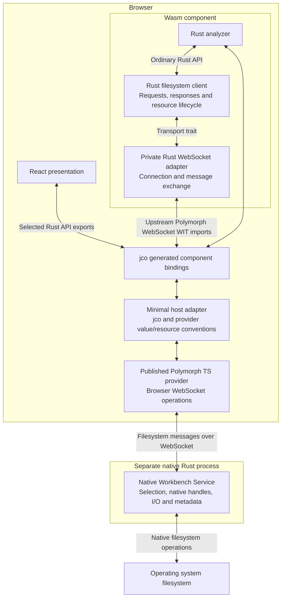
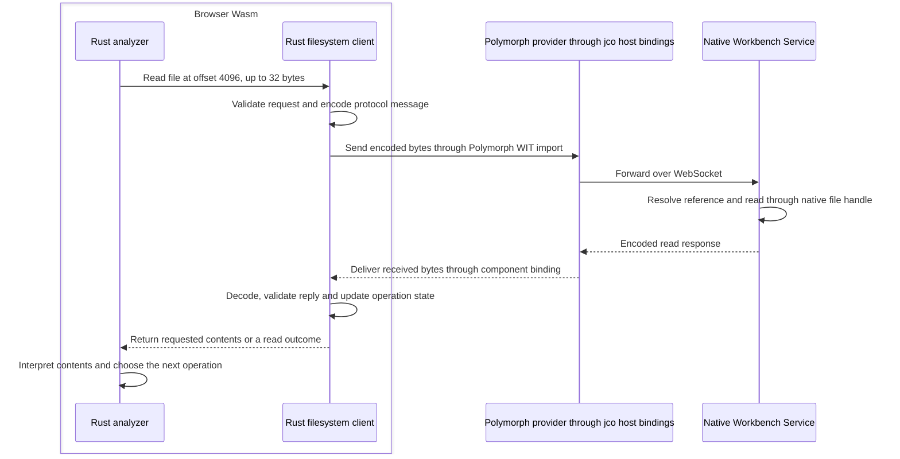

# Rust filesystem communication flow

**Status: implemented native file/directory workflow. Platform support, complete
application metadata and richer operations require separate qualification.**

The Rust analyzer calls an ordinary Rust filesystem API. A Rust client implements
remote access behind that API and owns requests, response interpretation and
resource lifecycle. This document makes that communication flow concrete; the
[Rust reuse contract](README.md) owns the architectural requirements.

## Browser Wasm and the Native Workbench Service

The application model obtains a generated WIT `Session` through
the runtime’s `getSession()` and calls its selected methods directly through jco;
those exports adapt ordinary Rust APIs. The browser's WebAssembly engine executes
the Rust analyzer and filesystem client together. They call each other directly
inside the component. Polymorph supplies the browser WebSocket provider through
its upstream WIT interface. The pinned GitHub download and `wkg` workflow provide
that interface unchanged. These deployment choices stay in the component adapter.

The `use crate::polymorph::websocket::{...}` statement in the component's
[`websocket.rs`](../../../crates/workbench/component/src/websocket.rs) imports Rust
bindings generated by `wit_bindgen::generate!` in
[`lib.rs`](../../../crates/workbench/component/src/lib.rs) from upstream WIT.
The import statement is handwritten; the imported bindings are generated from
WIT, not from TypeScript. In browser execution, those calls reach Polymorph's
TypeScript browser provider, which implements the same WIT interface. They do
not select Polymorph's Wasmtime implementation. The component's
[`native.rs` facade](../../../crates/workbench/component/src/native.rs) owns WIT
resources, Rust API calls and result conversion; its private
socket adapter returns ordinary client errors. Both modules run inside browser Wasm.

The optional native remote experiment supplies its
[`tokio-websockets` adapter](../../../experiments/workbench/native/src/socket/native.rs)
to the same client. The native filesystem service also uses `tokio-websockets`.
Neither path requires Wasmtime. The shared client depends on neither adapter;
direct native analysis uses `NativeFileSource` without a remote client or socket.
The application resolves upstream interfaces from the
[`wkg` dependency area](../../../wkg/README.md) alongside its own component world.

A small host adapter translates the published provider's value and resource
conventions to those expected by jco. It forwards upstream connect/send/receive
and close operations, converts boundary values and preserves host-local safety
checks. It contains no filesystem messages, resource-ownership policy or analysis
workflow. The published provider implements browser networking; jco supplies the
application component bindings.

The Rust client runs alongside the analyzer but remains a separate responsibility
outside the parsing core. Rust owns connection decisions, request encoding, reply
validation, resource state and completion outcomes. A Rust
facade that forwards these responsibilities to a TypeScript filesystem client
would not implement this flow.

The browser binding supplies the networking operations the environment must
perform. It sends bytes supplied by Rust, delivers received bytes and forwards
connection errors. The provider enforces its configured handshake timeout and
retains appropriate host-local safety checks. Rust independently enforces its
contracts and determines what a response, transport timeout or connection closure
means for the filesystem operation. Selection/filesystem exchanges have no application deadline.

## Async helpers and runtime ownership

The native adapters and service tests use `futures = "0.3"` for async helpers.
The crate comes from
[`rust-lang/futures-rs`](https://github.com/rust-lang/futures-rs), maintained
within the Rust project. Rust's [repository configuration](https://github.com/rust-lang/team/blob/master/repos/rust-lang/futures-rs.toml)
grants its Async Working Group write access. This is an ordinary Cargo library;
Rust already supplies `async`, `.await` and the standard
[`Future` trait](https://doc.rust-lang.org/std/future/trait.Future.html).
The library adds useful APIs without changing the language or requiring a
compiler extension. It has its own releases and compatibility policy, separate
from the standard library.

`futures` is the umbrella crate for that project. It already includes and
re-exports helpers from `futures-util`; those names identify parts of the same
library family. Neither crate belongs to Tokio. The relevant APIs are documented
in the [upstream crate reference](https://docs.rs/futures/0.3.34/futures/).

### Helpers used by the adapters

- **Native WebSocket messages:** `SinkExt` supplies `socket.send(...).await` and
  `StreamExt` supplies `socket.next().await` for `tokio-websockets`. These helpers
  handle the socket's asynchronous readiness and polling; the Rust client and
  service retain protocol validation and connection policy.
- **Native picker tests:** `futures::poll!` advances a request once so tests can
  check cancellation while that request is still pending.

Connection establishment is bounded by the configured Polymorph browser provider
or the native adapter's Tokio timeout. An established connection waiting for a
filesystem response has no application deadline. A connection timeout does not
undo filesystem work already running in another process.

### Who executes the work

The helpers use their caller's execution context. They do not start an executor
or thread pool merely because they are imported or called. The operations passed
to them still retain their own environment requirements.

- **Browser Wasm:** `wit_bindgen::block_on` drives the component's async work;
  jco binds its imported networking operations to the published Polymorph browser
  provider. The component awaits the provider's bounded connection result directly.
  Keep Tokio out of the browser component dependency graph.
- **Native networking:** Tokio drives the native socket adapter and filesystem
  service, providing native I/O, timers and task execution. The `futures` helpers
  operate within that execution. `futures` does not replace Tokio's networking
  runtime.
- **Direct native analysis:** the analyzer can call an in-process filesystem
  provider through its ordinary Rust API. That composition does not require the
  WebSocket adapters or either async library.

### Dependency tradeoff

The native crates use the `futures` dependency with default features. That retains
a broader helper API and dependency graph than a minimal feature selection.
In particular, its defaults include `futures-executor`;
the native adapters use Tokio rather than `futures::executor`.
An available executor dependency does not mean a second executor is running.
Dependency presence alone also does not establish the final artifact's size.

The reason to retain the library in native crates is concrete: existing helpers
cover stream/sink operations and test polling without custom async machinery.
Rust-project provenance explains where the implementation comes from; suitability still depends
on the required APIs, target compatibility and adapter tests.

## Filesystem messages and connection lifecycle

Client and service share ordinary Rust message types, encoding and validation,
separate from the analyzer and component bindings. A qualified serialization
library supplies the codec. WebSocket carries those messages; Polymorph supplies
its browser operations. Requested file bytes remain binary payloads.

The service listens at the loopback address in
[`config/native_service.rs`](../../../config/native_service.rs), shared with the
application component. The runtime lazily creates its generated session without an
endpoint argument; Rust connects through Polymorph. Browser URL fragments and
storage do not participate in service configuration. Refresh creates a new component that
queries the same native owner.

Any local client can query and change the shared selection and read the selected
file. Startup still publishes the endpoint and maximum request size for ordinary
native callers, probes and tests. Those consumers may supply explicit endpoints
to their adapters. WebSocket backends report connection failures; the filesystem
protocol validates messages independently. See the [service configuration](../../../crates/services/filesystem/README.md#launch)
for the address, startup behavior and rebuild requirements.

The Rust message contract covers file length, bounded reads, directory navigation,
native selection/current state and structured errors. It defines exact integer
handling, message limits and permitted response types. Each binary WebSocket
message carries one MessagePack request or response directly. Client and service
must be rebuilt and deployed together when the shared message schema changes.
Matching schemas are a deployment requirement; decoding cannot detect every
incompatible change in meaning.
Both sides cap complete messages before decoding owned values and validate the
field bounds. Encoders validate those same bounds before allocating messages.
File-byte buffers and strings must exist in the bounded input before copying.
I/O failure replies carry the native error's message. The original
`std::io::Error` remains available to in-process native callers.

Repeated reads use a retained WebSocket connection with one outstanding request
at a time and ordered replies. Rust owns failure and completion semantics.
Selection/filesystem exchanges, native request dispatch and picker waits have no
application deadline. Connection/handshake deadlines, reply/flush deadlines and
provider/library timers remain in their adapters.
The service retains one native selection until successful replacement or shutdown.
Finishing an inspection, closing a connection or disposing a component runtime
does not change ownership. Replaced identifiers fail as unknown resources, so a
stale request cannot target the replacement; an admitted read completes against
its original handle. No remote
cleanup or frontend deselection operation exists.

Analysis uses `Session::inspect` and returns its outcome when
the invocation completes. The UI displays “Analysis in progress…” while waiting;
it cannot distinguish preparation from parsing. There are no analysis progress
callbacks, WIT event imports, cancellation controls or replacement polling.
The application owner disposes its local host bindings when its lifetime ends.
Changing presentations does not dispose the runtime. The
[system overview](../system-overview.md#runtime-lifecycle) defines disposal's limits,
including already-obtained sessions, pending invocations and admitted native work.
Transport errors retain their original causes; provider-reported cancellation
is a provider failure.

Read allocations remain bounded to 64 KiB per request.

Native acquisition and bounded listing complete before replacement. Cancellation
of a dialog or failed acquisition preserves the preceding selection. Rust composes
selection/navigation with a subsequent current-state query. The returned outcome
contains ordered steps, each with its kind and original result. An action failure
does not prevent the query step, and both failures remain available. A standalone
query returns one step; inspection returns one aggregate step.
These are completed results, not progress notifications. The
[Rust reuse contract](README.md#public-apis-and-component-boundaries) describes
the generic Rust structures and concrete WIT projections.
A lost reply may conceal a successful replacement; the client does not replay acquisition or restore old state. Unavailable
state is distinct from an empty owner, and a later observation may reflect another
caller's replacement. These are state observations, not snapshots of file contents.
Both the operation and its follow-up state query can remain pending. A known
operation result does not imply that its composed outcome is available before the
state observation finishes.

The native executable starts directly with no arguments and an empty selection;
the application's file or folder control requests the native dialog. It publishes
readiness after binding the configured address. Shutdown stops connection work,
waits for native access and then drops the owner; it has no application deadline.
Test watchdogs and forced test disposal do not define production lifecycle policy.

## Example: one requested byte range

Assume the native service already holds an open file and the Rust client holds its
remote reference. The following is a conceptual successful read, not a proposed
wire format or a claim about synchronous/asynchronous Rust method signatures.

The browser binding does not choose the file or byte range, interpret the reply,
or manufacture a native selection observation. Errors and short reads
follow the same ownership division. Selection outcome composition
and response validation remain Rust responsibilities.

Requested contents still enter Wasm memory. A remote resource reference does not
expose the native file descriptor, establish shared memory or make the read
zero-copy. The [Wasm/native-filesystem decision](../wasm-analysis-with-native-filesystem.md)
owns acquisition, resource borrowing and byte-boundary details.

## Reuse outside the browser

| Execution arrangement                                  | Filesystem connection                                                                       |
| ------------------------------------------------------ | ------------------------------------------------------------------------------------------- |
| Browser Wasm and a native service                      | Rust client through Polymorph WIT, jco host bindings and browser WebSocket.                 |
| Optional native remote experiment                      | Same reusable Rust client through the experiment's Tokio WebSocket adapter.                 |
| Analyzer and filesystem provider in one native process | Ordinary Rust calls directly to the provider; no remote client, RPC or service is required. |

The analyzer keeps its Rust-facing input abstraction. Generated WIT types,
JavaScript values and transport-specific types stay in their adapters. These are
compositions for different consumers; compilation alone does not establish a working browser
connection or qualify every execution arrangement.

Use the [Rust reuse contract](README.md#evidence-required-for-reuse-claims) to
qualify native operation, browser integration and agreement of results.
