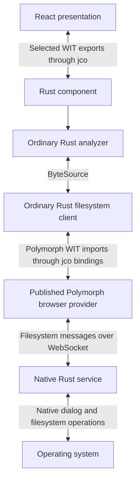
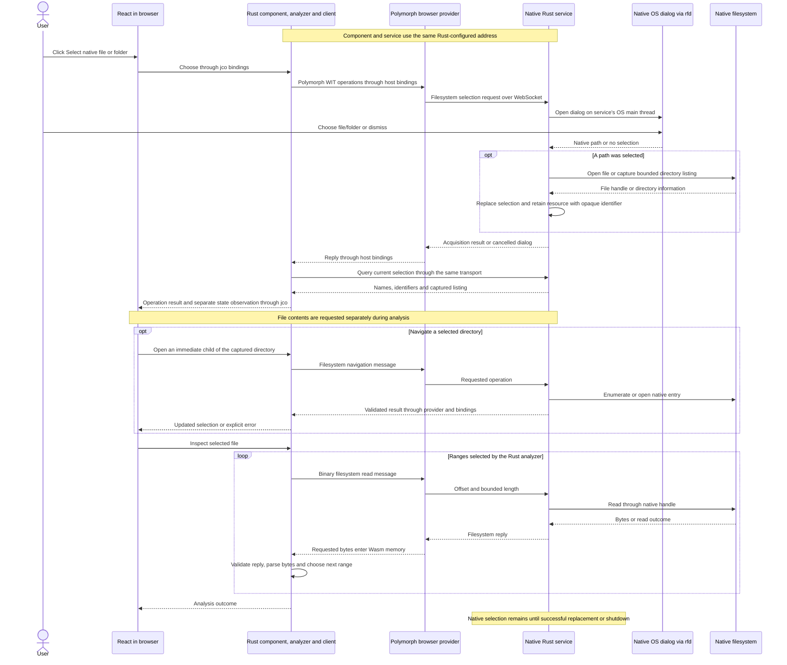

# Wasm analysis with native Rust filesystem access

**Selected application architecture. Native selection, directory navigation and
bounded header inspection are implemented; richer application context and metadata
remain future work.**

The analyzer executes as ordinary Rust compiled into a WebAssembly component.
Native Rust selects files and supplies requested ranges; React invokes selected
component operations through jco and visualizes the results.

> No mandatory whole-file transfer. The Rust analyzer controls incremental access
> and receives the bounded portions of input it needs in Wasm memory.

The [system overview](system-overview.md) describes the implemented composition.
The [Rust reuse contract](rust-runtime-independence/README.md) governs ordinary
APIs and component boundaries, and the
[communication flow](rust-runtime-independence/filesystem-communication-flow.md)
owns filesystem messages, response validation, selection-state projection and operation composition.

## Problem and decision

Application acquisition must preserve filesystem context without requiring React
to manage input buffers. The browser Wasm component performs analysis; moving
interpretation into the service would give it a different responsibility. The
service supplies filesystem operations, not a second Mach-O analyzer. The
[byte-boundary comparison](../filesystem/browser-filesystem-and-wasm-boundaries.md)
explains whole-file buffers and range-read alternatives.

The selected division is:

| Layer                      | Responsibility                                                       |
| -------------------------- | -------------------------------------------------------------------- |
| React                      | User interaction, presentation state and visualization               |
| Rust analyzer in Wasm      | Decide reads, parse bytes, interpret evidence and produce reports    |
| Component adapter          | Translate ordinary Rust input abstractions and results to WIT        |
| Rust filesystem client     | Encode requests, validate replies and compose selection observations |
| jco and host bindings      | Connect component imports/exports to environment providers           |
| Polymorph browser provider | Perform browser WebSocket networking                                 |
| Native Rust filesystem     | Selection, native handles, requested I/O and filesystem metadata     |

The native filesystem provider does not become a second Mach-O analyzer. As those
features are implemented, format recognition, load-command decoding, signature
interpretation, hashing and dependency analysis belong to the Wasm analyzer for
this execution path. Native services supply the filesystem facts it requests.
Optional OS-specific verification remains separate evidence, as described in the
[filesystem comparison](../filesystem/README.md#optional-native-presentation-and-verification).

## Native capabilities and browser comparison

The [filesystem overview](../filesystem/README.md) compares native and browser
acquisition. Both can supply bytes for the same Rust analyzer, but expose different
filesystem facts.
The implemented native provider supports range reads and limited navigation; it
does not yet supply complete metadata or bundle acquisition.

The input abstraction must support capability discovery and optional operations
without reducing every provider to the browser's capabilities. Native Rust can
query available volume features, links, file identity, modes, xattrs and other
platform metadata. What it can actually return depends on the filesystem, driver,
permissions and specific operation. A browser provider must report unavailable
capabilities explicitly. Preserve the distinction between
[absent, unsupported, denied and not inspected](../filesystem/README.md#discover-capabilities-before-claiming-complete-acquisition).

Native access also offers implementation choices worth measuring:

- Reuse open native handles for offset reads. Rust's Unix `FileExt::read_at` reads
  at an explicit offset without changing the file cursor. This supports serving
  requested ranges without reopening the file for each request.
  [Rust offset reads](https://doc.rust-lang.org/std/os/unix/fs/trait.FileExt.html#tymethod.read_at).
- Query metadata for multiple directory entries together where the platform
  supports it. For example, macOS `getattrlistbulk` returns requested attributes
  for multiple entries, including information about links themselves. This is a
  candidate for reducing per-entry query overhead, not a measured project result.
  [Apple bulk attribute query](https://github.com/apple/darwin-xnu/blob/main/bsd/man/man2/getattrlistbulk.2).
- Retrieve native metadata directly instead of trying to reconstruct it from file
  contents. The analyzer can use those facts to choose valid follow-up operations;
  missing browser metadata must remain unknown rather than inferred absent.

Reading only part of a file is not a native-only optimization: the browser also
supports ranges through `Blob.slice()`.
[File API range selection](https://www.w3.org/TR/FileAPI/#slice-method-algo).
The Wasm analyzer owns requested ranges, interpretation and caching policy
independently of the source adapter. Native batching and I/O optimizations must
preserve those semantics
and the [source consistency requirements](../filesystem/requirements.md#consistent-access-and-protected-originals).
They do not move parsing into the native host or remove the Wasm byte boundary.

Compare shared byte-analysis results, capability coverage, read and request counts,
memory and end-to-end timing. Include native connection overhead. Native access
enables richer observations and possible shortcuts; it is not automatically faster.

## Communication flow

Component imports can be connected to supplied implementations through jco's
[import mapping or instantiation interfaces](https://bytecodealliance.github.io/jco/transpiling.html).
jco does not grant native filesystem access or supply the service. Browser
bindings carry socket values and requested bytes, without choosing ranges,
acquiring source files through browser File APIs or interpreting binary data.

## Native selection and inspection sequence

The browser displays the selection button and carries network messages. The native
service opens the dialog and acquires filesystem access. React receives a display
name and a wrapper around an opaque resource identifier, not a browser `File` or
an OS descriptor. Dismissing the dialog leaves the current native selection unchanged.
Rust returns the operation result separately from the state observed afterward;
a failed state query is not a confirmed empty owner. Another caller can replace
selection between observations, so the service validates every identifier.

This describes the selected file/directory workflow, not complete application
traversal or metadata capture. Reads can fail or be short. Native access is retained
by the service; its identifiers are not native pointers. A general application
resource spanning dependencies and metadata is future work.

## What resources and borrowing mean

The implemented adapter owns Rust sessions and remote file identifiers; the
analyzer consumes an ordinary `ByteSource`. A future WIT `borrow<file>` interface
could expose a provider-managed file resource with surrounding application
context. It is a possible API shape, not the current native-session contract.

A resource identifies an object managed by its provider. `borrow<file>` permits
using that handle during a call without transferring ownership. It does not map
the native file into Wasm or give guest Rust a native `&[u8]`. Access to contents
happens through resource operations such as a bounded `read-at`.
[WIT resources and borrowing](https://component-model.bytecodealliance.org/design/wit.html#resources).

There are three distinct steps:

1. Passing or borrowing a file resource passes a handle, without copying the file.
2. Reading a range delivers its bytes into the analyzer's Wasm memory. Ordinary
   byte-list bindings allocate and copy according to the component ABI.
3. The Rust parser can borrow those guest bytes locally without cloning the buffer.

Resource borrowing does not remove step 2. The
[Component Model ABI](https://github.com/WebAssembly/component-model/blob/main/design/mvp/Explainer.md#canonical-abi)
defines the boundary between component values and linear-memory representations.
An implementation may reduce intermediate allocations, but neither a resource
nor a descriptor establishes a zero-copy path.

Incremental reads do not establish bounded aggregate memory or mean reading only
a small fraction of every input. The current analyzer retains requested ranges
until inspection ends, as specified by the
[parser contract](rust-analysis-core.md#reads-and-memory).
For example, hashing can require every covered byte while processing one bounded
portion at a time. The analyzer and reused libraries must support that access
pattern; a resource wrapper cannot remove an internal whole-file requirement.

## Acquisition and memory requirements

Native Rust performs acquisition and filesystem operations. Requested input bytes
may enter Wasm so the complete analyzer can execute there; neither React nor the
analyzer requires a complete executable to be materialized before analysis begins.
Prohibiting every input byte from entering Wasm would require another analysis
location. A resource or descriptor cannot satisfy that prohibition while an
ordinary guest parser reads those bytes.

Ordinary native analysis remains required for Rust reuse and is a separate
frontend execution alternative. Metadata, reconstruction, signing and portability
requirements remain governed by their own contracts.

## Reusable Rust APIs

Keep analysis logic, domain types and input abstractions in ordinary Rust. WIT,
WASI, jco and browser-specific types stay in adapters. The same analysis library
must remain usable by native Rust applications without compiling or instantiating
a Wasm component.

The core accepts resident bytes through `inspect(&[u8])` and incremental input
through `inspect_source(source)` and `ByteSource`. Native callers
may supply `NativeFileSource` directly without a service or Wasm runtime. The component
composes the Rust remote client with the same analyzer and preserves checked
offsets, range validation and diagnostics. The [Rust core document](rust-analysis-core.md)
owns those invariants.

Keep WIT conversion and asynchronous host adaptation at the component boundary.
Regenerate bindings using the existing build rather than changing generated code.

Application composition owns runtime creation and disposal independently of the
presentation library. The [system overview](system-overview.md#application-ownership)
describes the application's shared runtime and model; this choice does not change
ordinary Rust APIs or native resource ownership.

## Remaining qualification

- **Native installation and permissions:** the directly started local Rust service,
  Polymorph browser provider and native Tokio transport are implemented. Installer
  packaging and broader platform/permission coverage remain separate work. This
  hybrid route does not satisfy the independent browser-only signing experiment
  in the [portability contract](../portability/requirements.md).
- **Application context and metadata:** qualify path/name representation, links,
  identity, volume capabilities and complete acquisition before adding richer
  resource operations. WIT resources do not select a WASI version or establish
  fidelity. Use the [WASI study](../filesystem/wasi-evolution-and-host-boundaries.md)
  and [filesystem requirements](../filesystem/requirements.md).
- **Scheduling and failures:** the component uses JSPI while I/O is pending.
  `--instantiation async` alone does not provide runtime suspension, and JSPI does
  not preempt CPU-bound parsing or hashing on the browser thread. Measure UI
  responsiveness and qualify local disposal and trap behavior separately.
- **Complete browser path:** the current JavaScript suites do not start the native
  service or qualify a full native-service-to-browser round trip. Exercise the
  running service and application, real provider and native dialogs separately.
- **Representative measurements:** record requested/transferred bytes, maximum read
  and cache sizes, peak memory, copies, timing and cleanup on real artifacts.
  Rust fixture tests establish bounded header inspection, not general
  performance, immutable input, full bundles or native metadata fidelity.

The shared [filesystem acceptance checks](../filesystem/requirements.md) govern
fidelity, source consistency and failure behavior. A source review or interface
alone does not qualify a provider or execution arrangement.
