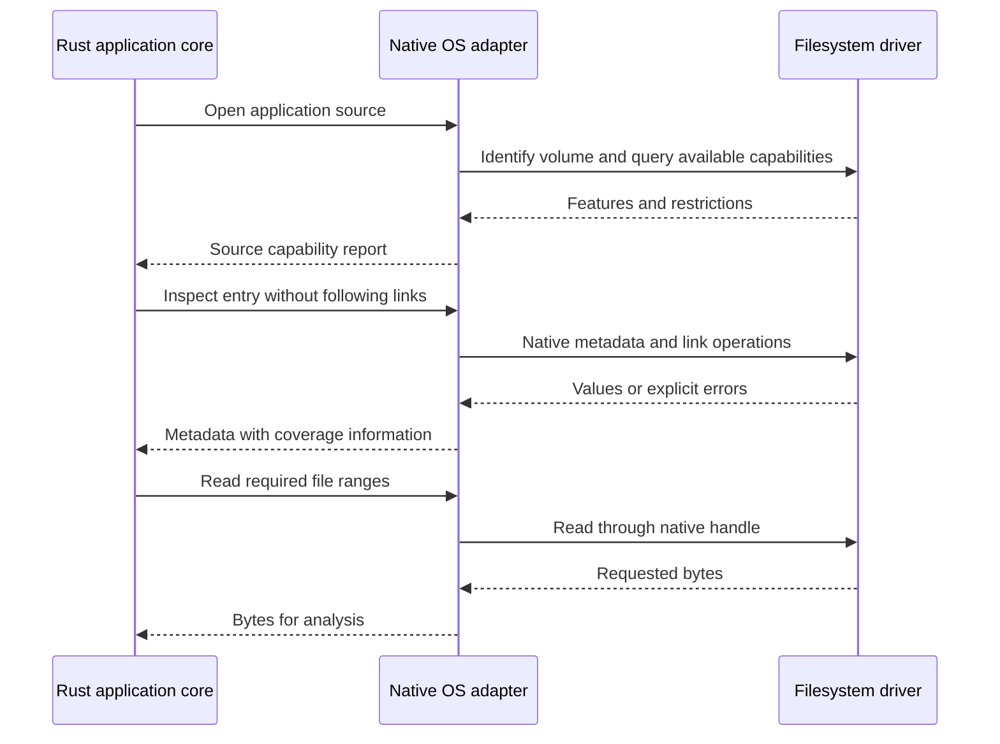
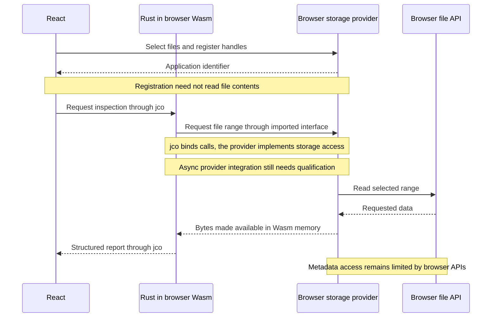
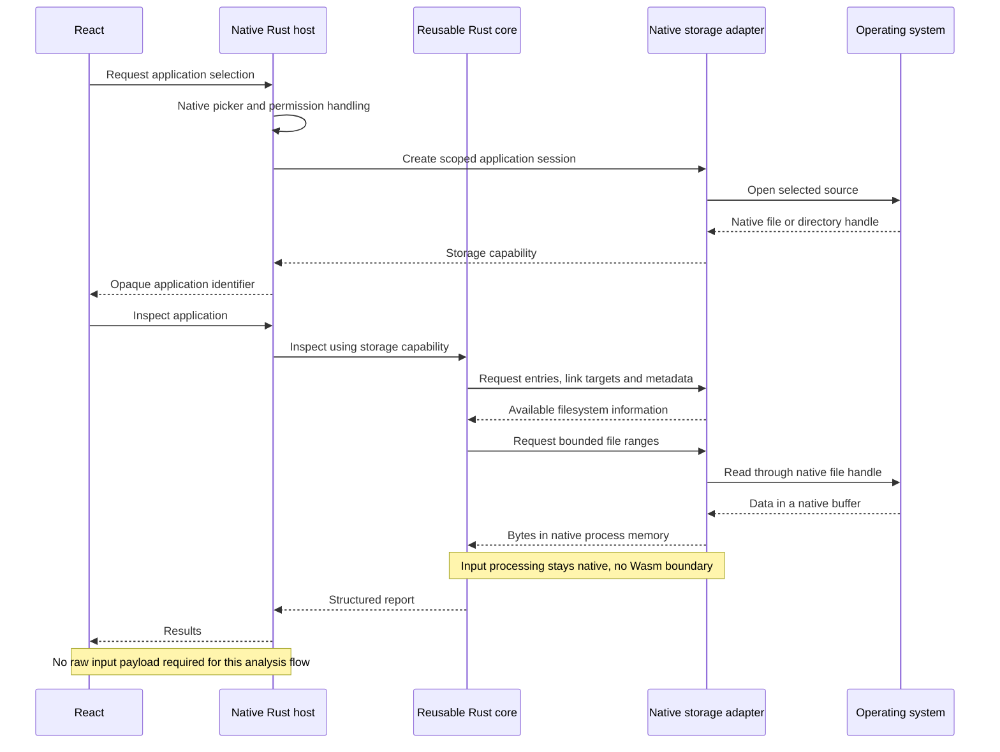
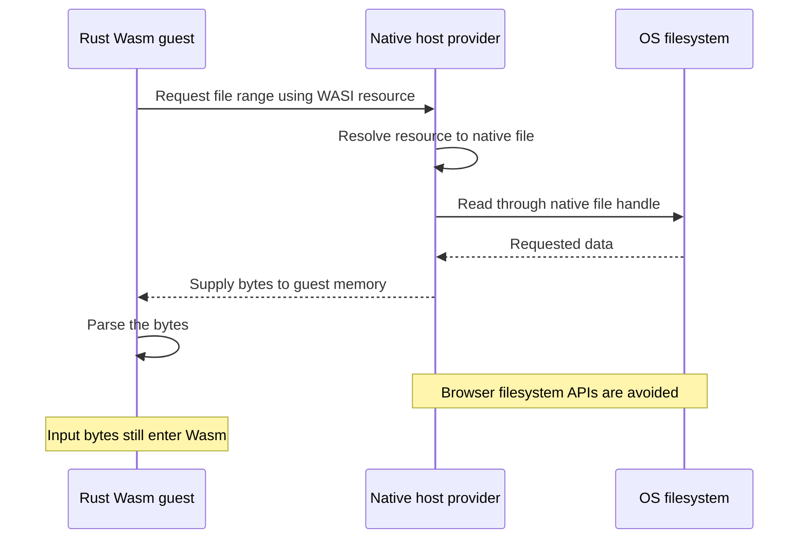

# Filesystem access and backend comparison

**The application uses native Rust selection and bounded reads with a Rust analyzer
in browser Wasm.** Browser filesystem APIs and native-hosted analysis below are
technical alternatives. Broader application reconstruction remains a requirement,
not an implemented filesystem capability.

App Anatomy needs to acquire, inspect, transform and export application artifacts
while preserving their required structure and metadata.

## Why the application uses native input

### Range-based reads

A range read requests part of a file using an **offset** (where to start) and a
**length** (how many bytes to request).

**Example: header inspection of a 16 MiB Mach-O file**

This illustrative thin 64-bit Mach-O has a 32-byte header and a 256-byte
load-command region. The drawing is not to scale.

```text
┌────────────────────────────────────────┐
│ Mach-O header                          │ ← Read header fields
│ Bytes 0–31                             │
├────────────────────────────────────────┤
│ Load commands                          │ ← Read required command fields
│ Bytes 32–287                           │
├────────────────────────────────────────┤
│ Code, data and remaining payloads      │
│ Bytes 288–end                          │   Outside this example's reads
└────────────────────────────────────────┘
```

1. **Read the header.** Rust determines the format, command count and declared
   size of the load-command region.
2. **Inspect load commands.** Rust requests the fields needed for platform and
   signature-location information.
3. **Skip unneeded payloads.** Finding a signature's location does not require
   reading or verifying its contents.

For example, `offset = 32, length = 8` requests the eight-byte header of the first
load command: its command type and size. Rust uses those fields to determine
which command fields to read and where the next command starts. Each marked
region may involve several small requests; the drawing does not imply one read
per region or reproduce an exact execution trace.

Range reads avoid mandatory whole-file loading. An operation such as hashing may
still need to read the entire file in bounded chunks.

### Filesystem capabilities

**Both native and browser filesystem APIs support range reads.** The application
uses the native service; a browser-backed provider could also serve the analyzer's
requested ranges. The access API determines which filesystem operations and
metadata are available to our code.

Native Rust owns selection, handles and reads. This keeps filesystem behavior
reusable through ordinary Rust APIs and permits OS-specific operations as they
are needed. The analyzer controls ranges and interprets bytes inside Wasm for the
web application; direct native Rust callers can use the same analyzer without a
service or Wasm runtime. The
[architecture decision](../architecture/wasm-analysis-with-native-filesystem.md)
owns that division.

| Concern               | Browser filesystem input              | Native Rust input                            |
| --------------------- | ------------------------------------- | -------------------------------------------- |
| Selection             | Browser handles and permission model  | Native dialog or supplied native path        |
| Read access           | Requested ranges through browser APIs | Requested ranges through retained OS handles |
| Filesystem facts      | Browser-exposed attributes            | Applicable native APIs and permission checks |
| Rust analyzer in Wasm | Requested bytes enter guest memory    | Requested bytes enter guest memory           |
| Deployment            | Browser storage access                | Native service installation and connection   |

The browser also uses operating-system I/O, but application code can access only
what its browser filesystem API exposes. Reading smaller ranges does not add
link, mode, xattr or volume-query operations to that API. Native Rust adapters
can use applicable OS-specific facilities, subject to filesystem support and
permissions. The [capability comparison](#browser-access-and-native-access)
details those differences.

Acquisition fidelity and Rust reuse motivate the native path. No representative
benchmark has established that browser range reads are too slow. Both approaches
must qualify the source, destination, permissions and individual operations;
neither can recover metadata lost during an earlier copy or export.

The implemented native path provides bounded file reads and limited directory
navigation through one persistent native selection. The native owner survives
inspection and frontend disposal until successful replacement or
owner/service shutdown. Its observed state is not an immutable snapshot of bytes.
Listed symlink entries are not eligible for opening, but path checks
are not an atomic confinement boundary. It does not yet preserve complete
application trees, xattrs, ACLs, resource forks or APFS-specific metadata. Native
access creates the opportunity to implement those operations; it does not prove
they exist or succeed on every volume. Browser capabilities must not limit the
ordinary Rust core's model.

## Where each subject belongs

This overview owns the capability comparison and execution alternatives.
Detailed requirements and evidence remain in their existing documents:

- [Filesystem requirements](requirements.md): acquisition fidelity, I/O behavior,
  protected originals, export, optional mount checks and acceptance evidence.
- [Native filesystem library evaluation](native-filesystem-library-evaluation.md):
  directory capabilities, bounded reads, native metadata, incremental parser input
  and candidate-specific qualifications and experiments.
- [Browser filesystem and Wasm boundaries](browser-filesystem-and-wasm-boundaries.md):
  file references, input copies, synthetic qualification and proposed browser range reads.
- [WASI evolution and host boundaries](wasi-evolution-and-host-boundaries.md):
  preview versions, resource semantics, provider compatibility and native reuse.
- [FSKit native-mount evaluation](fskit-native-mount.md): one optional macOS
  presentation adapter, its dependencies and proposed qualification.

The [system overview](../architecture/system-overview.md) describes implemented
header analysis. The [portability contract](../portability/requirements.md) covers
the complete transformation and every tool or host dependency. The
[library study](../libraries/selection-and-reuse.md#reuse-input-format-and-traversal-libraries)
owns candidate discovery and reuse; the
[relocation design](../rebuilding/application-relocation-and-signing.md)
owns application relationships. Their detailed content stays there.

## Browser access and native access

The native column below assumes a suitable platform adapter. It is not a claim
that every operation exists in portable `std::fs` or succeeds on every volume.

| Operation                          | Browser file APIs         | Native adapter                          |
| ---------------------------------- | ------------------------- | --------------------------------------- |
| Read file ranges                   | Available                 | Available                               |
| Inspect link and target text       | No general link interface | Link-aware OS operations                |
| Read modes and ownership           | No general interface      | Platform metadata and security APIs     |
| Read xattrs, ACLs or named streams | No complete interface     | Applicable platform-specific operations |
| Use native descriptors             | Browser handles only      | OS file descriptors or handles          |
| Query source capabilities          | Limited exposed model     | Volume, mount and filesystem queries    |

A restriction blocks an operation that requires the missing capability; it does
not invalidate every browser-based inspection workflow. The evidence below
separates API restrictions from capabilities that still need qualification.
Rust documents its cross-platform baseline and additional platform extension
traits separately. [Rust filesystem module](https://doc.rust-lang.org/std/fs/).

### What a browser import captures and leaves unknown

Selecting or reading an application does not inherently alter its source. The
information at risk is missing from the acquired representation or a later export,
even though it can remain present in the original application.

Complete, unchanged file bytes retain the structures stored inside them, including
Mach-O load commands, `LC_RPATH`, dependency names and embedded signing data.
The [Mach-O example](#mach-o-information-and-dependency-context) distinguishes
those binary facts from the filesystem context needed to resolve dependencies.

Readable bytes do not establish a complete application import. The
[link and metadata evidence](#links-and-native-metadata) explains the acquisition
gaps. Native file identifiers and volume capabilities also remain outside the
standard browser handle interface.
[Browser filesystem interfaces](https://fs.spec.whatwg.org/#idl-index).

These limits also apply when the selected folder resides on APFS. The browser
interface does not expose APFS internals just because APFS backs the selected
files. The [source-representation comparison](#filesystem-type-driver-and-source-representation)
covers mounted folders, filesystem images, archives and sidecars separately.

Importing the acquired representation into
[OPFS](browser-filesystem-and-wasm-boundaries.md#opfs-as-a-separate-storage-alternative)
cannot recover omitted metadata or link relationships.

An unsupported query must not become a claim that the source has no attribute.
Preserve the [capability-report distinctions](#discover-capabilities-before-claiming-complete-acquisition).
Successful reads or matching file-byte hashes alone do not establish faithful
reconstruction; apply the [export requirements](requirements.md#writable-output-and-export).

### Links and native metadata

The discussion explicitly prioritized framework symbolic links, file modes,
extended attributes and unchanged bytes. Browser file and directory handles lack
general `lstat`, `readlink`, symlink-creation, mode, ownership, ACL and xattr APIs.
The exposed interface therefore cannot establish complete native metadata fidelity.
[Browser filesystem interfaces](https://fs.spec.whatwg.org/#idl-index).

For example, a framework can contain:

```text
Example.framework/Versions/Current -> A
Example.framework/Example -> Versions/Current/Example
```

Reading the executable reached through this chain does not preserve the chain.
The acquisition process must identify links and their target text independently
of reading targets. A Rust virtual filesystem cannot infer the original links or
metadata from ordinary file contents after acquisition has omitted them.
Apple documents this framework layout in its
[framework anatomy guide](https://developer.apple.com/library/archive/documentation/MacOSX/Conceptual/BPFrameworks/Concepts/FrameworkAnatomy.html).

Hardlink relationships, exact names, case and Unicode behavior also need evidence.
Browser handles support entry comparison, but this does not by itself qualify a
complete hardlink inventory or faithful reconstruction on another filesystem.

### Executable output and metadata restoration

The File System Access specification explicitly provides no operation to mark a
file executable. It notes that an already executable file may remain executable
after modification. It also allows browser security marking and checks on writes.
[Executable-file restrictions](https://wicg.github.io/file-system-access/#malware).

Consequently, writing correctly rebuilt Mach-O bytes into a newly created
`Contents/MacOS/Example` does not establish executable permissions. Modifying an
existing executable, exporting a new application tree and producing an archive
for later extraction are separate cases.

Reading source ownership, ACLs, modes or xattrs and restoring them are different
operations. Recording a value does not establish permission or destination support
to apply it. Keep observed metadata distinct from the output filesystem's ability
to store or enforce it, and report restoration gaps explicitly. A suitable archive
may preserve records for a capable extractor; browser export alone does not
establish the final installed tree. Apply the shared
[export requirements](requirements.md#writable-output-and-export) to that final step.

## Portable Rust and specialized OS adapters

`std::fs` provides file access, enumeration and basic metadata. Its
`symlink_metadata()` inspects the link itself, while `read_link()` returns its
target. It is the common native foundation; complete ACL, xattr and other native
metadata handling needs additional platform APIs or libraries.
[Link inspection](https://doc.rust-lang.org/std/fs/fn.symlink_metadata.html),
[link targets](https://doc.rust-lang.org/std/fs/fn.read_link.html).

Unix extension traits expose mode bits, UID/GID, device/inode identity, hardlink
counts, timestamps and allocation information. Native descriptor/handle access
can support further OS operations. Preserve native names without requiring every
path to become a UTF-8 string: Unix names can retain bytes and Windows names can
retain their UTF-16 representation.
[Unix metadata](https://doc.rust-lang.org/std/os/unix/fs/trait.MetadataExt.html),
[Unix descriptors](https://doc.rust-lang.org/std/os/fd/trait.AsFd.html),
[Windows handles](https://doc.rust-lang.org/std/os/windows/io/trait.AsHandle.html),
[Unix names](https://doc.rust-lang.org/std/os/unix/ffi/trait.OsStrExt.html),
[Windows names](https://doc.rust-lang.org/std/os/windows/ffi/trait.OsStrExt.html).

The reviewed stable Windows metadata extensions expose attributes, times and
size. Their file-index, volume-serial and hardlink-count methods are marked
experimental, so a stable implementation must not assume those methods are
available unchanged. Suitable Windows API bindings can supply additional queries.
[Windows metadata extensions](https://doc.rust-lang.org/std/os/windows/fs/trait.MetadataExt.html).

Examples of OS-specific adapter work are:

| Adapter        | Additional information or operations                          |
| -------------- | ------------------------------------------------------------- |
| macOS / Darwin | Extended attributes, resource forks, richer volume attributes |
| Windows        | Security descriptors, reparse data, named streams, file IDs   |
| Linux          | Extended file status, xattr namespaces, mount information     |

On macOS, `fgetxattr` reads attributes through an open descriptor; `getxattr` with
`XATTR_NOFOLLOW` inspects symlink attributes without following the link.
`getattrlist` queries richer file and volume metadata.
[Apple xattr API](https://developer.apple.com/library/archive/documentation/System/Conceptual/ManPages_iPhoneOS/man2/getxattr.2.html),
[attribute queries](https://developer.apple.com/library/archive/documentation/System/Conceptual/ManPages_iPhoneOS/man2/getattrlist.2.html).

Windows security APIs retrieve owner and ACL information. NTFS stream APIs expose
data beyond the default stream; volume queries describe supported features.
[Security descriptors](https://learn.microsoft.com/en-us/windows/win32/api/aclapi/nf-aclapi-getnamedsecurityinfow),
[file streams](https://learn.microsoft.com/en-us/windows/win32/fileio/file-streams),
[volume capabilities](https://learn.microsoft.com/en-us/windows/win32/api/fileapi/nf-fileapi-getvolumeinformationw).

Linux `statx` reports extended metadata and masks identifying which information
was returned. Xattr enumeration is a separate operation whose result depends on
the filesystem and access rights.
[Extended status](https://man7.org/linux/man-pages/man2/statx.2.html),
[xattr enumeration](https://man7.org/linux/man-pages/man2/listxattr.2.html).

These examples identify reusable API capabilities, not adopted crates or completed
adapters. Calls can use Rust libraries or bindings; a native API does not itself
require a shell command. Every implementation still follows the
[tool and host dependency inventory](../portability/tool-and-host-dependencies.md).

## Filesystem type, driver and source representation

An OS-specific adapter must account for the actual volume, driver, mount options
and access rights. It must not choose a fixed capability set solely from the host
OS or filesystem name. Query available information and retain per-operation errors;
a supported feature does not guarantee access to every entry.

For example, the same Windows program encounters different capabilities on NTFS
and exFAT. Microsoft lists hardlinks, symbolic links, alternate data streams and
ACLs for NTFS but not exFAT. Native execution cannot supply features absent from
the selected filesystem. [Filesystem comparison](https://learn.microsoft.com/en-us/windows/win32/fileio/filesystem-functionality-comparison).

For a **mounted directory**, use the native OS adapter and applicable capability
extensions. The OS driver normally interprets APFS, NTFS, ext4 or another mounted
filesystem. Linux documents this separation through its virtual filesystem layer.
[Linux VFS](https://docs.kernel.org/filesystems/vfs.html).

For an **offline filesystem image**, opening the image with `std::fs::File` yields
its bytes. Interpreting its internal entries and metadata requires a qualified
filesystem-format reader or mounting implementation. Compression, encryption and
snapshots need explicit coverage when present. This is a different backend from
ordinary access to mounted files.

For an **archive or metadata sidecar**, the stored representation determines what
can be recovered. A selected directory and a metadata-preserving archive are
different input routes. The archive or sidecar can supply information absent from
browser handles, provided its producer recorded it. Its format, producer, Rust
reader and eventual exporter must demonstrate the required coverage. Neither
wrapping an incomplete folder import in an archive nor switching to a native
reader can restore metadata lost during an earlier acquisition, copy or export.
The [acceptance contract](requirements.md) applies to each representation.

Executable format and storage format are independent. A Mach-O file stored on
NTFS still needs Mach-O interpretation, while its storage access follows the
actual OS/filesystem backend. Reusing a binary parser does not supply an APFS or
NTFS image reader.

### Mach-O information and dependency context

The discussion about `rpath` raised a concern that native macOS access might expose
binary facts unavailable to a browser parser. Stored load commands, dependency
names, segments, symbols and embedded signing structures are in the input bytes.
Reading them does not inherently require macOS. Compatibility of each selected
parser with Wasm is a separate library question.
[Apple's Mach-O definitions](https://github.com/apple-oss-distributions/xnu/blob/main/EXTERNAL_HEADERS/mach-o/loader.h).

Consider this limited example:

```text
Executable:  Demo.app/Contents/MacOS/Demo
LC_RPATH:    @executable_path/../Frameworks
Dependency:  @rpath/Helper.framework/Versions/A/Helper

Candidate:   Demo.app/Contents/Frameworks/Helper.framework/Versions/A/Helper
```

Rust can calculate that candidate from supplied context. Establishing its existence,
following framework links, finding external dependencies and observing loader
acceptance require additional evidence. Folder selection does not grant access to
every external dependency or capture the complete execution environment.
[Apple run-path behavior](https://developer.apple.com/library/archive/documentation/DeveloperTools/Conceptual/DynamicLibraries/100-Articles/RunpathDependentLibraries.html).

Use the existing [dependency-resolution design](../rebuilding/application-relocation-and-signing.md#dependency-resolution-context)
to represent those relationships. Report unavailable context explicitly instead
of claiming that the binary lacks information or that a candidate will load.

## Discover capabilities before claiming complete acquisition

The proposed source report should distinguish **attribute absent**, **operation
unsupported**, **permission denied** and **not inspected**. Preserve values and
their provenance without forcing Unix modes, Windows security descriptors and
other platform records into a falsely equivalent representation. Storing a
platform record does not establish that another host can enforce it.



Native handles help maintain identity, but native access alone does not establish
an immutable application snapshot. Concurrent changes, link traversal and output
publication still require the shared
[consistency checks](requirements.md#consistent-access-and-protected-originals).
[Rust filesystem race guidance](https://doc.rust-lang.org/std/fs/#time-of-check-to-time-of-use-toctou).

## Guest interfaces and metadata fidelity

The reviewed WASI filesystem 0.2.0 interface (Preview 2) provides links, file types,
timestamps and identity-related operations, but its ordinary metadata records do
not carry the full native modes, ownership, ACL and xattr model. Paths are Unicode
strings. Its link operations restrict absolute/rooted targets, including reading
their target text. These constraints matter even with a native host provider.
[WASI filesystem 0.2.0 contract](https://raw.githubusercontent.com/WebAssembly/wasi-filesystem/v0.2.0/wit/types.wit).

For preservation, recording an external link's exact target is different from
allowing traversal through it. Ordinary Rust storage abstractions and additional
metadata interfaces can retain information outside the standard WASI contract;
WASI need not be the sole artifact representation. A richer interface still needs
an acquisition source capable of supplying those values.

The [WASI study](wasi-evolution-and-host-boundaries.md) separates these interface
contracts from preview evolution and versioned provider findings. The absence of
an operation in one shim is not a limitation of every provider or of native Rust.

## Execution models and communication

Storage capability and execution location are separate decisions. The native
adapter discussion above does not imply that a Wasm guest can use every native
operation without an appropriate host interface. The
[WASI study](wasi-evolution-and-host-boundaries.md) explains the host boundary;
[metadata fidelity](#guest-interfaces-and-metadata-fidelity) remains a separate
qualification even with a native provider.

The architectural alternatives discussed have different boundaries:

| Analysis location              | Backing file access                    | Input bytes enter Wasm |
| ------------------------------ | -------------------------------------- | ---------------------- |
| Rust in browser Wasm           | Native Rust service (application)      | Yes, when read         |
| Rust in browser Wasm           | Browser storage provider (alternative) | Yes, when read         |
| Rust in native-hosted Wasmtime | Native host provider                   | Yes, when read         |
| Ordinary native Rust library   | Native Rust storage layer              | Not required           |

Native Wasmtime can remove JavaScript from file transport, but reads still deliver
bytes into guest memory. Ordinary native analysis can keep input bytes outside
Wasm and exchange only commands and reports with its UI; that is a
different frontend execution arrangement. Neither alternative is required for
ordinary in-process Rust library use.

A file read placing data into process memory is different from an additional
buffer copy. Any zero-copy claim must identify the boundary and provide
measurements; a handle or virtual mount alone is insufficient.

### Browser range-read proposal

This proposed experiment would combine browser-managed selection with repeated
range reads requested by the Rust analyzer. That complete workflow has not been
implemented or qualified end to end in the application. The current iteration
keeps one native input workflow to limit implementation and maintenance effort;
browser-backed range access may be revisited in a separately scoped experiment.



Rust can own access decisions and caching. The provider still acquires input
through browser APIs, and guest processing still needs the bytes. The specific
copy observed in `wasi-fs-access` remains documented in the
[byte-boundary evidence](browser-filesystem-and-wasm-boundaries.md#proposed-descriptor-backed-range-reads).

### Native acquisition and native analysis proposal

The bridge below is conceptual. No transport, installer or host framework is
selected. Selection uses a native picker and access flow; a browser file handle
does not automatically become a native path or descriptor.



This describes the analysis path. Future byte previews or output downloads would
need their own explicit transport decisions. Application composition determines
runtime and presentation lifetimes; those choices do not constrain this native
analysis path.

### Native Wasmtime proposal



The host must explicitly expose any required services beyond its WASI contract.
Supplying native I/O to a guest does not make every filesystem or OS operation
available to that guest automatically.
[Wasmtime preopened directories](https://docs.wasmtime.dev/api/wasmtime_wasi/struct.WasiCtxBuilder.html#method.preopened_dir).

## Optional native presentation and verification

Reading an existing native filesystem and publishing a new native mount are
different capabilities.

An application path inside a browser virtual filesystem is not a mount visible to
Finder, native tools or the operating-system loader. The FSKit discussion concerned
the latter capability and requires native integration. Mounting through FSKit does
not then give browser Wasm native access to the mounted files. Its architecture,
source versions, native tools, deployment and qualification limits remain in the
[FSKit study](fskit-native-mount.md).

The same host boundary applies to directly invoking macOS Security.framework or
launching the artifact through the native loader. Portable parsing and signature
verification remain distinct from macOS policy assessment and observed loading.
For example, Apple's native validation API is
[`SecStaticCodeCheckValidity`](https://github.com/apple-oss-distributions/Security/blob/main/OSX/libsecurity_codesigning/lib/SecStaticCode.h).

Native signature checks, executable/library loading and application behavior must
remain separate results. A successful directory listing proves none of them.
These checks can supply optional independent evidence without becoming dependencies
of portable transformation. A native helper or runtime does not automatically
qualify its metadata preservation, mount behavior or loading results either.

## Architectural consequences and open decisions

Keep interpretation, artifact relationships and transformation in ordinary reusable
Rust. Isolate backing-storage access, component bindings and native services behind
their respective adapters. Required information must remain representable even
when one adapter cannot supply it. Follow the existing
[core separation](../architecture/system-overview.md).

The selected application path keeps analysis in Wasm and permits requested input
bytes to enter its memory. Alternative input paths must qualify their admitted
inputs and metadata coverage before adoption.

The directly started native service supplies the implemented connection. Wider
platform/permission support, packaging and installation remain separate work;
neither Wasmtime, FSKit nor a UI framework supplies all of them automatically.

Performance, source consistency, complete-bundle publication, interrupted writes,
browser coverage and final export fidelity remain unqualified. In particular, a
set of individually successful file reads or writes does not establish a stable
application snapshot or an atomic bundle transaction. These are reasons to apply
the existing acceptance checks, not measured failures of every browser route.

Record future evidence through the existing
[complete-workflow experiments](../portability/complete-workflow-experiments.md).
Preserve the distinction between a source-established interface limit, a failed
experiment, an unsupported case and a check that has not run.
