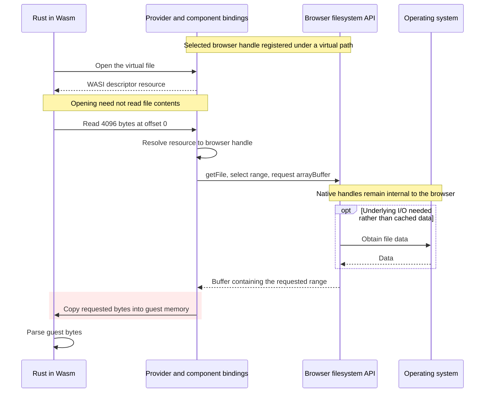

# Browser filesystem access and Wasm memory boundaries

**Technical comparison and qualification evidence.** This document examines
browser file references and Wasm memory boundaries. The filesystem overview owns
the [native-input decision](README.md#why-the-application-uses-native-input) and
[browser range-read proposal](README.md#browser-range-read-proposal).

## Problem and scope

What identifies the file, who performs the read, where do the bytes arrive, and
which operations copy them? This document follows whole-file input and a proposed descriptor-backed browser
provider through those boundaries, alongside recorded synthetic component evidence.

The [filesystem overview](README.md) owns acquisition and reconstruction fidelity,
native capabilities and cross-backend communication. The
[WASI study](wasi-evolution-and-host-boundaries.md) owns preview versions, resource
semantics and provider compatibility. The [filesystem requirements](requirements.md)
and [portability requirements](../portability/requirements.md) remain the shared
contracts.

## Acquisition and byte-transfer requirements

Avoiding whole-file allocation, avoiding browser filesystem acquisition and keeping
all input bytes outside Wasm are three different requirements. Range reads can
satisfy the first while failing either of the others. Keeping React free of
parsing also does not establish any of them.

The application uses native Rust acquisition and accepts bounded ranges in Wasm
so the analyzer executes there. Completely prohibiting input bytes in Wasm would
require analysis outside that guest. A file resource or borrowed handle cannot
resolve that conflict. The [architecture decision](../architecture/wasm-analysis-with-native-filesystem.md)
and [Rust I/O requirements](requirements.md#rust-controls-application-io) define the
selected boundary; the alternatives below explain its costs.

## Whole-file component input

A whole-file route starts with a browser `File`: `arrayBuffer()` materializes it,
a worker transfer passes ownership of that buffer, and a `Uint8Array` view is
lowered into a component `list<u8>`. Rust receives an owned vector and may borrow
it during analysis. A sample acquired through `fetch → response.arrayBuffer() →
new File(...)` adds acquisition work before this sequence. A reviewed prototype
limited this path to 64 MiB; that is not a browser or binary-format requirement.

```mermaid
sequenceDiagram
    participant B as Browser File API
    participant U as Frontend session
    participant W as Worker
    participant J as Generated jco binding
    participant R as Rust in Wasm

    U->>B: file.arrayBuffer()
    B-->>U: Whole-file ArrayBuffer
    U->>W: postMessage with buffer in transfer list
    Note over U,W: Ownership transferred; sender buffer detached
    W->>J: inspect with Uint8Array view
    J->>R: Allocate guest input memory
    R-->>J: Guest pointer
    rect rgb(255, 235, 235)
        J->>R: Copy input into guest memory
    end
    J->>R: Invoke inspect with guest pointer and length
    R->>R: Core borrows the guest bytes
    R-->>J: Analysis result
    J-->>W: Decoded report
    W-->>U: Report for visualization
```

The reviewed whole-file prototype used these generated jco operations on the
typed-array input branch:

```js
var ptr0 = realloc0(0, 0, 1, len0 * 1);
// valData0 is a view of the worker's input buffer.
const out0 = new Uint8Array(memory0.buffer, ptr0, valLenBytes0);
out0.set(valData0);
```

This illustrates an observed generated lowering path, not a fixed implementation
contract for every jco version or the current native-session API.

## Allocation, transfer, view, copy and borrow

| Operation                            | Effect on input bytes                                     |
| ------------------------------------ | --------------------------------------------------------- |
| `file.arrayBuffer()`                 | Materializes the complete file in a host buffer           |
| Worker transfer list                 | Transfers buffer ownership; avoids a message payload copy |
| `new Uint8Array(buffer)`             | Creates a view over existing bytes                        |
| Guest `realloc0(...)`                | Allocates space for input in Wasm memory                  |
| `out0.set(valData0)`                 | Copies the input into that guest allocation               |
| `binary_inspection::inspect(&bytes)` | Borrows guest bytes; does not clone the whole input       |

The worker transfer does not place the bytes in Wasm memory. Creating a typed-array
view also does not move them. The explicit copy happens in the generated binding.
[Transfer semantics](https://html.spec.whatwg.org/multipage/structured-data.html#transferable-objects),
[Blob buffer acquisition](https://www.w3.org/TR/FileAPI/#blob-arraybuffer).

These observations do not establish the browser's internal buffer count, the
number of disk reads, or peak resident memory. Caches, allocation lifetimes and
runtime internals require measurement. Making input available to a Wasm parser
and adding an extra intermediate-buffer copy are separate questions.

## File references and the operations behind them

| Reference                                 | Where operations are resolved        |
| ----------------------------------------- | ------------------------------------ |
| Browser `FileSystemFileHandle`            | Browser API and its permission model |
| WASI Preview 1 descriptor number          | Provider's guest descriptor mapping  |
| WASI Preview 2 or 3 `descriptor` resource | Component host/provider              |
| Native OS descriptor or handle            | Native operating-system interface    |

A `FileSystemFileHandle` is a browser-managed capability, not an exposed POSIX file
descriptor. A WASI descriptor backed by that handle does not grant native system
calls or native file-backed `mmap`. A virtual path does not change those rights.
The browser controls any underlying native handles; their identity and lifetime
are not a public one-to-one mapping from the browser handle.
[Browser handle API](https://fs.spec.whatwg.org/#api-filesystemfilehandle).
The [WASI resource explanation](wasi-evolution-and-host-boundaries.md#a-resource-is-not-a-native-file-descriptor)
covers typed handles, ownership and native-host mappings.

Rust can decide when to open and read files while the browser supplies backing
access. Implementing the adapter through Rust web bindings instead of handwritten
JavaScript still uses the browser's capabilities. WASI supplies an interface;
jco supplies generated bindings. Neither independently supplies native filesystem
privileges. WebAssembly relies on the host capabilities made available to it.
[WebAssembly security model](https://webassembly.org/docs/security/),
[jco import integration](https://bytecodealliance.github.io/jco/transpiling.html).

## Proposed descriptor-backed range reads

Registering a selected file under a virtual path can initially transfer no file
contents. Once a conventional Rust/Wasm parser reads it, the requested bytes must
be made available in Wasm memory. Registration and analysis have different costs.

The following is one proposed browser provider using range buffers. It assumes
selection has supplied a browser file handle; it is not implemented by the current
component. The host needs a compatible mechanism for asynchronous browser calls.



`getFile()` returns a `File`; `slice()` selects a range; `arrayBuffer()`
materializes it. Those steps do not each imply a disk read. This drawing shows
an intermediate-buffer copy, not a mandatory copy count for every provider.

The reviewed `wasi-fs-access` implementation demonstrates the distinction:
`OpenFile.read()` uses `getFile()`, `slice()` and `arrayBuffer()`; its `fd_read`
binding copies the returned chunk into the guest buffer with `buf.set(chunk)`.
It avoids mandatory whole-file loading but still uses browser I/O and transfers
bytes into Wasm.
[File access implementation](https://github.com/GoogleChromeLabs/wasi-fs-access/blob/main/src/fileSystem.ts),
[WASI bindings](https://github.com/GoogleChromeLabs/wasi-fs-access/blob/main/src/bindings.ts).

That library supplies Preview 1 evidence, not an implementation of the resource
flow above. Its compatibility limits and Preview 3's async alternatives belong
to the [WASI study](wasi-evolution-and-host-boundaries.md#tool-support-and-provider-support-are-separate).
A synchronous imported call cannot simply receive an unresolved browser promise;
the chosen toolchain, bindings and provider must implement the required suspension
and resumption. Generating bindings alone does not establish that integration.

A virtual registration is also different from an
[OS-visible mount](README.md#optional-native-presentation-and-verification).
For native Rust and native Wasmtime, use the existing
[execution-model comparison](README.md#execution-models-and-communication).

## OPFS as a separate storage alternative

OPFS is separate browser-private storage. Its synchronous access handles are
available in dedicated workers and are restricted to that storage, not arbitrary
selected external files. Using them for an existing application requires importing
the relevant content first.
[Synchronous access restrictions](https://fs.spec.whatwg.org/#api-filesystemfilehandle-createsyncaccesshandle).

An OPFS proposal must therefore account for acquisition, additional storage,
retention, metadata and export. It cannot be described as directly opening the
selected application through a native descriptor. The original performance
question also remains open: no representative App Anatomy benchmark has
established that browser I/O is too slow.

## Synthetic asynchronous resource qualification

The synthetic file-resource experiment isolated the ordinary Rust
`inspect_source` analyzer and jco/JSPI read boundary using fixtures. It did not
select real files through browser filesystem APIs or read requested ranges from
those files. Its results qualify the synthetic setup, not the proposed browser
input workflow, filesystem fidelity or current native transport. It used Node 24,
Rust `wasm32-unknown-unknown`, wasm-tools and pinned jco 1.30.0, with native report
comparison through the Rust parity example.
Its private `apple-code:filesystem-probe@0.2.0` contract reused the
`apple-code:analysis@0.2.0` report schema and core report conversion.

The owned adapter held a generated resource, captured length and original provider
error without named lifetimes or shared ownership containers. One exported
`own<file>` operation consumed one resource; subsequent inspections used fresh
resources and budgets. Length was read once outside the range-call budget and
did not establish a snapshot. Short reads advanced the offset; premature empty
progress produced `unexpected-eof`. An overlong response produced
`invalid-read-count`; the adversarial test exceeded the requested length by one
byte. Providers must bound responses before ABI lowering, not rely on guest checks
after allocation. Errors preserved diagnostics, offsets, limit usage and provider
codes without interpreting those codes through the guest OS error table.

JSPI suspended metadata and range calls while another host task ran. Async
instantiation only initialized the component; runtime suspension used explicit
JSPI import/export selectors, not a core Rust executor or WASI Preview 3. Generated
jco 1.30.0 declarations still described synchronous results despite that runtime
behavior. Without `WebAssembly.Suspending` and `WebAssembly.promising`, the harness
reported unsupported rather than pass.

| Recorded run                           | Evidence                                                                                                                                                                                                                                                         |
| -------------------------------------- | ---------------------------------------------------------------------------------------------------------------------------------------------------------------------------------------------------------------------------------------------------------------- |
| Transport probe 0.1.0, 2026-09-22      | Four scenarios passed in Node 24.15.0 and in-app Chromium 153.0.0.0. Four-byte reads at offsets 0 and 9,007,199,254,740,993 produced checksum 36; short replies were rejected.                                                                                   |
| Analyzer integration 0.2.0, 2026-09-22 | All 24 Node tests and 22 in-app Chromium scenarios passed. Thin/universal reports matched the native analyzer; repeated inspections used fresh resources and budgets.                                                                                            |
| Sparse and large-offset fixtures       | An 8 GiB logical input required five reads totaling 68 bytes. A universal64 member retained exact offset 9,007,199,254,740,993. Fixtures allocated supplied regions only.                                                                                        |
| Failure and ownership checks           | Metadata/read cancellation and I/O details, malformed input and read/cache budgets remained distinct. Every completed scenario observed exactly one disposal and none while its call was pending. The Wasm example build and Clippy with warnings denied passed. |

Generated bindings allocated/copied each returned `list<u8>` into guest memory;
the adapter copied that range into the reader's cache buffer, and parsed records
were copied by value. Read/cache budgets bounded requests and retained payload,
not provider allocation before lowering, JavaScript memory, reports or allocator
overhead. These results do not establish zero-copy access or total runtime memory
bounds.

Cancellation meant cooperative provider rejection. A harness deadline requested
cancellation but could not interrupt synchronous Wasm CPU work blocking the event
loop. jco's disposal callback was synchronous. The checks do not establish cleanup
after traps or worker termination, asynchronous native-handle closure, reentrancy,
source-change detection, native permissions/metadata, transport/installation
support, or compatibility with other browsers. Native and browser results are
separate qualification evidence.

## What still requires measurement

Whole-file loading and the prototype's 64 MiB limit are implementation choices,
not browser requirements. Range access and streams are available, but still use
browser acquisition and supply requested bytes to the Wasm parser. Reused parsers
must also be checked for full-input requirements; a storage adapter cannot remove an internal
whole-file allocation automatically.
[Browser range and stream access](https://developer.chrome.com/docs/capabilities/web-apis/file-system-access#read_a_file_from_the_file_system).

An input-path experiment should record requested and fetched byte counts,
allocations and copied bytes at each boundary, peak memory, elapsed read/parse
time and cleanup after cancellation or failure. Include any import into OPFS.
Compare whole-file and bounded routes using the same inputs; do not infer
performance from interface names or claim zero-copy behavior from a descriptor.

Bundle fidelity, source consistency and export remain subject to the
[shared acceptance requirements](requirements.md). The
[accepted architecture decision](../architecture/wasm-analysis-with-native-filesystem.md)
owns the selected design; the [overview](README.md#architectural-consequences-and-open-decisions)
compares execution alternatives.
