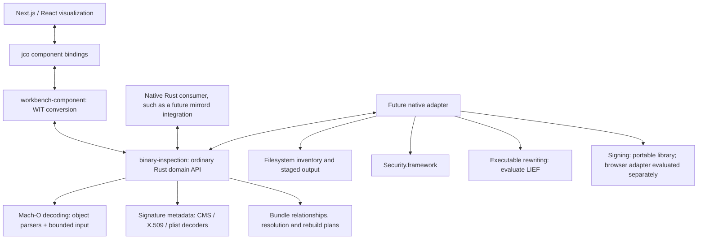

# Library alternatives and reuse for Apple code analysis

**Research snapshot: 2026-09-15. Current adoption: `object` header-analysis parsers; broader library roles proposed.**

This comparison records which existing libraries can replace substantial implementation
work in Code Workbench. Its purpose is to make reuse the starting point for each
capability, while preserving the application's ordinary Rust library, explicit
analysis contracts and React-only visualization boundary.

The current implementation is still the header-analysis milestone described in
[the repository README](../../README.md) and [Rust core design](../architecture/rust-analysis-core.md).
It does not yet traverse bundles, decode certificate chains, verify signatures or
rebuild applications. The core uses `object` 0.40.0 for format detection, thin and
universal headers, command iteration and payload decoding; see the
[implemented parser contract](../architecture/rust-analysis-core.md#parsing-dependencies).
Deeper `object` analysis and the other library roles below remain proposals based
on documentation and source review. Their integration and performance remain to
be qualified. Proposed APIs and examples describe that additional scope.

The separate [LIEF integration approach](lief-selective-builds-and-wasm.md) covers selective builds, Rust
bindings and Wasm delivery. This comparison keeps the comparison across libraries.
The [library composition design](../rebuilding/macho-layout-growth-and-signing.md)
explains where candidates can cover each other's gaps, using command-space growth
and the reconstruction-to-signing handoff as a complete worked example.

## Contents

- [Recommended direction](#recommended-direction)
- [Separate the questions being answered](#separate-the-questions-being-answered)
- [Foundation layers and ownership](#foundation-layers-and-ownership)
- [Mach-O parsing and extraction](#mach-o-parsing-and-extraction)
- [Signatures, entitlements and certificates](#signatures-entitlements-and-certificates)
- [Bundles, resources and archive inputs](#bundles-resources-and-archive-inputs)
- [Dependencies and relocation planning](#dependencies-and-relocation-planning)
- [Rebuilding and signing](#rebuilding-and-signing)
- [Optional deeper analysis](#optional-deeper-analysis)
- [Dependency selection and maintenance](#dependency-selection-and-maintenance)
- [Evaluation before adoption](#evaluation-before-adoption)
- [Implementation order and reuse rules](#implementation-order-and-reuse-rules)

## Recommended direction

Use the adopted **`object` Mach-O header and command parsers**, and evaluate its
additional readers when deeper analysis becomes a requirement. Keep bounded input,
evidence selection and report conversion in the application.
Use specialized CMS, X.509 and plist libraries for their respective data formats.
Keep filesystem access, native trust evaluation and signing execution in adapters.

**Complete-workflow portability is a primary selection requirement.** The
[shared requirements](../portability/requirements.md) apply to every selected
library and indirect tool dependency. For the signing stage, a production
signer must create signatures without Apple hardware, macOS, Xcode, Apple's
signing tools or a remote signing service. Native host support and browser/Wasm
support require separate evidence. Compare the
[source-screened signing options](#portable-signing-candidates), then admit only
the relevant scopes to the
[dedicated experiments](../signing/ad-hoc-experiments.md) before adoption.

Evaluate **LIEF as the leading native executable-rewriting candidate** alongside
that evaluation of additional readers. These answer different questions: whether
additional `object` readers can supply deeper analysis in the portable core, and whether
LIEF can perform the layout changes needed by a future native rebuild executor.
The separate [rebuilding and re-signing plan](../rebuilding/application-relocation-and-signing.md) starts
with the application-relocation problem. Its
[early LIEF experiment](lief-native-macho-rewriting-experiment.md) should test
rewriting before we invest in custom mutation code or finish the bundle UI.
Neither experiment requires replacing the entire Rust core or adopting multiple
production backends at once.

| Candidate                      | Proposed role                                                           | Status                                                                     |
| ------------------------------ | ----------------------------------------------------------------------- | -------------------------------------------------------------------------- |
| `object` 0.40.0                | Typed Mach-O, linkedit and signature structure decoding                 | Header/command parsers adopted; deeper analysis proposed                   |
| `goblin` 0.10.7                | Alternative Mach-O reader; convenient dependency fields                 | Comparison candidate; narrower relevant coverage                           |
| LIEF 1.0.0                     | Native executable rewriting, rich inspection and independent comparison | Leading native writer candidate; evaluate early, outside the portable core |
| `apple-codesign` 0.29.0        | Apple signature semantics, bundle signing and scoped integrity checks   | Native signer candidate; full crate blocked on Wasm as shipped             |
| RustCrypto `cms` + `x509-cert` | Typed CMS and certificate decoding                                      | Portable candidate; prove Apple encoding coverage                          |
| `cryptographic-message-syntax` | BER-aware CMS decoding and signature operations                         | Alternative CMS foundation; assess dependencies                            |
| `x509-parser`                  | Convenient certificate field inspection                                 | Alternative or focused supplement to `x509-cert`                           |
| `security-framework`           | macOS static code checks and native certificate trust evaluation        | Future macOS adapter only                                                  |

Capability evidence is expanded and linked in the relevant sections below.
These libraries occupy different layers: choosing `object` does not replace the
need for a CMS decoder, and choosing a certificate parser does not replace a
Mach-O reader.

Reuse should also apply to our own interfaces. Preserve owned domain reports and
the native/component boundary, and explicitly review diagnostic changes when
changing parsers. The current Rust API exposes selected `object` value types;
component serialization remains independent of those dependency types.

## Separate the questions being answered

Our UI must represent independent properties instead of compressing them into one
"application type." These are proposed reporting categories, not newly implemented
classifications.

| Aspect            | Evidence                                                                | Distinction                                                                         |
| ----------------- | ----------------------------------------------------------------------- | ----------------------------------------------------------------------------------- |
| Input source      | File, archive entry, directory inventory or native path                 | Transport does not identify executable format                                       |
| Container         | Thin Mach-O header, universal table, archive structure or bundle layout | Directory bundles and universal executables are different containers                |
| Architecture      | CPU type/subtype and each member's Mach-O header                        | One universal file can contain multiple architecture identities                     |
| Declared platform | Build/version commands and relevant bundle metadata                     | CPU alone cannot distinguish device, simulator, Catalyst or other platform contexts |
| File role         | Mach-O file type and bundle role                                        | Bundles may contain a main executable, frameworks, helpers and resources            |
| Signing evidence  | Signature commands, embedded blobs, CMS and resource seals              | Presence, metadata, integrity and trust are separate results                        |
| Execution/loading | Architecture, dependency resolution and native policy context           | Parsing successfully does not establish execution eligibility                       |

The raw formats provide separate header, CPU, platform and fat-entry fields.
Preserve that separation and unknown values in the domain model.
[Apple Mach-O declarations](https://github.com/apple-oss-distributions/xnu/blob/main/EXTERNAL_HEADERS/mach-o/loader.h),
[universal-container declarations](https://github.com/apple-oss-distributions/xnu/blob/main/EXTERNAL_HEADERS/mach-o/fat.h).

## Foundation layers and ownership

The architecture below is a proposal for growing the existing boundaries. Labels
describe responsibilities; they are not additional crates already present.



The core receives bytes and explicit context; it does not reach into the browser,
filesystem, keychain or network. A future native adapter can supply inventories
and additional evidence through ordinary Rust records. React renders reports and
plans. It must not become an alternative parser or policy engine.

| Aspect                       | Evaluate                                                             | Reuse                                                          | Workbench responsibility                                         |
| ---------------------------- | -------------------------------------------------------------------- | -------------------------------------------------------------- | ---------------------------------------------------------------- |
| Thin Mach-O decoding         | `object`; compare `goblin`                                           | Structures, endian-aware reads and load-command payload access | Scope, range checks, absolute report ranges and typed conversion |
| Universal members            | Adopted `object` fat readers                                         | Universal headers, architecture tables and member ranges       | Bounded input, coordinates and report conversion                 |
| Segments, symbols, dyld data | `object`; optional LIEF                                              | Established binary-format decoders                             | Bounded traversal, evidence selection and useful reports         |
| Signature structures         | `object`; native `apple-codesign`                                    | SuperBlob and CodeDirectory decoding                           | Version coverage, completeness and explicit verification states  |
| CMS and certificates         | RustCrypto stack or `cryptographic-message-syntax`;<br>`x509-parser` | ASN.1, signer and certificate decoding                         | Provenance, graph relationships and requested checks             |
| Property lists               | `plist`; separate Apple DER handling                                 | XML/binary plist parsing                                       | Interpret bundle fields and entitlements                         |
| Bundle discovery             | `apple-bundles`; native traversal utilities                          | Known layouts and filesystem enumeration                       | Stable artifact identities and resource relationships            |
| Archive input                | `zip` for applicable ZIP containers                                  | Archive parsing and decompression                              | Entry limits, provenance and incremental byte acquisition        |
| Dependency resolution        | Mach-O dependency commands                                           | Decode load names and rpaths once                              | Resolve against explicit execution and staging contexts          |
| Binary reconstruction        | LIEF; focused native writers                                         | Format-aware mutation and layout rebuilding                    | Select supported transformations; describe their effects         |
| Signing and resource seals   | `apple-codesign`; focused `libsui` use cases                         | Signature generation and established bundle signing            | Signing policy, operation order and post-operation reports       |
| Native trust                 | `security-framework`                                                 | macOS code and certificate evaluation APIs                     | Preserve evaluation context; avoid broader claims                |

## Mach-O parsing and extraction

### Why object is the parsing foundation

`object` provides both general object-file interfaces and Mach-O-specific readers.
The latter are particularly relevant because our application needs format details,
raw values and command-level evidence rather than only a common executable abstraction.

Its Mach-O module includes segments, symbols, relocations, dependency information,
dyld bind/rebase data, export tries, chained fixups, shared-cache readers and
signature parsing. Reusing these components could avoid writing multiple complex
linkedit decoders as the application grows.
[Mach-O API](https://docs.rs/object/latest/object/read/macho/index.html).

The implemented header analysis uses its low-level readers directly with borrowed
slices and cache range views. The [parser contract](../architecture/rust-analysis-core.md#parsing-dependencies)
owns the selected APIs, acceptance and first-error behavior.

| Feature                                  | `object` 0.40.0                                      | `goblin` 0.10.7                                                |
| ---------------------------------------- | ---------------------------------------------------- | -------------------------------------------------------------- |
| Thin 32/64-bit headers, both byte orders | Supported                                            | Supported                                                      |
| Big-endian fat32                         | Supported                                            | Supported                                                      |
| Big-endian fat64                         | Supported                                            | Unsupported by standard `Mach::parse` / `MultiArch`            |
| Swapped/little-endian fat containers     | Unsupported by fat reader                            | Unsupported by fat dispatcher/reader                           |
| Load commands and dependency names       | Typed commands; byte-oriented string access          | Typed commands; convenient `libs` / `rpaths` fields            |
| Chained fixup payloads                   | Dedicated readers                                    | Command recognized; no decoding in Mach import API             |
| Signature structures                     | SuperBlob, blob iteration and CodeDirectory decoding | Command location; no full blob decoder in reviewed Mach module |

The exact published sources reviewed were `object` commit
`400e64fbcb03fddb4b1ae8aef1868976ab999acc` and `goblin` commit
`0dbba0bd5f5cb0a2b89b8ed40174e3348dd99651`. These identify the examined releases
even when a documentation site changes its `latest` target.
[Object fat reader](https://github.com/gimli-rs/object/blob/400e64fbcb03fddb4b1ae8aef1868976ab999acc/src/read/macho/fat.rs),
[Goblin Mach reader](https://github.com/m4b/goblin/blob/0dbba0bd5f5cb0a2b89b8ed40174e3348dd99651/src/mach/mod.rs),
[Goblin fat definitions](https://github.com/m4b/goblin/blob/0dbba0bd5f5cb0a2b89b8ed40174e3348dd99651/src/mach/fat.rs).

**Fat32/fat64 describes the width of the container's offset and size fields.**
It does not describe whether its embedded executable is ARM64 or x86_64.

### What belongs in our reader boundary

The application retains generic bounded input, absolute
coordinates, typed failures and report conversion. Format detection and
decoding belong to the selected upstream parsers. The current
[parser contract](../architecture/rust-analysis-core.md#parsing-dependencies)
records their validation and read behavior, including the reason for using low-level
entrypoints instead of `MachOFile::parse`.

For future alternatives, compare acceptance and scope explicitly. A general file
parser may inspect sections or symbol tables beyond a header-only request.
Goblin's convenient
strings are UTF-8 `&str` values; its `libs` collection includes a self entry, so
copying it blindly would create a false dependency.

[Object file reader](https://github.com/gimli-rs/object/blob/400e64fbcb03fddb4b1ae8aef1868976ab999acc/src/read/macho/file.rs),
[object command reader](https://github.com/gimli-rs/object/blob/400e64fbcb03fddb4b1ae8aef1868976ab999acc/src/read/macho/load_command.rs),
[Goblin parsing behavior](https://github.com/m4b/goblin/blob/0dbba0bd5f5cb0a2b89b8ed40174e3348dd99651/src/mach/mod.rs).

The workspace pins the shared dependency with this feature configuration:

```toml
object = { version = "=0.40.0", default-features = false, features = ["read_core", "macho", "elf", "pe", "names"] }
```

The inspection and component crates inherit this configuration with
`object.workspace = true`. ELF and PE (`pe` includes `coff`) are available through
the ordinary Rust
[object-file identity API](../architecture/rust-analysis-core.md#object-file-identity).
The application component exposes the dedicated Mach-O report.

The inspected object and Goblin manifests support allocation-based parsing without
requiring `std` and specify Rust 1.85 / edition 2024. At this research snapshot,
the then-selected `object` subset had been built on macOS arm64 and for
`wasm32-unknown-unknown` through this project's component pipeline. That historical
evidence does not qualify additional parsers or deeper decoders,
Goblin or additional native platforms; those still require separate evaluation.
The `object` feature named `wasm` enables reading Wasm-format inputs; it is **not**
needed merely to compile the Mach-O reader to Wasm.
[Object manifest](https://github.com/gimli-rs/object/blob/400e64fbcb03fddb4b1ae8aef1868976ab999acc/Cargo.toml),
[Goblin manifest](https://github.com/m4b/goblin/blob/0dbba0bd5f5cb0a2b89b8ed40174e3348dd99651/Cargo.toml).

### Where LIEF is useful

LIEF's native API provides extensive image inspection and mutation: libraries,
rpaths, sections, symbols, bindings, fixups, build information, signature bytes
and reconstruction operations. It is a useful candidate for advanced native
capabilities and independent comparison with the portable implementation.
[Mach-O binary API](https://lief.re/doc/stable/rust/lief/macho/struct.Binary.html).

LIEF returns a `FatBinary` abstraction even for a thin input containing one image.
Our classification must therefore come from the original input, not the name of
the returned wrapper.
[Mach-O parsing model](https://lief.re/doc/stable/formats/macho/index.html).

The stable 1.0.0 parser reads 32-bit `fat_arch` records and has no fat64 dispatch
path in the inspected source. It also has a fixed maximum of 30 fat members and
can continue past failed member parsing. Its universal handling cannot directly
replace our format coverage or completeness contract.
[LIEF 1.0.0 parser source](https://github.com/lief-project/LIEF/blob/1.0.0/src/MachO/Parser.cpp).

The Rust interface wraps C++ through `cxx` and links native libraries; documented
precompiled targets include Intel and Apple Silicon macOS, but not Wasm.
A browser integration would require a separate port/build investigation. Keep it
out of the mandatory portable core dependency graph.
[Rust integration](https://lief.re/doc/stable/api/rust/index.html).

The [LIEF-specific approach](lief-selective-builds-and-wasm.md) records the existing Postject/Emscripten
precedent, the limits of that evidence, CMake format selection and the proposed
WASI/component evaluation. Its Rust bridge and footprint still need validation.

### Extraction is different from reconstruction

For an extraction feature, copy the original bytes in a validated member or
file-backed section range and retain their origin. Check byte-for-byte equality
with the input. Zero-fill sections have no original file payload to copy;
representing their virtual contents is a separate operation.

A parsed-image writer reconstructs an output according to its own layout rules.
Calling a write method is therefore not a substitute for byte-exact extraction.
LIEF explicitly describes its fat writer as reconstruction.
[FatBinary writer](https://lief.re/doc/stable/rust/lief/macho/struct.FatBinary.html).

Our extraction report should identify source artifact, original range, member
identity and output digest. It should not claim that a rebuilt file is an
unchanged original merely because its displayed metadata matches.

## Signatures, entitlements and certificates

### Model separate stages

The following is a proposed evidence pipeline. A stage should state its scope and
whether it was requested, completed, unsupported or failed; absence of a later
result must not be presented as success.

| Stage                          | Foundation                                              | Reportable result                                              |
| ------------------------------ | ------------------------------------------------------- | -------------------------------------------------------------- |
| Locate embedded data           | Mach-O reader                                           | Signature command and bounded payload range                    |
| Decode signature structures    | `object` or `apple-codesign`                            | CodeDirectories, blob types and raw payloads                   |
| Decode entitlements            | Appropriate plist/Apple DER decoder                     | Values in the entitlement blob                                 |
| Decode CMS                     | Selected CMS library                                    | Signer information, attributes and included certificates       |
| Decode certificates            | `x509-cert` or `x509-parser`                            | Subject, issuer, validity, public key and extensions           |
| Check content integrity        | Selected signature implementation and digest primitives | Covered bytes and stored hashes compared                       |
| Check cryptographic signatures | Appropriate algorithm implementation                    | Signature checked and key used                                 |
| Evaluate certificate trust     | Explicit trust evaluator; macOS adapter where requested | Result with recorded policy, anchors and evaluation conditions |
| Explain execution/loading      | Separate contextual analysis/native evidence            | Scoped findings; parsing alone cannot establish eligibility    |

### Reuse CodeDirectory and SuperBlob parsing

Format reference: [Apple code-signature storage and hashes](https://developer.apple.com/documentation/technotes/tn3126-inside-code-signing-hashes).

`object` 0.40.0 can extract identifiers, Team IDs, flags, stored code hashes and
several CodeDirectory version extensions. CMS and entitlement payloads remain
available for specialized decoding. This can avoid creating our own foundational
SuperBlob decoder.

Coverage is not unlimited: scatter-based code hashes are unsupported, typed
version extensions stop at its executable-segment extension, and complete
relationships between declared blob lengths still need validation. A stored hash
returned by the reader has not been recomputed. A parsed Team ID is an unverified
claim until the relevant integrity and identity checks have been performed.
[Signature-reader implementation](https://github.com/gimli-rs/object/blob/400e64fbcb03fddb4b1ae8aef1868976ab999acc/src/read/macho/codesign.rs).

LIEF's `CodeSignature::content()` gives us raw signature bytes. Its
`code_signature_dir()` accessor refers to `LC_DYLIB_CODE_SIGN_DRS`; it should not
be confused with parsing a CodeDirectory inside the embedded signature.
[Signature command API](https://lief.re/doc/stable/rust/lief/macho/commands/struct.CodeSignature.html),
[LIEF binary accessors](https://lief.re/doc/stable/rust/lief/macho/struct.Binary.html).

### Choose a CMS foundation before implementing ASN.1

| Candidate                                                | Reusable capability                                                                            | Evaluation question                                                          |
| -------------------------------------------------------- | ---------------------------------------------------------------------------------------------- | ---------------------------------------------------------------------------- |
| RustCrypto `cms` 0.2.3<br>+ compatible `x509-cert` 0.2.5 | Typed CMS `SignedData`, certificates and attributes; basic parsing without the signing builder | Does DER decoding cover the required Apple signature corpus?                 |
| `cryptographic-message-syntax` 0.28.0                    | BER-aware parsing, signer/certificate access and signature operations                          | Does the selected dependency graph work through our Wasm component pipeline? |
| `x509-parser` 0.18.1                                     | Detailed certificate inspection and raw DER access                                             | Does it add useful inspection beyond the CMS stack's certificate types?      |

RustCrypto `cms` is `no_std` with allocation support. It already uses
`x509-cert`; do not add a second certificate implementation by default.
The independently newer `x509-cert` 0.3.0 should not be assumed API-compatible
with the version selected by stable `cms` 0.2.3.
[CMS API](https://docs.rs/cms/0.2.3/cms/),
[CMS dependency manifest](https://docs.rs/crate/cms/0.2.3/source/Cargo.toml).

`x509-parser` is useful when its inspection helpers simplify our report conversion.
Its parsing features can be used without its optional `ring` or AWS-LC signature
verification. Its structural `validate` functionality is not cryptographic
verification.
[X.509 parser API and features](https://docs.rs/x509-parser/0.18.1/x509_parser/).

CMS decoding and the selected library's cryptographic operations do not establish
certificate trust by themselves. Treat content-signature checks and trust
evaluation as separate capabilities, including when a CMS library supplies both
parsing and verification helpers.
[BER-aware CMS verification scope](https://docs.rs/cryptographic-message-syntax/0.28.0/cryptographic_message_syntax/).

### Certificate visualization must preserve evidence

For a hypothetical signed application, the UI could display:

```text
Application executable
└── arm64 image
    └── Embedded signature
        ├── CodeDirectory: identifier, Team ID, flags, stored hashes
        ├── Entitlements: decoded values and source blob
        └── CMS
            ├── Signer information
            ├── Embedded certificates
            └── Candidate certificate relationships
```

Keep three concepts separate: certificates actually embedded in CMS, a candidate
chain assembled from available certificates, and a chain accepted by an evaluator.
The proposed graph should allow missing intermediates, multiple candidates and
separately supplied trust anchors. It must not manufacture an embedded root or
assert a verified relationship solely because issuer and subject names match.

React should receive the graph and evidence states from Rust. The tree is a
presentation of relationships; certificate order in an input collection should
not become the chain-building algorithm.

### Apple-specific integrity and native policy checks

`apple-codesign` provides embedded signature, requirements, entitlement and CMS
facilities, along with Mach-O and bundle signing. It is an established source of
Apple-specific behavior to reuse or compare against.
[Apple code-signing API](https://docs.rs/apple-codesign/0.29.0/apple_codesign/).

Its verification is scoped. The published implementation includes unfinished
checks involving complete certificate chains and external special-slot content;
it is not a replacement for every macOS policy decision.
[Verification implementation](https://docs.rs/crate/apple-codesign/0.29.0/source/src/verify.rs).

For native evaluation, `security-framework` 3.7.0 exposes `SecStaticCode` checks
and `SecTrust` evaluation. Record the selected policy, flags, anchors, evaluation
date and relevant environmental inputs with results.
[Static code API](https://docs.rs/security-framework/latest/security_framework/os/macos/code_signing/struct.SecStaticCode.html),
[trust API](https://docs.rs/security-framework/latest/security_framework/trust/struct.SecTrust.html).

A successful certificate check still does not answer every question about a
particular executable loading a particular framework. Our model must leave room
for separate process and library-validation context.

## Bundles, resources and archive inputs

### Reuse input-format and traversal libraries

| Foundation             | Reusable mechanisms                                                                             | Placement and limits                                                                      |
| ---------------------- | ----------------------------------------------------------------------------------------------- | ----------------------------------------------------------------------------------------- |
| `apple-bundles` 0.21.0 | Info.plist access, main-executable lookup, nested bundles, framework versions and file metadata | Native directory adapter; recognition does not prove complete bundle validity             |
| `plist` 1.10.1         | XML/binary plist parsing and writing; typed values and Serde                                    | Byte-oriented core candidate; handle Apple DER entitlements separately                    |
| `zip` 8.6.0            | Entry enumeration and decompression over a seekable reader                                      | Portable archive candidate with selected features; measure memory and compression support |
| `walkdir` 2.5.0        | Native recursive enumeration, filtering, depth controls and traversal errors                    | Filesystem adapter; no Apple bundle or signing semantics                                  |

[Apple bundles API](https://docs.rs/apple-bundles/0.21.0/apple_bundles/),
[plist API](https://docs.rs/plist/1.10.1/plist/),
[ZIP API](https://docs.rs/zip/8.6.0/zip/),
[walkdir API](https://docs.rs/walkdir/2.5.0/walkdir/).

For an archive input, use the archive library to supply entry bytes and metadata
to Rust analysis. Prefer inspecting entries without extracting the whole archive
onto a filesystem. Browser TypeScript may acquire files and transport bytes; it
should not parse ZIP headers, Info.plist fields or nested application roles.

For native directory input, evaluate `apple-bundles` before writing our own
collection of layout heuristics. Its constructor performs limited recognition;
its source leaves correct symlink handling to callers. Reuse its mechanisms
where compatible and explicitly report unsupported layouts.
[DirectoryBundle implementation](https://docs.rs/crate/apple-bundles/0.21.0/source/src/directory_bundle.rs).

ZIP entry names, offsets, sizes, modes and symlink information are useful provenance.
An archive library's path containment helper does not resolve application resources.
Preserve duplicate names, entry identity and failed reads. Bound expanded data and
entry counts as well as compressed input size.
[ZIP entry API](https://docs.rs/zip/8.6.0/zip/read/struct.ZipFile.html).

**Known adoption gap:** `zip` 8.6.0's high-level `ZipArchive` builds a map keyed by
raw filename, replacing an earlier entry when another has the same name. Simply
enumerating that API cannot prove that all original entries were represented.
Complete provenance needs an evaluated entry-preserving API or another library.
Its stream reader is a possible investigation, with different metadata and format
constraints; it is not a demonstrated replacement here.
[Published archive reader](https://docs.rs/crate/zip/8.6.0/source/src/read/zip_archive.rs).

### Property-list formats need their own boundary

Use a plist parser for Info.plist, CodeResources and XML entitlement payloads.
Keep original bytes alongside parsed values when integrity or rebuilding matters.

**Apple DER entitlements are not ordinary binary plists.** Evaluate dedicated
Apple-specific DER support, such as the implementation in
[`apple-codesign::plist_der`](https://docs.rs/apple-codesign/0.29.0/apple_codesign/plist_der/).
A generic ASN.1 decoder supplies encoding primitives; it does not automatically
supply Apple's entitlement schema and canonicalization rules.

Re-encoding a document can change its bytes without changing the values displayed
in the UI. A future planner should therefore distinguish preserving original
content from intentionally emitting a new encoding.

### Compose a resource graph from reused mechanisms

Reuse the inventory and decoding libraries above. Workbench-specific graph
identity, relationship types and visualization requirements are defined in the
[application design](../rebuilding/application-relocation-and-signing.md#compose-a-resource-graph-from-reused-mechanisms).

## Dependencies and relocation planning

### Reuse parsing; make resolution context explicit

`object` or LIEF can decode library load names and rpaths. That provides references,
not proof of which installed file a particular launch will use.

The [dependency-resolution design](../rebuilding/application-relocation-and-signing.md#dependency-resolution-context)
preserves the runpath source evidence, reference/context table, uncertainty
requirements and limits of a project-specific resolver.

The [application relocation plan](../rebuilding/application-relocation-and-signing.md#problem-to-solve)
describes the problem, a concrete original/staged bundle example and the questions
our planner must answer. The comparison here identifies reusable foundations for
those responsibilities.

## Rebuilding and signing

This section compares libraries by responsibility. The separate
[application rebuilding and re-signing document](../rebuilding/application-relocation-and-signing.md)
contains the problem statement and operation order. The
[portable signing experiments](../signing/ad-hoc-experiments.md) own
signer qualification; the [native LIEF experiment](lief-native-macho-rewriting-experiment.md)
owns rewriting correctness.

### Portable signing candidates

**Source screening: 2026-09-17; no builds or signing runs.** Read the README,
manifest, build setup and actual signing path before admitting a dependency to
experiments. Native host support, reusable API shape and browser compatibility
are separate decisions; a cross-platform claim does not establish all three.

| Option                  | Non-Apple native signing                                                     | Browser / Rust integration                            |
| ----------------------- | ---------------------------------------------------------------------------- | ----------------------------------------------------- |
| `apple-codesign` 0.29.0 | Upstream supports Linux and Windows; Rust signing API                        | Full crate has Wasm blockers; native shortlist only   |
| `libsui` 0.5.0 / 0.16.4 | Direct byte signer is focused; Intel helper does not satisfy the requirement | Narrow ARM64 feasibility candidate; no bundle signing |

Start with `apple-codesign` for native coverage and a limited `libsui` byte-signer
feasibility check. Neither is established as the complete native-and-browser
solution. Only promote another option when its source supports a needed operation
and an explicit integration approach; do not run the full matrix for every name.

Apple's `/usr/bin/codesign` is an optional comparison and validation tool on
macOS. It cannot satisfy the portable production requirement. LIEF remains a
rewriting candidate; removing a signature does not establish signature-generation
support.

### Select a writer for the operation being performed

| Operation                                                   | Evaluate                                  | Avoid                                                                          |
| ----------------------------------------------------------- | ----------------------------------------- | ------------------------------------------------------------------------------ |
| Extract original member bytes                               | Validated original ranges                 | Reconstruction presented as extraction                                         |
| Change layout/load commands                                 | LIEF for supported native transformations | Relocation, fixup and linkedit rewriting without an established implementation |
| Add focused executable content;<br>emit an ad-hoc signature | Relevant `libsui` version                 | Duplicating its supported section-writing/signing mechanism                    |
| Generate Apple signatures and resource seals                | `apple-codesign`                          | Another general CMS/CodeDirectory/bundle-signing stack                         |
| Evaluate native output                                      | macOS APIs and selected independent tools | Hand-written replacement for all macOS policy rules                            |

`object::write::Object` focuses on relocatable object generation. Its existence is not
evidence that it can safely rewrite arbitrary already-linked application
executables. Reader and writer selection should be separate decisions.
[Object writing API](https://docs.rs/object/latest/object/write/index.html).

LIEF's modification support accounts for interactions between command growth,
segments, relocations and linkedit data. Reuse supported transformations, then
test their effect on the exact formats and signatures we support.
It is the candidate for longer paths that require moving payload beyond the
supported space of Bryan's bounded writer. The
[layout-growth example](../rebuilding/macho-layout-growth-and-signing.md#worked-example-a-dependency-path-outgrows-its-command)
explains that distinction and the limits of combining the two libraries.
Its documentation treats removing an old signature and subsequent re-signing
as separate steps.
[Mach-O modification](https://lief.re/doc/stable/tutorials/11_macho_modification.html).

### Where libsui fits

The referenced `libsui` 0.5.0 implementation provides executable-byte operations
such as section writing, building and signing. Its signer emits an ad-hoc,
linker-signed CodeDirectory. This is a focused mutation/signing mechanism, not
a certificate-chain inspector or a recursive application resource manager.
[0.5.0 implementation](https://docs.rs/crate/libsui/0.5.0/source/lib.rs),
[0.5.0 signer](https://docs.rs/crate/libsui/0.5.0/source/apple_codesign.rs).

In this version, `libsui::apple_codesign` is libsui's own module, not the
separate `apple-codesign` crate. Its source alone does not prove Linux, Windows
or browser execution; qualify each through the signing experiments.

The 0.5.0 `build_and_sign` helper calls its signer only for ARM64; its other
branch only builds. A successful helper return must therefore not be treated as
proof that every architecture was signed.
[Helper source](https://docs.rs/crate/libsui/0.5.0/source/lib.rs).

The separately inspected 0.16.4 release retains an in-memory ARM64 signing path.
For Intel input, `build_and_sign` invokes Apple's `codesign` on Apple hosts;
on non-Apple hosts it only builds and returns success without that signing step.
`Macho::from` also attempts Apple-tool signature removal for Intel input on Apple
hosts. This helper workflow fails our portable Intel re-signing requirement.
[0.16.4 implementation](https://github.com/denoland/sui/blob/debe4bb02092f21eb0f948534e74eb88a6a24ae0/lib.rs#L876),
[signature removal](https://github.com/denoland/sui/blob/debe4bb02092f21eb0f948534e74eb88a6a24ae0/lib.rs#L541).

Both reviewed direct signers accept a byte buffer and write through Rust's
`Write` interface without invoking Apple tools. They assume a thin 64-bit layout
with existing signature metadata and emit a limited CodeDirectory, not bundle
resource seals or entitlement blobs. That makes a narrowly scoped ARM64
byte-signing probe reasonable; it does not establish arbitrary Mach-O or browser
support. Test the library target and dependency graph before adopting it.
[0.16.4 signer](https://github.com/denoland/sui/blob/debe4bb02092f21eb0f948534e74eb88a6a24ae0/apple_codesign.rs),
[manifest](https://github.com/denoland/sui/blob/debe4bb02092f21eb0f948534e74eb88a6a24ae0/Cargo.toml).

### Where apple-codesign fits

`apple-codesign` is the signing crate in
[`indygreg/apple-platform-rs`](https://github.com/indygreg/apple-platform-rs).
Rust imports it as `apple_codesign`; the package also provides the `rcodesign`
CLI. Evaluate the library for Rust reuse and the CLI as an experiment harness
without making a CLI part of the application's user interface.
[Package manifest](https://docs.rs/crate/apple-codesign/0.29.0/source/Cargo.toml).

Upstream explicitly describes operation on Linux and Windows without Apple
software; it is a portable native candidate, not a macOS-only library.
Confirm the pinned build and requested operations in our own experiments.
[Upstream overview](https://github.com/indygreg/apple-platform-rs/blob/main/apple-codesign/README.md).

The library exposes Mach-O signing and bundle-signing machinery, including
nested bundles, additional code and resource sealing. Evaluate those mechanisms
before implementing signing traversal or resource-rule generation.
[Bundle signer](https://docs.rs/apple-codesign/0.29.0/apple_codesign/struct.BundleSigner.html),
[CodeResources](https://docs.rs/apple-codesign/0.29.0/apple_codesign/struct.CodeResources.html).

Container support needs separate qualification: upstream documents signing a DMG
without recursively unpacking and re-signing its filesystem contents.
[Documented limitations](https://github.com/indygreg/apple-platform-rs/blob/main/apple-codesign/docs/apple_codesign_quirks.rst).

The full 0.29.0 crate has a concrete source-level browser build blocker:
`stapling` and `ticket_lookup` unconditionally import `reqwest::blocking`,
while reqwest 0.12.9 excludes that module on `wasm32`. Disabling the default
`notarize` feature does not remove those modules or the reqwest dependency.
This is an incompatibility in the inspected source, not a failed build measured
here. Feature separation or another upstream-supported subset must precede a
browser experiment; not calling the HTTP functions is insufficient.
[Library module declarations](https://docs.rs/crate/apple-codesign/0.29.0/source/src/lib.rs),
[Stapling source](https://docs.rs/crate/apple-codesign/0.29.0/source/src/stapling.rs),
[ticket lookup source](https://docs.rs/crate/apple-codesign/0.29.0/source/src/ticket_lookup.rs),
[reqwest target gating](https://docs.rs/crate/reqwest/0.12.9/source/src/lib.rs).

There is a useful reusable boundary: `MachOSigner` accepts bytes and writes
through `Write`. Evaluate whether upstream feature separation can expose it
without incompatible dependencies. Bundle signing additionally uses host paths,
symlinks and filesystem metadata; wrapping it in WIT does not supply those
semantics to the browser.
[Pinned byte signer](https://github.com/indygreg/apple-platform-rs/blob/2312b1e5bd77322c019613e0ca624e222c6c6e08/apple-codesign/src/macho_signing.rs),
[pinned bundle signer](https://github.com/indygreg/apple-platform-rs/blob/2312b1e5bd77322c019613e0ca624e222c6c6e08/apple-codesign/src/bundle_signing.rs).

By contrast, `cryptographic-message-syntax` 0.28.0 can disable its default HTTP
feature. Its BER-aware API is therefore worth evaluating independently of the
full signer. It still depends on `ring` and `x509-certificate`, so Wasm
compatibility and size remain open measurements.
[CMS API](https://docs.rs/cryptographic-message-syntax/0.28.0/cryptographic_message_syntax/),
[CMS manifest](https://docs.rs/crate/cryptographic-message-syntax/0.28.0/source/Cargo.toml).

### Keep planning reusable and execution explicit

The [application design](../rebuilding/application-relocation-and-signing.md#reusable-plans-and-explicit-signing-inputs)
defines ordinary Rust plan data, native execution evidence and explicit signing
settings. Those policies compose the mechanisms compared here.

Evaluate LIEF first for the native writer role. In that initial rewriting
experiment, its dependency remains confined to native execution; classification, evidence interpretation and planning remain
in the core. Any expansion to a native
analysis backend should first document how its results are normalized and how
disagreements are reported. A separate
[LIEF integration study](lief-selective-builds-and-wasm.md) evaluates possible Wasm delivery; that research
does not expand the initial native experiment or adopt a browser dependency.

Neither this comparison nor a parser dependency implements staging, key handling,
signing, notarization or application launching.

## Optional deeper analysis

Avoid expanding the core with custom decoders for features that are not yet
needed. When these become product requirements, existing foundations are available.

| Future capability                                            | Reuse candidate                                 | Boundary                                                                                      |
| ------------------------------------------------------------ | ----------------------------------------------- | --------------------------------------------------------------------------------------------- |
| Code/resource digests                                        | RustCrypto digests, e.g. `sha2`                 | Reuse algorithms; separately validate Apple's covered ranges, slots and algorithm identifiers |
| DWARF debug information                                      | `gimli`; Mach-O sections supplied by the reader | Debug records do not establish signing or trust                                               |
| Objective-C metadata;<br>advanced native reverse engineering | LIEF Extended                                   | Evaluate distribution/access and native integration separately                                |
| Dyld shared-cache inspection                                 | `object` readers; compare LIEF Extended         | Distinct from ordinary bundle traversal; standalone dylib reconstruction is not guaranteed    |

`sha2` 0.11.0 offers pure-Rust digest implementations with portable backends.
`gimli` 0.34.0 supports DWARF reading with selectable features.
These were checked at the documentation level; no project feature set or version
selection has been validated.
[SHA-2 API](https://docs.rs/sha2/0.11.0/sha2/),
[DWARF API](https://docs.rs/gimli/0.34.0/gimli/).

LIEF Extended adds facilities such as Objective-C metadata, debug information and
shared-cache support. It is a separate distribution with its own versioning and
access. Do not assume that every capability on the LIEF website belongs to the
ordinary open-source Rust package.
[Extended distribution](https://lief.re/doc/stable/extended/intro.html).

The earlier published `macho-core` / `macho-codesign` 0.5.6 toolkit remains an
exploratory alternative. That version's signature parser can skip a CodeDirectory that fails parsing;
its CMS-presence helper detects bytes rather than verifying a CMS signature.
Repository `main` and published package naming were also in transition at the
snapshot. Review exact package identity and error behavior before adoption.
[Published signature implementation](https://docs.rs/crate/macho-codesign/0.5.6/source/src/lib.rs),
[toolkit repository](https://github.com/bryanmatteson/macho).

A separate source review of commit `61709c7` found the newer unified, feature-gated
`macho` package, whose workspace declares version 1.0.0. The
[`macho` analysis and bounded rewriting experiments](bryanmatteson-macho-evaluation.md)
own its capability coverage, native/browser feature screening and proposed checks.
Do not transfer the 0.5.6 parser findings to that revision without rechecking them.
Neither version has been adopted; the new evaluation also keeps signing
qualification under the shared portable-signing procedure.

## Dependency selection and maintenance

Do not select a dependency solely because it is pure Rust, has few direct
dependencies or advertises Mach-O support. Review the exact capability and
transitive features we intend to use.

| Concern            | Evidence needed for a selection                                                     |
| ------------------ | ----------------------------------------------------------------------------------- |
| Format coverage    | Pinned source, representative fixtures and explicit unsupported cases               |
| Wasm compatibility | Actual target build, componentization, jco generation and browser execution         |
| Feature isolation  | Selected Cargo features and resulting transitive dependency graph                   |
| Build requirements | MSRV, native compiler/linker requirements and reproducible artifact acquisition     |
| Resource behavior  | Peak memory, parse time, iteration/output limits and error behavior                 |
| Maintenance        | Release history, relevant fixes and current repository activity                     |
| Licensing          | License of the selected version, features and any separately distributed native SDK |
| API stability      | Internal adapter cost and migration impact on our domain reports                    |

Relevant distribution distinctions are LIEF's Apache-2.0 core versus its separate
Extended distribution, and the MPL-2.0 Apple-platform/CMS crates versus the
MIT/Apache-2.0 RustCrypto alternatives. Preserve the selected versions and their
license metadata in an adoption record.
[LIEF source license](https://github.com/lief-project/LIEF/blob/1.0.0/LICENSE),
[apple-codesign package](https://docs.rs/crate/apple-codesign/0.29.0),
[CMS package](https://docs.rs/crate/cryptographic-message-syntax/0.28.0),
[RustCrypto CMS license](https://docs.rs/cms/0.2.3/cms/).

The source-reviewed versions in this document are a reproducible comparison
snapshot, not a promise that every `latest` link will continue resolving to them.
Some cached API pages displayed older versions during research; prefer the
published release source and pinned commit for exact behavior.

Before adopting or upgrading a package, update the relevant comparison row and
record changed format coverage. An older release date alone should not be treated
as proof that a project is abandoned.

## Evaluation before adoption

### 1. Establish comparable inputs and requested scopes

Reuse the current synthetic fixtures and contracts first. Add a read-only corpus
covering selected real application versions, recording which artifact and
architecture each result came from. Local Chrome, Firefox and WhatsApp candidates
should be inspected only when that evaluation is performed; their current
installation contents have not been established by this research.

| Area                       | Required cases and expected evidence                                                                               |
| -------------------------- | ------------------------------------------------------------------------------------------------------------------ |
| Containers                 | Thin32/64, both byte orders, fat32/64, swapped containers and unknown CPU values                                   |
| Container failures         | Truncation, overlap, table intrusion, alignment, CPU mismatch and arithmetic/range boundaries                      |
| Commands                   | Known sizes, unknown payloads, duplicates, bad alignment, truncated commands and complete region consumption       |
| Resource use               | Memory, requested ranges and traversal cost for large tables and overlapping ranges                                |
| Dependencies               | Raw names, invalid UTF-8, rpaths, weak/re-exported references and missing targets                                  |
| Rich linkedit data         | Symbols, export tries, bind/rebase streams and supported chained-fixup encodings                                   |
| Signature metadata         | Unsigned/ad-hoc/CMS cases, multiple CodeDirectories, unsupported versions and malformed nested lengths             |
| Entitlements/CMS           | XML versus Apple DER, relevant BER/DER encodings, timestamps and missing/extra certificates                        |
| Bundle/archive inputs      | Nested bundles, framework versions, symlinks, duplicate entries, unsupported layouts and incomplete inventories    |
| Extraction                 | Exact equality with the original validated byte range                                                              |
| Rewriting, when introduced | Independently parsed output, coherent changed ranges, expected signature/resource changes and scoped native checks |

A mismatch between parsers is a finding to investigate, not a vote won by whichever
library accepts more inputs. Resolve differences against format evidence and our
documented scope. Preserve malformed and unsupported outcomes as distinct
results, with the report scope stated explicitly.

### 2. Preserve the existing domain boundary

Before accepting a replacement, demonstrate that it preserves:

- Owned, typed native reports and raw unknown values.
- Absolute input coordinates, including signature payloads inside fat members.
- Typed errors, their original causes and the `HeadersOnly` first-error behavior.
- Native/component parity and the versioned WIT conversion boundary.
- The same behavior in both React views, which consume one shared analysis result.

If a deliberate behavior change is justified, document and test it separately.
A library migration should not silently redefine the public contract.

Add deeper analysis as explicitly requested capabilities. A failure to decode a
symbol table or CMS blob should not retroactively redefine a header-only request.
Any future partial-report mode needs its own completeness semantics.

### 3. Prove the actual deployment paths

Evaluate both decoder deployment paths:

```text
Native Rust caller → binary-inspection → selected decoders

Browser React → jco → WIT component → binary-inspection → selected decoders
```

Compile for the project's actual `wasm32-unknown-unknown` target, create the
component with the existing build pipeline and exercise the published native
adapter through the [selected input flow](../architecture/rust-runtime-independence/filesystem-communication-flow.md).
A native build or a different Wasm target is not sufficient evidence.

Record generated Wasm size, compressed delivery size if relevant, initialization
time, parse time, peak memory and output size on a stated corpus. Measure
incremental cost against the current implementation. No such measurements have
been performed for the candidates in this comparison.

Before enabling richer decoders, measure memory and traversal cost for symbols,
fixups, blob counts, certificate counts, archive expansion, graph size and output.
Input size alone does not describe all work performed.

The [complete-workflow experiments](../portability/complete-workflow-experiments.md)
qualify the composition of these decoders with the remaining transformation stages.

### 4. Evaluate CMS alternatives on the same corpus

Compare RustCrypto `cms` and `cryptographic-message-syntax` using identical
signature payloads. Check parser coverage and certificate/signer extraction before
adding signature verification. Then separately assess the cryptographic operations
required by our supported cases.

Prefer one CMS foundation. Add another only if a demonstrated compatibility gap
justifies its maintenance, size and normalization cost. Unsupported encoding must
remain visible rather than silently dropping a signer or certificate.

### 5. Record the adoption decision

For each selected foundation, record the version, enabled features, reused APIs,
remaining gaps, test evidence and any native/Wasm differences. Map each retained
custom decoder to a reason for keeping it.

A successful evaluation should delete redundant implementation code where
equivalent library behavior has been established. It should not leave two
unexplained implementations of the same parsing rule.

## Implementation order and reuse rules

| Increment                      | Reuse first                                                             | Workbench work                                                    | Completion evidence                                                      |
| ------------------------------ | ----------------------------------------------------------------------- | ----------------------------------------------------------------- | ------------------------------------------------------------------------ |
| Early native writer experiment | LIEF native Rust bindings; platform tools for optional reference checks | Isolated fixture harness and evidence; no product executor yet    | Check supported rewrites, all members, signatures and runtime resolution |
| Portable signing experiments   | `apple-codesign`, `libsui`                                              | Shared artifact fixtures, host/runtime evidence and explicit gaps | Prove ad-hoc signing without Apple tooling before adopting a signer      |
| Mach-O foundation (adopted)    | `object` low-level parsers                                              | Bounded input and domain conversion                               | Check the documented parser contract in native and Wasm use              |
| Signature metadata             | Existing SuperBlob/CodeDirectory readers                                | Explicit coverage and evidence records                            | Decode supported blobs without validity claims                           |
| Certificates                   | Selected CMS and X.509 foundation                                       | Candidate relationships and provenance                            | Corpus coverage and useful Rust-generated graph                          |
| Bundle/resource inventory      | Plist, archive and native bundle utilities                              | Unified artifact relationships; report incomplete input           | Equivalent normalized facts from supported sources                       |
| Resolution/staging plan        | Dependency records and inventory                                        | Contextual resolution and reviewable operations                   | Evidence explains original and staged references                         |
| Native verification/rebuild    | Writer and signer; OS APIs for optional checks                          | Plan execution and resulting evidence                             | Independently check supported output                                     |

Start the [portable signing experiments](../signing/ad-hoc-experiments.md),
[native LIEF feasibility experiment](lief-native-macho-rewriting-experiment.md)
and evaluation of additional `object` decoders as independent tracks. The early
writer experiment informs the later native product executor; it does not depend on
completing certificate graphs or the bundle UI. Deliver production increments
separately so each dependency and behavior change remains measurable, and qualify
additional decoders before expanding the public analysis report.

Before creating a substantial subsystem:

1. Identify the exact format or mechanism being implemented.
2. Check this comparison and the candidate's current supported API.
3. Prefer a dependency plus a small domain adapter when it satisfies the contract.
4. Prove any missing capability with a fixture before writing a replacement.
5. Keep project-specific policy, provenance and composition separate from decoding.
6. Preserve the ordinary Rust API; keep WIT/jco details in the component boundary.

The intended outcome is less custom format code, more explicit evidence and a
core that native Rust consumers and the React application can share.
