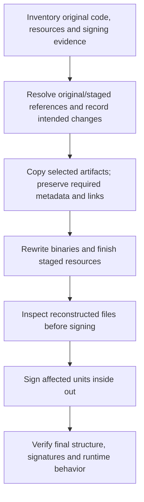

# Application relocation, rebuilding and re-signing

## Problem to solve

We want to prepare a modified application in a separate folder, for a future
workflow such as instrumenting a copied executable, while making its dependencies,
resources and signing changes explicit. Copying and re-signing the main Mach-O
file alone cannot establish that the resulting application is complete or uses
the intended files.

The workbench must explain **what the staged application will use, what needs to
change, and which signing units those changes affect** before an executor
performs the plan. It must preserve the original and produce evidence about the
result. This problem drives the library choices; evaluating LIEF is one bounded
step toward solving it.

The complete transformation must meet the
[shared portability requirements](../portability/requirements.md), including every
required library, tool invocation and indirect dependency. Native macOS validation
is optional evidence. The
[signing experiments](../signing/ad-hoc-experiments.md) qualify libraries
for each artifact and execution environment before adoption.

**Status: proposed application design, 2026-09-16. No rebuilding, signing or native
executor has been implemented.** The current app provides header analysis only.
See the [foundation comparison](../libraries/selection-and-reuse.md) for library alternatives
and the [architecture](../architecture/system-overview.md) for the existing Rust/component boundary.
The [library composition design](macho-layout-growth-and-signing.md) follows
a longer dependency path through bounded editing, possible LIEF reconstruction
and portable signing, with the contracts between those operations made explicit.

### A concrete failure to prevent

Consider this hypothetical application and its proposed copy:

```text
Original/MyApp.app/Contents/
  MacOS/MyApp
  Frameworks/Example.framework/Versions/A/Example
  Resources/Settings.plist

Staged/MyApp.app/Contents/
  MacOS/MyApp
  Frameworks/Example.framework/Versions/A/Example
  Resources/Settings.plist
```

Suppose the executable contains an absolute dependency path to the framework
under `Original`. Copying the directory leaves that recorded path unchanged.
Re-signing the copied executable does not turn the reference into a staged path.
A launch could still use the original framework, or fail when it is unavailable.
A bundle-relative reference may already work with the preserved layout; the
planner should establish which case applies before requesting any rewrite.

The same planning task must account for resources, helpers, framework-version
symlinks and files loaded dynamically. Binary load commands alone cannot prove
that every file an application might open has been discovered. Preserve unknown
relationships and report incomplete evidence. This is a design example, not a
claim about an inspected Chrome, Firefox, WhatsApp or mirrord installation.

### Questions the plan must answer

| Aspect                | Required answer                                                                                                                  |
| --------------------- | -------------------------------------------------------------------------------------------------------------------------------- |
| Staging scope         | One executable, selected dependencies or a complete bundle; external/system dependencies intentionally left outside staging.     |
| Per-image resolution  | Original and staged targets of each known dependency, for every relevant architecture and loading context.                       |
| Resource layout       | Resources, metadata, permissions and symlink targets to preserve or deliberately change; links that leave the staged tree.       |
| Binary reconstruction | Load-command changes and whether the selected writer supports resulting growth, offsets and fixups.                              |
| Signing impact        | Affected code objects and resource seals; signatures that can remain; enclosing signing units needing updates.                   |
| Execution policy      | Intended identity, entitlements and flags; native checks available to establish compatibility with the selected platform and OS. |
| Evidence              | Read, inferred, independently verified and unknown facts; whether execution used the intended staged dependency.                 |

Filesystem containment, library dependencies, nested signing units and certificate
chains describe different relationships. A framework can be inside the copied
bundle yet still be bypassed by an absolute dependency path. Keep these
relationships separate in Rust reports so the visualization can explain them.

## Compose a resource graph from reused mechanisms

The application still needs a common model connecting library results. Proposed
node kinds include artifacts, archive entries, directory entries, bundles,
Mach-O images, resources and signature records.

Use distinct relationship types for:

- Physical containment.
- A bundle's declared main executable.
- A framework version or symlink target.
- A Mach-O dependency reference and its resolution result.
- Coverage by a resource seal or another signature structure.
- An original artifact and its staged replacement.

This composition is where Workbench-specific code is valuable. Keep graph identity
separate from a single pathname: an artifact can have aliases, and a staged copy
can have a different location while retaining provenance.

A tree view can show containment, but dependency and signing relationships are
graphs. React should receive stable node/edge identities and render alternate
views of the same Rust-generated relationships.

## Dependency resolution context

Apple's runpath model uses load commands and the applicable search context.
The resolver should keep the original reference and the evidence for each
candidate it considers.
[Apple runpath documentation](https://developer.apple.com/library/archive/documentation/DeveloperTools/Conceptual/DynamicLibraries/100-Articles/RunpathDependentLibraries.html).

The following illustrates the context our proposed planner needs; it is not a
claim that dependency resolution is already implemented or that these rules
capture every dyld behavior.

| Reference form          | Context to record                                       | Staging question                                                       |
| ----------------------- | ------------------------------------------------------- | ---------------------------------------------------------------------- |
| Absolute path           | Exact load name and available inventory                 | Does the copied executable still refer to the original installation?   |
| `@executable_path`      | Selected main executable location                       | Which root applies to this planned launch?                             |
| `@loader_path`          | Image containing the reference                          | Where will that image reside in the staged layout?                     |
| `@rpath`                | Applicable ordered runpath context and dependency chain | Which candidates resolve under the chosen launch context?              |
| Resource lookup         | Bundle metadata and available resource evidence         | Does the staged bundle retain the expected resource layout?            |
| Runtime-computed lookup | Additional evidence, if available                       | Is the target statically known, uncertain or outside current analysis? |

No reviewed general parser supplies our complete relocation planner. Before adding
a large dyld resolver, evaluate an existing implementation against our required
contexts and platform versions; avoid calling an approximation "the macOS result."

## Reusable plans and explicit signing inputs

A future rebuild plan should be ordinary Rust data. It should connect each
operation to its source artifact, destination, prerequisites and expected changes.
An executor can use a chosen portable library to carry out the plan and return
evidence from the resulting artifacts. Filesystem and browser I/O belong in
adapters; reusable transformation logic must not acquire a macOS or Wasm dependency.

Keep signing settings explicit: the selected identity, entitlements, flags and
resource treatment are inputs. A library's defaults should not silently become
the product's re-signing strategy.

## Rebuilding comes before final re-signing

Here, **rebuilding** means reconstructing modified binary files and assembling
the staged application layout. It does not mean recompiling the application's
original source. **Re-signing** produces signatures for the resulting code and
resource state.

Moving an intact signed artifact is not, by itself, a change to its signed
content. Modifying covered bytes requires renewed signing. Relocation and
signature validity must therefore be evaluated separately.
[Apple code-signing tasks](https://developer.apple.com/library/archive/documentation/Security/Conceptual/CodeSigningGuide/Procedures/Procedures.html).

The planned sequence is:



For nested code, finish a child's signature before signing an enclosing unit
that records it. Determine affected ancestors from their actual seals and
requirements: an equivalent nested-code replacement can sometimes preserve an
outer signature. An ad-hoc replacement signature must not be assumed to preserve
the original vendor identity. Rebuilding signed content afterward means
revisiting the affected signatures.
[Apple nested-code and signature guidance](https://developer.apple.com/library/archive/technotes/tn2206/_index.html).

The executor should leave the original unchanged, record every output's source
and planned destination, and avoid presenting an incomplete staging directory as
a successful result. Finish the selected resource layout before sealing it.
Verification after signing must inspect the final bytes, because signing itself
also changes the executable.

For unchanged vendor libraries, assess signature integrity and compatibility with
the staged executable's library-validation policy separately.

## What the first experiment can establish

The application-level problem is broader than one binary library. LIEF is the
leading candidate for native Mach-O reconstruction; the workbench still owns
staging decisions, resource relationships, signing policy and evidence. The
initial [native LIEF experiment](../libraries/lief-native-macho-rewriting-experiment.md)
tests an executable and its own dylib. A successful
result would establish those specific transformations, not full application
relocation or recursive bundle signing.

Nested-code signing and resource-seal coverage belong to the dedicated
[portable signing experiments](../signing/ad-hoc-experiments.md):
controlled frameworks, helpers, resources and versioned symlinks need independent
resource and nested-signing checks. Keep that work separate from the initial LIEF
rewrite fixture. Do not infer iOS execution support from a macOS result. The general library comparison
remains in [Reusable foundations](../libraries/selection-and-reuse.md#rebuilding-and-signing).

The [complete-workflow experiments](../portability/complete-workflow-experiments.md)
qualify the assembled transformation from original application contents to exported
output, using the relevant stage evidence.

The separate [LIEF integration approach](../libraries/lief-selective-builds-and-wasm.md) owns selective
compilation, Rust bridge constraints and Wasm delivery. The separate native experiment
is intended to establish rewriting, signing and execution correctness independently
of that browser integration work.
