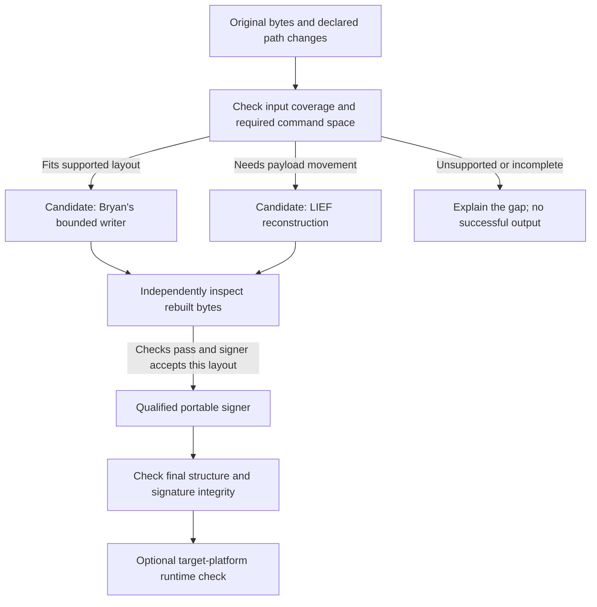

# Mach-O layout growth and signing

**Status: proposed technical design, 2026-09-17. Capabilities have been reviewed in
documentation and source; the integrations and experiments described here have
not run. No dependency or application behavior is added by this document.**

## Problem to solve

An application relocation can require a longer dependency path inside an executable.
A library might understand that path and edit it when spare space exists, yet be
unable to rebuild the file when the command outgrows that space. Another library
can supply reconstruction, and a third can sign the resulting bytes. We want to
reuse those implementations without assuming that their inputs, outputs and
platform support automatically match.

**LIEF is the candidate for covering the command-space limitation of Bryan
Matteson's bounded Mach-O writer.** This is a proposed division of work, with
specific handoffs to qualify. It does not make either library support every
Mach-O layout.

This document owns the worked example and the contracts between libraries. The
[foundation comparison](../libraries/selection-and-reuse.md) owns
candidate versions, source screening and alternatives. The
[application design](application-relocation-and-signing.md) owns resource graphs,
staging and signing impact; the linked experiments own procedures and results.

The complete transformation follows the
[shared portability requirements](../portability/requirements.md), including every
required library, tool invocation and indirect dependency.
Native Linux/Windows operation and execution through the browser's Rust/Wasm/jco
path require separate evidence. A native composition can establish useful coverage
while the browser path remains unresolved.

## Where one library can cover another's gap

Choose libraries for a needed operation. The following combinations are candidates,
not a requirement to install every dependency or run every output through every
library.

| Gap encountered                                                             | Complement to evaluate                                                       | Handoff that must be established                                                       |
| --------------------------------------------------------------------------- | ---------------------------------------------------------------------------- | -------------------------------------------------------------------------------------- |
| A Mach-O reader exposes an embedded CMS blob without decoding certificates. | A compatible CMS/X.509 stack.                                                | Preserve raw bytes and decoding errors; parsing does not establish trust.              |
| `object` supplies decoding, but the task needs linked-executable mutation.  | Bryan's bounded writer or LIEF, according to the edit.                       | Parsed facts must become an explicit operation against the original input.             |
| Bryan's writer cannot fit a larger command without moving existing payload. | LIEF reconstruction.                                                         | The exact image, metadata and requested growth must be supported.                      |
| A rewritten Mach-O needs a new signature.                                   | `apple-codesign`; a separately qualified `libsui` path for its narrow scope. | The writer's output must satisfy the signer's format and metadata requirements.        |
| Individual signed files must become a sealed application bundle.            | `apple-codesign` bundle machinery.                                           | Supply the completed staged tree and policy; verify nested code and resource coverage. |

`object::write` targets relocatable object generation; it does not fill the general
linked-executable rewriting role. Bryan's toolkit also exposes richer metadata
readers, which may complement or replace selected `object` uses after evaluation.
Adopt a second reader only for a demonstrated capability or independent check.
See [reader and writer selection](../libraries/selection-and-reuse.md#select-a-writer-for-the-operation-being-performed)
and the [Bryan toolkit evaluation](../libraries/bryanmatteson-macho-evaluation.md).

`apple-codesign` is the Rust crate in
[`indygreg/apple-platform-rs`](https://github.com/indygreg/apple-platform-rs),
imported as `apple_codesign`. Its native API includes Mach-O signing and bundle
resource sealing. Reuse and qualify that machinery before implementing another
bundle signer. Its documented non-Apple support still needs testing for our exact
inputs and settings. [Upstream signing overview][apple-codesign]

## Worked example: a dependency path outgrows its command

Use the controlled executable and dylib from the
[LIEF fixture](../libraries/lief-native-macho-rewriting-experiment.md#concrete-path-rewrite).
The executable moves from `input/bin/probe` to `staged/bin/probe`. Its library moves
from `input/lib/libprobe.dylib` to
`staged/Frameworks/RelocatedProbe/libprobe.dylib`.

| Executable field | Planned replacement                                              |
| ---------------- | ---------------------------------------------------------------- |
| Dependency name  | `@rpath/libprobe.dylib` → `@rpath/RelocatedProbe/libprobe.dylib` |
| Runpath          | `@executable_path/../lib` → `@executable_path/../Frameworks`     |

With this fixture's declared runpath context, the replacement points at the staged
dylib. Copying the files alone leaves the old load commands intact. Signing alone
does not perform either path change. A library's own `LC_ID_DYLIB`, when changed,
is a separate operation from the executable's dependency command.

### Why a longer string can require reconstruction

Dependency names and runpaths live in variable-sized load commands near the start
of a Mach-O image. Increasing the string can increase its command's aligned size.
Commands occupy physical space before file-backed payload, so the writer must
account for the available room.

For illustration, suppose the planned commands need 32 additional bytes, but the
image has only 8 bytes of proven unused command space. These numbers illustrate
the boundary; they are not measured sizes for the strings above.

```text
Original, simplified thin-image layout:
[header][load commands][8 bytes free][existing code and data ...]

Requested command growth: 32 bytes
Available command space:  8 bytes
Shortfall:                24 bytes
```

Writing through the following payload would corrupt it. Appending the longer
string to the end of the file also fails to provide the required space in this
load command. The complete edit needs either a supported way to free command
space or reconstruction that accommodates growth.

Bryan's reviewed writer uses proven zero-filled header slack and supports certain
section/segment extensions with placement restrictions. It does not move existing
thin-image payload to create command space. The insufficient-space case therefore
needs explicit refusal. This is a limit of the writer's editing model.
[Pinned mutation-layout contract][macho-layout]

### What LIEF contributes

LIEF documents longer and shorter library-path replacements, including the
internal adjustments needed for growth. Its modification tutorial describes
shifting payload in position-independent executables to create command space,
with a shift aligned to the applicable page size. [Path modification][lief-paths],
[layout reconstruction][lief-layout]

```text
Reconstructed layout, conceptually:
[header][larger load commands][remaining padding][moved code and data ...]
                                                    ↑
                            affected references must follow the movement
```

Affected metadata can include section/segment offsets and addresses, entry-point
information, symbols, relocations, bindings and exports. LIEF describes updating
these references and regenerating loader metadata. This is the format-specific
work we want to reuse. The diagram is not a claim that every image is rebuilt by
one uniform shift. [Reconstruction details][lief-layout]

The documented mechanism is not proof for every architecture or metadata form.
Qualify the pinned Rust interface against the actual fixture, including relevant
chained fixups or legacy binding/rebasing. A longer replacement that happens to
fit existing padding does not demonstrate reconstruction beyond that padding.

## Choose the writer before applying the operation

The proposed Rust plan records the input digest, architecture/member selection,
command to change, replacement value and expected result. A backend's declared
capabilities must cover the complete operation. React presents the plan and
evidence; it does not decide binary-format rules.



These branches explain capability selection; they do not require two production
writers. A single qualified writer may cover both cases. If comparing them, start
each trial from the same original bytes. An unsupported bounded edit may justify
a separately qualified LIEF trial; a malformed input or unexplained failure must
not trigger blind retries through another writer.

Passing a partial mutation to LIEF would obscure which operation produced the
result. Preserve immutable originals, separate candidate outputs, diagnostics and
pre-signing intermediates. Compare intended semantic changes as well as byte
differences, since a writer may normalize layout during reconstruction.

## Handoffs that need their own proof

### Universal files require complete member accounting

The worked layout describes one thin image. A universal file adds an outer
container, with separate offsets and alignment for each member. One member might
have enough command space while another requires reconstruction.

Keep the original member inventory independently of the writer. The inspected
LIEF 1.0.0 parser has fat64 and incomplete-member limitations documented in the
[foundation comparison](../libraries/selection-and-reuse.md#where-lief-is-useful).
A more capable reader can identify such a gap, but cannot confer the missing
coverage on LIEF. Extracting supported members and rebuilding a container with
another library would be a separate composition experiment, including preservation
of unmodified members and outer metadata. It is not an established workaround.

### Reconstructed bytes must be acceptable to the signer

Finish dependency and layout changes before final signing. Plan how obsolete
signature metadata is removed or replaced, and what space/structures the signer
needs. Signing can itself update Mach-O layout, so validate the final signed bytes
again. LIEF documents signature removal followed by subsequent re-signing.
[Signature handling][lief-layout]

Do not assume that every reviewed signer accepts the same intermediate. The
reviewed `libsui` direct signers expect thin 64-bit input with existing signature
metadata. A LIEF output with `LC_CODE_SIGNATURE` removed does not automatically
meet that contract. Retaining obsolete metadata merely to satisfy a parser also
does not establish a valid signing operation. Qualify the exact writer-to-signer
handoff through the [portable signing experiments](../signing/ad-hoc-experiments.md).

`libsui` remains a narrow ARM64 byte-signing feasibility candidate. Its helper
behavior for Intel, limited signature contents and lack of bundle sealing prevent
it from serving as a universal fallback. Bryan's full signing profile wraps
`apple-codesign`; calling that profile and `apple-codesign` directly does not add
an independent signer or verifier. See the [signer screening](../libraries/selection-and-reuse.md#portable-signing-candidates)
and [toolkit signing profiles](../libraries/bryanmatteson-macho-evaluation.md#5-qualify-signing-paths-through-the-shared-experiment).

### Binary layout and application layout need different work

Making room inside a Mach-O does not move framework directories, preserve version
symlinks, rebuild resource seals or discover runtime-computed resource paths.
Those tasks use the application inventory and declared staging plan. Reuse
qualified bundle-signing machinery for the completed tree, processing affected
children before enclosing seals that record them. The
[application design](application-relocation-and-signing.md#rebuilding-comes-before-final-re-signing)
owns those relationships and ordering rules.

The example's successful outcome requires the controlled executable to use the
staged dylib. A valid ad-hoc signature alone cannot demonstrate that resolution,
recreate vendor authority or establish macOS/iOS execution permission. Record
structural correctness, signature integrity and runtime behavior separately.

### Native support does not establish browser support

Keep candidate-specific parser/writer objects behind Rust adapters. Reusable plans
and reports stay ordinary Rust types; WIT/Wasm details stay in the component
adapter. Pass artifact bytes and explicit operation data across the boundary,
not native library objects or a TypeScript reconstruction of their meaning.

LIEF's C++ implementation and Rust bridge need a separate browser build evaluation.
The full `apple-codesign` crate also has a documented Wasm dependency blocker.
Adding jco or another portable reader does not remove these requirements, and a
server performing the work would not prove on-device browser execution.
The [LIEF integration study](../libraries/lief-selective-builds-and-wasm.md) and
[signer portability screening](../libraries/selection-and-reuse.md#where-apple-codesign-fits)
own the technical details. Keep unqualified native backends outside the browser
core's mandatory dependency graph.

## Evidence needed to accept this composition

The [complete-workflow experiments](../portability/complete-workflow-experiments.md)
qualify the assembled transformation. Use the existing stage experiments rather
than creating a duplicate test matrix here:

- The [bounded-writer experiment](../libraries/bryanmatteson-macho-evaluation.md#4-test-bounded-rewriting-separately)
  covers fitting edits and explicit refusal when the layout cannot accommodate them.
- The [LIEF experiment](../libraries/lief-native-macho-rewriting-experiment.md#procedure-and-independent-checks)
  must demonstrate actual command-space exhaustion, successful supported growth,
  complete member preservation and independent structural checks.
- The [signing experiments](../signing/ad-hoc-experiments.md) qualify the
  selected signer on those rebuilt outputs and the required hosts/runtimes.
- The LIEF fixture's optional runtime check must prove the intended return value
  and staged library path, with a missing-staged-library control to expose fallback
  to the original. Whole-bundle and browser results remain separate qualifications.

Record each handoff's input/output digests, exact versions/features, operation,
signing settings and evidence. A result may be unsupported, incomplete, failed or
not run; a successful upstream API return alone does not close these checks.
Prefer an upstream fix or a narrower supported scope when composition exposes a
gap, before writing another parser, relayout engine or signing implementation.

[macho-layout]: https://github.com/bryanmatteson/macho/blob/61709c7ef780987b5d5c6c8648f9b7609a4a97c7/crates/macho/docs/mutation-layout.md
[lief-paths]: https://lief.re/doc/stable/formats/macho/index.html#rpath-and-library-path-modification
[lief-layout]: https://lief.re/doc/stable/tutorials/11_macho_modification.html
[apple-codesign]: https://gregoryszorc.com/docs/apple-codesign/stable/
